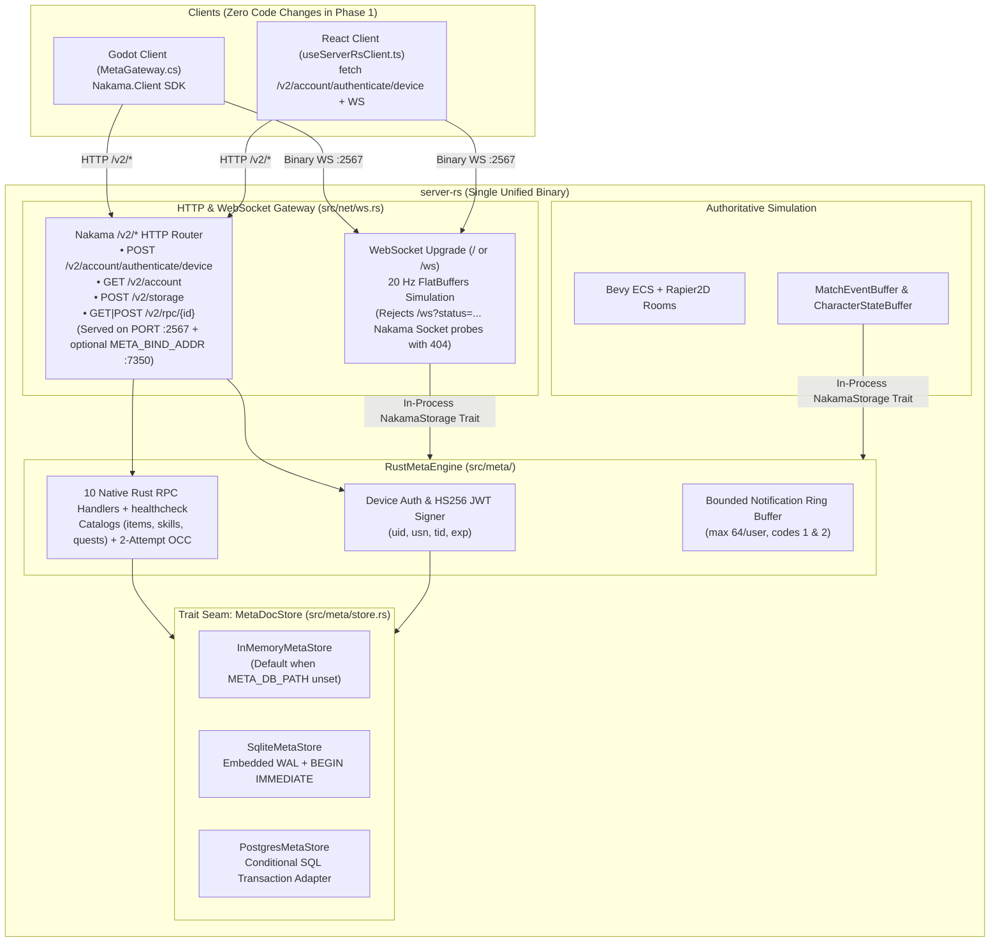

# Native Rust Meta Engine and Trait-Backed Persistence (`server-rs` Nakama Replacement)

- **Date:** 2026-10-18
- **Backlog ID:** `I-198`
- **Target Release:** `release/1.15`
- **Status:** Reviewed (R1/R2 Product, QA, and Tech Spec Lenses Folded In — Ready for R0 Gate)

---

## 1. Goal & Non-Goals

### Goal
Replace the external Go/Goja **Nakama + CockroachDB** stack with a native **Rust Meta & Auth Engine (`server-rs/src/meta/`)** built directly into `server-rs`, backed by a trait-based persistence layer (`MetaDocStore`: `InMemoryMetaStore`, embedded `SqliteMetaStore` in WAL mode, and `PostgresMetaStore` SQL adapter) and a drop-in **Nakama `/v2/*` HTTP wire-compatible gateway** so Godot (`MetaGateway.cs`), React (`useServerRsClient.ts`), and `server-rs` real-time rooms run against a single unified Rust binary with zero S2S network overhead and zero external container dependencies in local/single-node deployments.

### Non-Goals
- **Rewriting Godot (`MetaGateway.cs`) or React (`useServerRsClient.ts`) client code in Phase 1:** Phase 1 preserves full wire compatibility with `/v2/account/authenticate/device`, `/v2/account`, `/v2/storage`, and `/v2/rpc/{id}` (both wrapped Nakama SDK envelopes and `?unwrap` raw JSON) so existing clients work unchanged.
- **Social/chat/matchmaking lobbies (Epic `E-008`):** Guilds, party chat, and matchmaking remain out of scope for this slice and will build natively on `server-rs/src/meta/` in `E-008`.
- **Deleting `contracts/content/{items,skills,quests}.json`:** Content JSON files remain the single authored source of truth and are embedded and validated by `server-rs` via `include_str!`.

### Users & Jobs
- **Game Server Operator / Developer:** Wants `cargo run` (or a single `server-rs` container) to boot the complete authoritative simulation **and** persistent meta-systems (auth, profile, inventory, equipment, skills, quests, character state) in `< 50 ms` without spinning up CockroachDB, Nakama, `migrate.sh`, or the `esbuild` Goja bundler.
- **Godot (`game-client`) & React (`client/react-client`) Clients:** Authenticate device IDs into HS256 session JWTs (`uid`, `usn`, `tid`, `exp`), read player storage collections (`profile`, `inventory`, `equipment`, `skills`, `quests`), and invoke client RPCs (`equip_item`, `allocate_stats`, `set_skill_loadout`, `accept_quest`, `claim_quest_reward`) over `/v2/*`.
- **`server-rs` Authoritative Simulation Loop:** Hydrates joining players (`get_loadout`) and flushes `CharacterStateBuffer` (`save_character_state`) + `MatchEventBuffer` (`report_match_events`) directly in-process via `Arc<dyn NakamaStorage>` with zero HTTP serialization/loopback latency when running in unified mode.

### Success Measures
1. **100% Contract & Behavioral Parity:** All 10 gameplay RPCs + `healthcheck`, v1→v2 `profile` schema migration, optimistic concurrency (`version` CAS), multi-document atomic transactions (`claim_quest_reward`, `report_match_events`), and catalog referential-integrity validation pass in `cargo test`.
2. **Zero S2S Network Hop in Unified Mode:** `RustMetaEngine` implements `NakamaStorage` directly in-process (`< 0.2 ms` p99 per `get_loadout` / `save_character_state` / `report_match_events` vs `2–15 ms` HTTP S2S round-trip).
3. **Drop-In `/v2/*` Wire Compatibility & Zero Regressions:** Existing `NakamaClient` HTTP integration tests (`tests/nakama_persistence.rs`, `tests/nakama_wiring.rs`) and new `/v2/*` SDK client flows (`authenticate/device`, `/v2/account`, `/v2/storage`, `/v2/rpc/*` with and without `?unwrap`, CORS preflight, and Godot `/ws?status=` socket probe rejection) pass against `server-rs`.
4. **Triple Persistence Backend Verification:** Full unit + integration test suite passes against `InMemoryMetaStore`, `SqliteMetaStore` (WAL file across simulated restart & `:memory:`), and `PostgresMetaStore` (conditional-DML SQL transaction adapter).

---

## 2. Architecture Overview



### Environment Variable & Startup Matrix

| Env Var | Default | Behavior |
|---|---|---|
| `NAKAMA_URL` + `NAKAMA_HTTP_KEY` | Unset | When both are set and non-empty, `server-rs` uses `NakamaClient` over HTTP S2S (external override). When unset, `server-rs` logs `"Nakama not configured (NAKAMA_URL unset); using in-process RustMetaEngine"` (preserving `tests/nakama_wiring.rs` log assertion) and uses `RustMetaEngine` in-process. |
| `META_DB_PATH` | Unset (in-memory) | When set (e.g. `data/atlas_meta.db` or `:memory:`), `server-rs` backs `RustMetaEngine` with `SqliteMetaStore` in WAL mode. Leaving it unset during `cargo test` avoids creating untracked `.db` files in the repository checkout. |
| `META_POSTGRES_URL` | Unset | Optional Postgres connection/adapter config for `PostgresMetaStore` in multi-node deployments. |
| `META_BIND_ADDR` | Unset | Optional secondary TCP listener (e.g. `0.0.0.0:7350`) serving the `/v2/*` HTTP gateway so clients configured for default Nakama port `7350` work alongside `:2567`. |
| `NAKAMA_SERVER_KEY` | `"defaultkey"` | Basic auth username validated by `POST /v2/account/authenticate/device`. |

---

## 3. Requirements (EARS Form)

### R1 — Trait-Backed Document & Account Store (`MetaDocStore`)
- **R1.1 (Happy Path — Read & Atomic CAS Write):** When `read_doc(user_id, collection, key)` or `write_batch(writes)` is called on a `MetaDocStore` (`InMemoryMetaStore`, `SqliteMetaStore`, or `PostgresMetaStore`), the store shall execute all writes in the batch atomically (`BEGIN IMMEDIATE` with `PRAGMA journal_mode = WAL; PRAGMA busy_timeout = 5000;` on SQLite; conditional `INSERT ... ON CONFLICT DO NOTHING` / `UPDATE ... WHERE version = $expected` inside a transaction on Postgres), verifying that each write's `expected_version` matches the stored `version` (or `"*"` when the document does not yet exist) and assigning a new non-empty `version` string on commit.
- **R1.2 (Failure Twin — CAS Conflict):** If any `DocWrite` in `write_batch(writes)` specifies an `expected_version` that does not match the current stored `version` (including `"*"` when a document already exists), then the `MetaDocStore` shall abort and roll back the entire batch without mutating any document in the batch and return `Err(MetaError::VersionConflict)`.
- **R1.3 (Happy Path — Idempotent Device Account Resolution):** When `authenticate_device(device_id, username_hint, create)` is called with a valid `device_id` (`1..=128` ASCII printable characters), the store shall atomically resolve and return the existing `(user_id, username)` bound to `device_id`, or conflict-safely insert (`ON CONFLICT(device_id) DO NOTHING` + re-select, handling username uniqueness collisions with a suffix) and persist a new UUIDv4 `user_id` and `username` when `create == true`.
- **R1.4 (Failure Twin — Device Not Found or Invalid):** If `authenticate_device` is called with an empty or `> 128`-char `device_id`, or with `create == false` for an unknown `device_id`, then the engine shall return `Err(MetaError::BadRequest)` (HTTP `400`) or `Err(MetaError::NotFound)` (HTTP `404`) respectively.

### R2 — Schema Migration & Catalog Integrity
- **R2.1 (Happy Path — RPC Default Docs & `profile` v1→v2 Migration):** When `read_typed_doc` is called by an RPC handler for any of the 5 player collections (`profile`, `inventory`, `equipment`, `skills`, `quests`), the engine shall synthesize the canonical default document (`version = "*"`) on a storage miss, and if a stored `profile` document has `schemaVersion == 1`, the engine shall migrate it in-memory to `schemaVersion = 2` by preserving existing `allocated` stats and defaulting missing `allocated.dex` to `1`.
- **R2.2 (Failure Twin — Corrupt / Untrusted Schema Version):** If a stored document in `profile`, `inventory`, `equipment`, `skills`, or `quests` has a missing, non-numeric, or unrecognized `schemaVersion < current` (other than `profile` v1), then `read_typed_doc` shall fall back to the collection's canonical `default_doc` while preserving the stored OCC `version` string so a subsequent write overwrites the corrupt payload cleanly.
- **R2.3 (Happy Path — Embedded Catalog Validation):** When `MetaCatalogs::load_embedded()` initializes from `contracts/content/{items,skills,quests}.json`, the engine shall validate all item, skill, and quest definitions and verify cross-catalog referential integrity (every `skill.requires` references a valid `skill.id`, every `quest.rewards.items[].itemId` references a valid `item.id`, and every `quest.objectives[].targetId` is non-empty).
- **R2.4 (Failure Twin — Broken Catalog Cross-Reference):** If `validate_catalog_integrity` encounters an unknown prerequisite `skillId`, an unknown quest reward `itemId`, or an empty quest objective `targetId`, then it shall return an `Err` naming the offending catalog entry ID and target ID.

### R3 — Native Rust Gameplay RPCs (S2S and Client Session)
- **R3.1 (Happy Path — S2S RPCs & Monotonic In-Process Sequence Numbers):** When an S2S caller (`ctx.user_id == None`, authenticated via `http_key` or in-process `NakamaStorage`) invokes `get_loadout`, `save_character_state`, `report_match_events`, `grant_xp`, or `grant_loot`, the `RustMetaEngine` shall execute the RPC with exact parity to `nakama/src/rpc/*.ts` and retry up to 2 OCC attempts on `MetaError::VersionConflict`:
  - `get_loadout`: hydrates `LoadoutSnapshot` from the 5 collections + `character_state`, resolving equipped `instanceId`s to `itemId`s via `inventory.uniques` (resolving missing/stale `instanceId`s to `None`).
  - `save_character_state`: when invoked via `NakamaStorage` with `state.seq == 0`, assigns a monotonic sequence number seeded from `UNIX_EPOCH` milliseconds (`in_process_state_seq`); deduplicates when `seq <= current.seq` (`{"deduped":true,"seq":current.seq}`), otherwise persists `CharacterStateDoc` (`{"deduped":false,"seq":seq}`).
  - `report_match_events`: when invoked via `NakamaStorage::report_match_events(&MatchEventBatch)`, assigns a monotonic sequence number seeded from `UNIX_EPOCH` milliseconds (`in_process_event_seq`) so sequence numbers never regress across server restarts; deduplicates per `matchId` when `seq <= quests_seq[matchId]` (`{"deduped":true}`), otherwise folds matching `MOB_KILLED` / `ITEM_PICKED_UP` / `ZONE_ENTERED` events into active quests, atomically writes `quests` + `quests_seq`, appends notifications (`code = 1` for progressed, `code = 2` for completed) into a bounded per-user ring buffer (capped at 64 entries), and returns `{"deduped":false,"progressed":[...],"completedNow":[...]}`.
  - `grant_xp`: applies XP (`xp_to_next(level) = 100 * level`, `+3 statPoints` per level-up) with up to 2 OCC write attempts.
  - `grant_loot`: merges stackable items or appends unique item instances with fresh UUIDv4 `instanceId`s with up to 2 OCC write attempts.
- **R3.2 (Failure Twin — S2S Auth Enforcement & Attribution Guard):** If an authenticated client session (`ctx.user_id.is_some()`) invokes any S2S-only RPC (`get_loadout`, `save_character_state`, `report_match_events`, `grant_xp`, `grant_loot`), or if `report_match_events` contains an event whose `event.userId != batch.userId`, then the engine shall reject the call with `Err(MetaError::Forbidden)` (HTTP `403`) or `Err(MetaError::BadRequest)` (HTTP `400`).
- **R3.3 (Happy Path — Client Session RPCs):** When an authenticated client (`ctx.user_id == Some(uid)`) invokes `equip_item`, `allocate_stats`, `set_skill_loadout`, `accept_quest`, or `claim_quest_reward`, the engine shall validate the caller's ownership/points/unlocks/quest state and persist the updated document(s) (using an atomic 3-doc batch with up to 2 OCC attempts for `claim_quest_reward` across `profile`, `inventory`, and `quests`).
- **R3.4 (Failure Twin — Unauthenticated or Invalid Client RPC):** If an S2S/unauthenticated caller (`ctx.user_id == None`) invokes a client-only RPC, or if the caller attempts to equip an unowned `instanceId`, spend more `statPoints` than available, equip > 4 or locked skills, accept an unknown/active/completed quest, or claim an uncompleted/already-claimed quest, then the engine shall reject the call (`MetaError::Unauthorized` / `MetaError::BadRequest`) without mutating storage.

### R4 — Drop-In Nakama `/v2/*` HTTP Gateway & Unified `server-rs` Wiring
- **R4.1 (Happy Path — `/v2/*` Endpoints, CORS, & Storage Read Semantics):** When `WsServer` (or the optional `META_BIND_ADDR` listener) receives an HTTP request for `/v2/account/authenticate/device`, `/v2/account`, `/v2/storage`, or `/v2/rpc/<id>`, it shall include CORS headers (`Access-Control-Allow-Headers: content-type, authorization`) and route the request to `RustMetaEngine`:
  - `POST /v2/account/authenticate/device`: validates Basic auth against `NAKAMA_SERVER_KEY` (default `"defaultkey"`), authenticates the device, and returns `200 OK` with `{"token":"<hs256_jwt>"}` containing `uid`, `usn`, `tid`, and `exp` claims (`AuthGuard::generate_nakama_token` / `issue_session_token`).
  - `GET /v2/account`: validates `Authorization: Bearer <jwt>` and returns `200 OK` with `{"user":{"id":"<uid>","username":"<usn>"}}`.
  - `POST /v2/storage`: validates `Authorization: Bearer <jwt>`, accepts `object_ids`/`objectIds` (`user_id`/`userId`), and returns `{"objects":[...]}` containing **only existing stored documents** where `(doc.user_id == caller_uid && doc.permission_read >= 1) || doc.permission_read == 1` (omitting uncreated documents so missing keys return `{"objects":[]}` as expected by `MetaGateway.cs`, and never returning server-only `permission_read == 0` documents like `quests_seq`).
  - `GET|POST /v2/rpc/<id>`: authenticates either `?http_key=<key>` (S2S) or `Authorization: Bearer <jwt>` (client), accepts both raw JSON objects and JSON-encoded string bodies, and returns raw JSON when `?unwrap` is present in the query string or `{"payload":"<json_string>"}` when `?unwrap` is absent.
- **R4.2 (Failure Twin — Error Status Mapping & Godot `/ws?status=` Socket Guard):**
  - Every `MetaError` shall map deterministically to Nakama-formatted error JSON `{"error":"<msg>","message":"<msg>","code":<grpc_code>}` with HTTP status: `Unauthorized -> 401`, `Forbidden -> 403`, `BadRequest -> 400`, `NotFound -> 404`, `VersionConflict -> 409`, `Internal -> 500`.
  - If `WsServer` receives a WebSocket upgrade request on `/ws` carrying Nakama realtime socket query parameters (`status=` or `lang=`), it shall reject the request with HTTP `404 Not Found` before upgrading, preventing `MetaGateway.TryOpenSocket()` from accidentally joining a gameplay room or triggering `4002` session eviction.
- **R4.3 (Happy Path — Backwards-Compatible `WsServer` & Unified In-Process Wiring):** `WsServer::with_nakama` shall remain backwards-compatible for existing `Arc<NakamaClient>` / `Arc<dyn NakamaStorage>` callers while `WsServer::with_meta_engine(Arc<RustMetaEngine>)` (or unified initialization in `main.rs`) wires both `Arc<dyn NakamaStorage>` and the `/v2/*` HTTP router in-process.

---

## 4. Acceptance Criteria & End-to-End Verification

| ID | Given | When | Then |
|---|---|---|---|
| **AC-1** | `InMemoryMetaStore`, `SqliteMetaStore` (WAL file & `:memory:`), and `PostgresMetaStore` | `write_batch` is called with valid `version = "*"` then updated with the returned `version`, called again with a stale `version`, and a file-backed `SqliteMetaStore` is closed and reopened | First two writes succeed and return distinct versions; the stale write returns `MetaError::VersionConflict` and rolls back the entire batch; reopened SQLite store retains all committed documents and accounts. |
| **AC-2** | A `profile` v1 document `{ "schemaVersion": 1, "level": 3, "xp": 50, "statPoints": 6, "allocated": { "str": 4, "agi": 2, "int": 1, "vit": 3 } }` | `get_loadout` or `read_typed_doc` reads the player's profile | It migrates to `schemaVersion: 2` with `allocated.dex == 1` and preserves `level: 3, xp: 50, statPoints: 6`. |
| **AC-3** | `RustMetaEngine` with embedded `items.json`, `skills.json`, `quests.json` | S2S and client RPCs (`grant_xp`, `grant_loot`, `equip_item`, `allocate_stats`, `set_skill_loadout`, `accept_quest`, `report_match_events`, `claim_quest_reward`, `save_character_state`, `get_loadout`) and in-process `NakamaStorage` calls execute across simulated restarts | Every RPC matches the exact JSON schema, leveling curve (`100 * level`, `+3 statPoints`), quest progression, monotonic `UNIX_EPOCH`-seeded sequence numbers, and OCC retry semantics. |
| **AC-4** | `WsServer` with `RustMetaEngine` attached | Clients call `OPTIONS` + `POST /v2/account/authenticate/device?create=true` (concurrently), `GET /v2/account`, `POST /v2/storage` (before and after writes, and attempting to read `quests_seq`), `POST /v2/rpc/allocate_stats` (wrapped), `POST /v2/rpc/get_loadout?http_key=...&unwrap`, and probe `GET /ws?lang=en&status=true&token=...` | Concurrent device auth returns the same `user_id` and a valid JWT (`uid`, `usn`, `tid`, `exp`); `/v2/storage` returns `{"objects":[]}` before writes, returns stored docs after writes, and blocks `quests_seq`; `/ws?status=true` returns `404` without spawning a ghost player; gameplay WS join hydrates the player's live ECS entity. |

### End-to-End Verification Command
```bash
cargo test --manifest-path server-rs/Cargo.toml && ./scripts/precheck.sh --no-install
```

---

## 5. Interfaces & Files Touched

- **`server-rs/Cargo.toml`**: Add `rusqlite = { version = "0.32", features = ["bundled"] }` for zero-system-dependency embedded SQLite WAL persistence.
- **`server-rs/src/meta/mod.rs`** *(new)*: Module exports for `store`, `catalogs`, `models`, `engine`, and `http`.
- **`server-rs/src/meta/models.rs`** *(new)*: Rust types and `serde` schemas for `InventoryDoc`, `EquipmentDoc`, `SkillsDoc`, `QuestsDoc`, `QuestDef`, `ItemDef`, `SkillDef`, `MetaError`, and schema migration helpers (`migrate_profile_v1_to_v2`).
- **`server-rs/src/meta/catalogs.rs`** *(new)*: Compile-time embedded `items.json`, `skills.json`, `quests.json` loader + `validate_catalog_integrity`.
- **`server-rs/src/meta/store.rs`** *(new)*: `MetaDocStore` trait, `DocWrite`, `StoredDoc`, `UserAccount`, `InMemoryMetaStore`, `SqliteMetaStore` (WAL mode + `BEGIN IMMEDIATE`), and `PostgresMetaStore` conditional-DML SQL transaction adapter.
- **`server-rs/src/meta/engine.rs`** *(new)*: `RustMetaEngine` implementing all 10 RPCs + `healthcheck`, `UNIX_EPOCH`-seeded monotonic sequence counters, bounded 64-entry notification ring buffer, and `crate::storage::NakamaStorage` implementation for zero-hop in-process `server-rs` calls.
- **`server-rs/src/meta/http.rs`** *(new)*: Nakama `/v2/*` wire-compatible HTTP router (`/v2/account/authenticate/device`, `/v2/account`, `/v2/storage`, `/v2/rpc/*` with wrapped + `?unwrap` support, CORS preflight headers, and optional `META_BIND_ADDR` standalone listener).
- **`server-rs/src/auth/jwt.rs`**: Expose `AuthGuard::issue_session_token(user_id, username, ttl_secs)` producing Nakama-compatible `{ uid, usn, tid, exp }` HS256 JWTs in all builds (not just `#[cfg(test)]`).
- **`server-rs/src/net/ws.rs`**: Route `/v2/...` HTTP requests on `WsServer` to `RustMetaEngine`, guard `/ws?status=` Nakama realtime socket probes with `404`, and support `Arc<dyn NakamaStorage>` + `with_meta_engine` while keeping `with_nakama` backwards-compatible.
- **`server-rs/src/main.rs`**: Initialize in-process `RustMetaEngine` when external `NAKAMA_URL` is unset (preserving the `"Nakama not configured"` log prefix for `tests/nakama_wiring.rs`), wire `META_DB_PATH` / `META_POSTGRES_URL`, and optionally spawn the secondary `META_BIND_ADDR` listener.
- **`server-rs/tests/rust_meta_engine.rs`** *(new)*: Comprehensive unit + E2E wire tests covering all 10 RPCs, OCC conflicts, SQLite WAL persistence across restarts, `PostgresMetaStore` transaction semantics, `/v2/*` SDK envelope vs `?unwrap`, `/ws?status=` guard, and live WebSocket join hydration.

---

## 6. Alternatives Considered

1. **Do Nothing (Keep Go Nakama + CockroachDB):**
   - *Why it lost:* Requires running 2 extra containers (`nakama` + `cockroachdb`) and `./migrate.sh` for 900 lines of TS logic, suffers from Goja ES5 runtime quirks, duplicates types/math across TS and Rust, and adds an HTTP S2S hop on every join and state flush.
2. **Separate `meta-rs` Microservice Binary Only:**
   - *Why it lost:* Forces an HTTP hop even in single-node/dev deployments and requires managing two Rust processes. Building `meta` inside `server-rs` behind `MetaDocStore` + `NakamaStorage` traits gives zero-hop in-process speed by default while still allowing `server-rs` to bind `META_BIND_ADDR` or point at shared Postgres when scaling horizontally.
3. **Clean-Break Custom REST API (Dropping `/v2/*` Compatibility):**
   - *Why it lost:* Would break `game-client/src/Meta/MetaGateway.cs` (which uses the `Nakama.Client` NuGet package) and `client/react-client/src/hooks/useServerRsClient.ts` simultaneously. Supporting the 4 `/v2/*` endpoints in `server-rs/src/meta/http.rs` is ~200 lines of Rust and makes the migration 100% non-breaking for all clients.

---

## 7. Assumptions

- `ASSUMED: When NAKAMA_URL is unset, server-rs uses in-process RustMetaEngine (backed by SqliteMetaStore at META_DB_PATH when set, or InMemoryMetaStore when unset so cargo test leaves the working tree clean) — reversible: Y`
- `ASSUMED: External NAKAMA_URL + NAKAMA_HTTP_KEY remains supported as an override so existing Nakama wiring tests and external deployments continue to work without regression — reversible: Y`
- `ASSUMED: /v2/* endpoints are served directly on the primary server-rs port (2567) AND optionally on META_BIND_ADDR (e.g. 0.0.0.0:7350) when configured, while /ws?status=... Nakama realtime socket probes return 404 — reversible: Y`
- `ASSUMED: Session JWTs minted by POST /v2/account/authenticate/device use HS256 with { uid, usn, tid, exp } claims and default to a 7-day (604,800s) expiration matching local.yml — reversible: Y`
