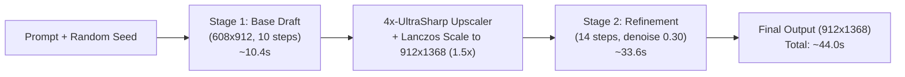

# ABP · Two-Stage Fast-Draft to Hi-Res Polish (FLUX.1-dev-fp8) & Rig Hardening

**Date:** 2026-11-01 · **Status:** Authoritative Measured Recipe · **Hardware:** Dual RTX 3090 (mont-pc)  
**Direct Endpoint:** `https://mont-pc.taild6b5fe.ts.net:8188` (or `https://mont-pc.taild6b5fe.ts.net`)  
**Follows:** `ABP-flux-dev-and-anchor.md`, `ABP-model-bakeoff.md` · **Companion Script:** `atelier/art-forge/generate/twostage.py`

---

## 1. Executive Summary & Quality Root Causes

In late October 2026, an investigation was conducted to determine why image generation on `mont-pc` produced results far inferior in texture, dynamic range, and micro-detail compared to GPT Web (DALL-E 3 / GPT-4o).

The investigation revealed **three primary root causes**:

1. **Distilled Model vs. Full Diffusion Foundation**:
   - The legacy pipeline ran `z_image_turbo_bf16.safetensors` at **8 steps, CFG 1.0**. Turbo/distilled models sacrifice micro-surface texture, volumetric lighting, and fine line detail for sub-second speeds, producing smooth, plastic, vector-like art.
   - **Resolution**: Upgraded to **`flux1-dev-fp8.safetensors`** running with `FluxGuidance` at **3.5**, which preserves photorealistic surface micro-detail, fabric weave, metallic scratches, and lighting fidelity.
2. **Missing Prompt Expansion Layer**:
   - GPT Web silently rewrites user prompts into dense ~100-word photographic specifications (focal length, sensor depth, volumetric raytraced lighting, material weathering). Sending terse raw prompts directly into ComfyUI yields plain, unstyled outputs.
   - **Resolution**: Prompt styling should specify surface details, materials, lighting, and composition explicitly.
3. **Rig Watchdog Crash-Loop (`comfyui-watchdog.ps1`)**:
   - The scheduled watchdog on `mont-pc` suffered from a PowerShell string escaping bug on line 37 (`ParameterBindingException` when attempting to POST to `/free` with double-quotes).
   - This caused ComfyUI to appear "dead" to the watchdog every 3 minutes while idle, triggering repeated headless spawns that locked port 8188 and degraded system responsiveness.
   - **Resolution**: Hardened `comfyui-watchdog.ps1` with verified AST syntax and layered health probes.

---

## 2. The Two-Stage Draft-to-Polish Recipe

A full 24-step high-resolution generation with `flux1-dev-fp8` at `1024×1536` on an RTX 3090 takes **~177 seconds (~3 minutes)** per roll. This turnaround is too slow for fast creative iteration or batch production.

To achieve both **fast turnaround** and **masterpiece-grade surface detail**, we established and verified the **Two-Stage Pipeline**:



### Stage Specifications

| Parameter | Stage 1: Fast Base Draft | Stage 2: Hi-Res Refinement |
| :--- | :--- | :--- |
| **Purpose** | Instant check for silhouette, anatomy, costume & composition | Adds micro-scratches, armor filigree, eye reflections, skin pores |
| **Model** | `flux1-dev-fp8.safetensors` | `flux1-dev-fp8.safetensors` |
| **Resolution** | `608 × 912` (or `832 × 1280`) | `912 × 1368` (1.5× scale via `4x-UltraSharp` + Lanczos) |
| **Steps** | **10 steps** | **14 steps** |
| **Sampler / Scheduler** | `euler` / `simple` | `euler` / `simple` |
| **CFG / Guidance** | CFG `1.0`, Guidance `3.5` | CFG `1.0`, Guidance `3.5` |
| **Denoise** | `1.0` (txt2img) | **`0.30`** (hires img2img refinement) |
| **Measured Time** | **10.4 seconds** | **33.6 seconds** |
| **Total Pipeline Time** | — | **~44.0 seconds (4× faster than 177s single pass)** |

---

## 3. ByteDance Hyper-FLUX LoRA Scaling Invariant

For accelerated 8-step workflows using ByteDance's Hyper-FLUX LoRA:
- **Location on `mont-pc`:** `F:\comfy-ui\loras\Hyper-FLUX.1-dev-8steps-lora.safetensors` (1.38 GB)
- **CRITICAL INVARIANT:**
  ```json
  {
    "class_type": "LoraLoader",
    "inputs": {
      "model": ["1", 0],
      "clip": ["1", 1],
      "lora_name": "Hyper-FLUX.1-dev-8steps-lora.safetensors",
      "strength_model": 0.125,
      "strength_clip": 0.0
    }
  }
  ```
  > [!CAUTION]
  > **Do NOT load at `strength_model: 1.0`!** Loading Hyper-FLUX at 1.0 with FLUX.1-dev FP8 causes latent saturation, static noise, and NaN pixel values. The mathematically calibrated working strength is **`0.125`** with CLIP strength set to **`0.0`**.

---

## 4. Rig Hardware & Access Standards (`mont-pc`)

1. **Network Access (Direct Tailscale)**:
   - ComfyUI is directly reachable across the Tailscale mesh:
     `https://mont-pc.taild6b5fe.ts.net:8188` or `https://mont-pc.taild6b5fe.ts.net`
   - **No SSH port-forwarding tunnel is required.** Legacy docs requiring `ssh -N -L 8188:127.0.0.1:8188` are superseded.
2. **GPU & Port Isolation**:
   - **GPU 0 / Port 8188**: Production ComfyUI for automated agent generation and atlas tools.
   - **GPU 1 / Port 8189**: The human owner's private instance. **NEVER send jobs, touch, or restart port 8189.**
3. **Thermal Power Cap**:
   - GPU 0 has an active hardware power limit of **210W** (clocked ~1700 MHz, max temp 68°C) enforced by `nvidia-smi` every 3 minutes to preserve rig longevity.
4. **Process Management & Sibling Protection**:
   - `mont-pc` hosts multiple Python services simultaneously:
     * ComfyUI (`:8188`)
     * Kokoro TTS Server (`:8770`)
     * Hermes Gateway & Dashboard (`:9119`)
     * Browser Automation Harness
   - **RULE:** Never kill generic `python.exe`. Any script managing or inspecting ComfyUI must filter by command line:
     ```powershell
     Get-CimInstance Win32_Process -Filter "Name = 'python.exe'" | Where-Object { $_.CommandLine -like "*ComfyUI*main.py*" }
     ```

---

## 5. ComfyUI API Execution Traps

### The Duplicate Prompt / Seed Cache Trap
When sending identical prompt graphs with the same `seed` to `/prompt`, ComfyUI's internal graph cache flags all nodes as `execution_cached`.
- In this state, ComfyUI completes the job instantly (`completed: true`) but leaves `/history/<prompt_id>.outputs` completely empty (`{}`).
- Any script polling for `outputs["14"]` will hang until timeout.
- **Rule for all agent scripts:** Always randomize the `seed` on each run (`random.randint(1, 2147483647)`), or inspect `status.completed` and fall back to fetching cached output if needed.

---

## 6. How to Run

### Option A: Ready-to-Run CLI Script
A production-ready CLI runner is provided at `atelier/art-forge/generate/twostage.py`:

```bash
# Run full 2-stage generation (~44s total)
python3 atelier/art-forge/generate/twostage.py \
  --prompt "Full-body concept art of a high elf knight in pearl-white plate armor with golden filigree, sunlit cathedral, 8k render" \
  --out /tmp/elf_knight.png

# Run fast Stage 1 draft only (~10s)
python3 atelier/art-forge/generate/twostage.py \
  --prompt "Full-body concept art of a high elf knight..." \
  --draft-only \
  --out /tmp/elf_draft.png
```

### Option B: Node.js / Direct API
Import or submit the canonical Two-Stage graph structure defined in `twostage.py` directly to `POST https://mont-pc.taild6b5fe.ts.net/prompt`.
