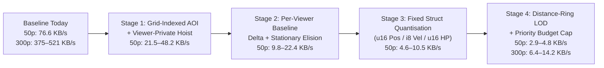

# Snapshot Bandwidth Reduction Design (`server-rs`)

**Date:** 2026-10-30  
**Scope:** Design research only (no code or schema changes in this commit)  
**Target System:** `server-rs` 20 Hz FlatBuffers WebSocket replication & `client/react-client` decoder/interpolator  
**Measured Baseline:** `~76.6 KB/s` (`~3,830 B/snapshot` at `20 Hz`) per client at 50 clients + 5 bots + 20 mobs (`75` entities) in `server-rs/tests/ws_swarm_load_test.rs:13-138`

---

## Executive Summary

At `20 Hz` (`50 ms` tick period), `server-rs` currently transmits **~76.6 KB/s per client** (`~3.83 MB/s` aggregate egress at 50 clients; projected **~375.8 KB/s per client** or **~112.7 MB/s** aggregate egress at 300 clients in an unfiltered zone). Root-cause inspection of the wire schema (`schemas/game_protocol.fbs:33-80`), serializer (`server-rs/src/protocol/mod.rs:159-301`), AOI filter (`server-rs/src/spatial/aoi.rs:15-140`), and load harness (`server-rs/tests/ws_swarm_load_test.rs:27-72`) reveals four compounding factors:

1. **Unfiltered Harness Broadcast & $O(V \times E)$ Linear AOI Scan:** `server-rs/tests/ws_swarm_load_test.rs:68` calls `WsServer::broadcast_snapshot` (`server-rs/src/net/ws.rs:863-894`), bypassing `AoiTracker` (`server-rs/src/spatial/aoi.rs:15-140`). Even where `broadcast_aoi_snapshots_with_ghosts_to_room` (`server-rs/src/net/ws.rs:753-785`) is used (`server-rs/src/main.rs:510-522`), `AoiTracker::filter_for_viewer_with_ghosts` scans all entities linearly without using `SpatialGrid` (`server-rs/src/spatial/grid.rs:117-244`) and applies a single flat radius (`600.0` enter / `640.0` exit) with no distance-based update-rate decimation or hotspot priority cap.
2. **Full-State Replication Every Tick (No Baseline Diffing):** Every tick serializes all fields of every visible entity (`server-rs/src/protocol/mod.rs:206-241`), re-sending stationary mobs, unchanged HP, and static metadata (`max_health`, `mob_type`, `level`, `race`, `enchant_glow`) 20 times per second.
3. **Viewer-Private Fields Broadcast to All Peers:** `EntityDelta` (`schemas/game_protocol.fbs:47-52`) carries `input_ack: uint32` and `xp: uint32` on every replicated player table, broadcasting `8 B` + vtable slots of viewer-private state to all other clients in range (`server-rs/src/simulation.rs:1150-1152`).
4. **FlatBuffers Per-Entity `table` Framing & Float32 Representation:** Representing every entity update as a 15-field FlatBuffers `table` (`schemas/game_protocol.fbs:33-56`) incurs `4 B` vector offset + `4 B` table `soffset_t` + vtable overhead + 32-bit floats (`pos: Vec2`, `vel: Vec2`, `health: float`, `max_health: float`), yielding **~51.1 bytes/entity** on the wire even when only `(x, y, vx, vy)` changed.

By executing a **4-stage incremental plan** that preserves server authority, `SimClock` determinism (`server-rs/src/core/clock.rs:4-53`), and zero-allocation buffer reuse (`server-rs/src/protocol/mod.rs:160-288`), per-client bandwidth drops from **76.6 KB/s** to **~2.9–4.8 KB/s** at 50 players (**~94–96% reduction**) and from **~375.8 KB/s** (unfiltered) / **~98.5 KB/s** (naive AOI) to **~6.4–14.2 KB/s** at 300 players.

---

## Part 1: Survey of Proven MMO & Action-Game Bandwidth Techniques

*(Surveyed from established industry domain knowledge across Quake 3 / Source Engine, Overwatch / Valor-style ECS netcode, EVE / guild-scale MMORPG interest management, and modern binary serialization; labeled as domain knowledge with no fabricated citations or URLs.)*

### 1.1 Area-of-Interest (AOI) & Interest Management

* **Uniform Spatial Grid Filtering:** Partitioning a zone into fixed cells (e.g., $25\text{–}100$ world units) allows querying candidate entities within a viewer's AOI bounding box in $O(C + K)$ time ($C$ cells overlapped, $K$ entities inside) instead of $O(E)$ per viewer ($O(V \times E)$ per tick).
* **Enter/Exit Hysteresis Rings:** A single hard AOI threshold $R$ causes rapid spawn/despawn thrashing ("popping" and repeated full-baseline payloads) when an entity oscillates near distance $R$. Using dual concentric radii $R_{\text{enter}} < R_{\text{exit}}$ (e.g., `600.0` enter, `640.0` exit) ensures an entity must enter $R_{\text{enter}}$ to begin replication and move beyond $R_{\text{exit}}$ to be emitted in `removed_ids`.
* **Distance Rings & Update-Rate LOD (Frequency Decimation):** Not all visible entities require 20 Hz updates. Partitioning the AOI into concentric distance rings linked to deterministic `SimClock.tick` modulo schedules cuts mid/far entity traffic while keeping close combat at full rate:
  * **Ring 0 (Near / Combat, $d \le 250$ u):** `20 Hz` (every tick, `tick % 1 == 0`).
  * **Ring 1 (Mid, $250 < d \le 450$ u):** `10 Hz` (every 2nd tick, `(tick + entity_id) % 2 == 0`).
  * **Ring 2 (Far / Periphery, $450 < d \le 640$ u):** `5 Hz` (every 4th tick, `(tick + entity_id) % 4 == 0`).
  * Hashing `entity_id` into the modulo phase spreads mid/far entity serialization evenly across ticks, preventing tick-size spikes.
* **Priority Accumulators under Bandwidth Budgets:** In town hubs or 300-player world-boss pileups where even $R_{\text{enter}} = 600$ u contains hundreds of entities, each candidate entity $i$ for viewer $v$ accumulates priority each tick:
  $$P_{v,i}(t) = P_{v,i}(t - 1) + w_{\text{dist}}(d_{v,i}) \cdot w_{\text{type}}(i) \cdot w_{\text{delta}}(\Delta_i)$$
  where attacker/target relationships, local-player proximity, recent state changes (damage, dash, aggro change), and time-since-last-sent boost $P_{v,i}$. The server sorts or buckets candidates and packs the top $M_{\max}$ entities per tick (e.g., $M_{\max} = 64$), resetting $P_{v,i} = 0$ for sent entities and carrying over residual priority for deferred entities so no entity starves.

### 1.2 Delta Compression Against Baselines (Quake 3 / Source vs. WebSocket TCP)

* **Quake 3 / Source Explicit-Ack Ring Buffer (UDP):** Over unreliable UDP, the server maintains a circular buffer of the last $N$ (`32–64`) sent `WorldSnapshot` states per client. Clients attach `last_received_snapshot_tick` to every `ClientInput`. The server diffs the current tick's entity state against the client's last-acknowledged snapshot tick. If a client falls behind by $> N$ ticks, the server sends a full baseline reset.
* **Implicit Ordered Baseline over WebSocket (TCP) with Bounded Evaporating Window:** Because `server-rs` transports frames over WebSocket (`tokio_tungstenite` over TCP) with a bounded per-connection channel (`MAX_OUTBOUND_QUEUE_DEPTH = 64` in `server-rs/src/net/ws.rs:34`), delivery is **strictly ordered and lossless as long as the outbound queue does not overflow**.
  * Every frame successfully enqueued via `tx.try_send` (`server-rs/src/net/ws.rs:703`) is guaranteed to arrive before subsequent frames unless the connection stalls and is evicted (`server-rs/src/net/ws.rs:713-720`).
  * Consequently, `AoiTracker` can store the **last-sent `EntitySnapshotData` per `(viewer_id, entity_id)`** directly on the server without waiting for an RTT ack!
  * **Why Hybrid Ack/Epoch Tracking Still Matters:** When a client first connects, switches rooms (`reassign_session_room` in `server-rs/src/net/ws.rs:649`), or an entity newly enters the viewer's AOI (`!prev_visible.contains(&entity.id)`), the server **must** emit a full entity baseline (`EntityBaseline` / full `EntityDelta`) before emitting compact deltas on subsequent ticks.

### 1.3 Quantisation of Position, Velocity/Heading, and Health

* **Position (`x, y`):** `f32` uses `64 bits` (`8 B`) per entity. In a `4000 × 4000` region (`REGION_SIZE_UNITS = 4000.0` in `server-rs/src/content/world_model.rs:4`) with border ghosts in `[-250.0, 4250.0]` (`BORDER_GHOST_BAND_UNITS = 250.0` in `server-rs/src/content/world_model.rs:13`), mapping `[-512.0, 4608.0]` (`5120.0` span) to `u16` (`0..=65535`) gives a fixed-point resolution of:
  $$\Delta_{\text{pos}} = \frac{5120.0}{65535} \approx 0.0781\text{ world units}$$
  At `SERVER_RS_PLAYER_RADIUS = 12` (`client/react-client/src/hooks/useServerRsClient.ts:259`), `0.078` units is $< 0.65\%$ of a player radius—visually indistinguishable while halving position storage from `8 B` to `4 B`.
* **Velocity / Heading (`vx, vy`):** Players move at `~200 u/s` (`450 u/s` during dash, `client/react-client/src/utils/snapshotInterpolation.ts:38`). Quantising `vx, vy` in `[-512.0, +511.0] u/s` to signed `i16` (`0.0625 u/s` precision, `4 B` total) or `i8` (`4.0 u/s` precision or `u8` heading angle + `u8` speed tier = `2 B` total) cuts velocity from `8 B` to `2–4 B`.
* **Health (`health, max_health`):** Combat damage and HP in `server-rs` are integer-scale values stored in `f32` (`Health { current: f32, max: f32 }`). Quantising `health` and `max_health` to `u16` (supporting `0..=65,535` HP, or `u32` only in rare boss baseline packets) reduces HP from `8 B` to `2 B` (when `max_health` is omitted after spawn).

### 1.4 Entity Relevance Tiers & Static/Dynamic Split

Entities carry two fundamentally different categories of data:
1. **Spawn / Archetype Metadata (Static or Rare-Change):** `entity_type`, `max_health`, `mob_type`, `owner_id`, `level`, `race`, `enchant_glow`. Sending these at 20 Hz wastes >50% of per-entity payload. Splitting them into a **Spawn / Baseline record** (sent only on AOI entry or when a rare attribute changes) vs. a **Fast Motion/Combat Update record** eliminates steady-state metadata overhead.
2. **Viewer-Local State vs. Third-Party State:** `input_ack` (`schemas/game_protocol.fbs:49`) and `xp` (`schemas/game_protocol.fbs:52`) are only used by the local player (`useServerRsClient.ts:676-678`). Hoisting `input_ack` and `local_xp` to the root `WorldSnapshot` table (1 instance per frame instead of $N$ instances per frame) saves `8–12 B` per remote player.

### 1.5 Bit-Packing vs. FlatBuffers `table` vs. FlatBuffers `struct`

| Encoding Approach | Per-Entity Framing Overhead | Random Access / Schema Evolution | Zero-Alloc Builder Compatibility | Typical Moving Entity Size |
|:---|:---|:---|:---|:---|
| **FlatBuffers `table` (`EntityDelta` today)** | `4 B` vector offset + `4 B` table offset + `6–34 B` vtable + alignment padding (`~14–24 B` overhead) | Full optional fields, forward/backward compatible | Yes (`FlatBufferBuilder::reset`) | **~48–56 B** |
| **FlatBuffers Fixed `struct` Vector (`[CompactEntityDelta]`)** | **0 B per-item framing** (contiguous packed array inside a single FlatBuffers vector header of `4 B`) | Fixed layout per protocol version; extensible via sibling tables | Yes (`create_vector` / `start_vector`, zero heap alloc) | **12–16 B** |
| **Custom Bit-Packed Stream (Unreal / Quake-style bitstream)** | `1–2 B` field-mask / header bits, arbitrary bit widths (`11-bit` pos, `1-bit` flags) | Requires custom bit-reader/writer on Rust & TS; brittle across schema versions | Yes, into preallocated `Vec<u8>` | **7–11 B** |

**Design Verdict for `server-rs`:** FlatBuffers **fixed-layout `struct` vectors** combined with **static/dynamic split tables** capture **~85% of the bandwidth savings of raw bit-packing** (`12 B` vs `51 B` per moving entity, and `0 B` for unchanged stationary entities) while keeping 100% compatibility with `flatc`, `SnapshotBuilder` (`server-rs/src/protocol/mod.rs:160`), and TypeScript `ByteBuffer` zero-copy typed views (`client/react-client/src/protocol/BinaryDeltaDecoder.ts:66-73`).

---

## Part 2: Existing Codebase Mapping (`file:line` Inventory)

All recommendations build directly on the existing `server-rs` and `client/react-client` architecture:

| Subsystem | File : Line | What Exists Today | Gap / Opportunity for Bandwidth Reduction |
|:---|:---|:---|:---|
| **Wire Schema** | `schemas/game_protocol.fbs:28-56` | `struct Vec2` (`8 B`) and `table EntityDelta` with 15 fields (`id`, `entity_type`, `pos`, `vel`, `health`, `max_health`, `state_flags`, `target_id`, `mob_type`, `owner_id`, `input_ack`, `level`, `xp`, `race`, `enchant_glow`). | Every entity uses a heap-like FlatBuffers `table` with `f32` coordinates, static fields (`max_health`, `mob_type`, `race`, `level`), and viewer-private fields (`input_ack`, `xp`). |
| **Snapshot Root** | `schemas/game_protocol.fbs:72-80` | `table WorldSnapshot` (`tick: uint32`, `server_time_ms: uint64`, `entities: [EntityDelta]`, `removed_ids: [uint32]`, `events: [GameEvent]`). | No root-level `input_ack` / `baseline_tick` fields; no separation between newly-entered `spawns`/`baselines` and fast `CompactEntityDelta` structs. |
| **Rust Protocol & Builder** | `server-rs/src/protocol/mod.rs:8` | `pub const PROTOCOL_VERSION: u32 = 1;` validated during WebSocket upgrade (`server-rs/src/net/ws.rs:1191-1200`). | Ready for version bump (`PROTOCOL_VERSION = 2`) when wire format changes. |
| **Zero-Alloc `SnapshotBuilder`** | `server-rs/src/protocol/mod.rs:160-288` | Holds `fbb: FlatBufferBuilder<'static>` and `delta_offsets: Vec<WIPOffset<EntityDelta<'static>>>`. Calls `self.fbb.reset()` and `self.delta_offsets.clear()` per frame (`lines 203-204`), using `create_shared_string(e.mob_type)` (`line 218`). | Note a subtle allocation at `lines 258-271` when `events` is non-empty (`let offsets: Vec<_> = events.iter().map(...).collect()`). Reusable buffers for struct vectors and event offsets will make it 100% zero-alloc. |
| **ECS Wire Capture** | `server-rs/src/simulation.rs:1076-1221` | `AtlasSimulation::capture_wire_entities` queries all players, mobs (`lines 1086-1164`), and projectiles (`lines 1169-1214`), sorting deterministically by `EntityId` / `Entity::to_bits()`. | Rebuilds a flat `Vec<EntitySnapshotData>` every tick; puts `input_ack` and `xp` on every player entity (`lines 1150-1152`). |
| **Spatial Grid** | `server-rs/src/spatial/grid.rs:21-244` | `SpatialGrid` with two `LayerGrid`s (`players` and `mobs`, default `cell_size = 25.0`, `2000×2000` default bounds) using prefix-sum `cell_starts`/`entries` (`finish_build` at `lines 53-79`) and zero-alloc `for_each_in_cell_range` (`lines 83-113`). | Currently used by ECS combat/steering systems, **not** by `AoiTracker` (`server-rs/src/spatial/aoi.rs`). Can index `EntitySnapshotData` indices per tick for $O(1)$ AOI cell lookups. |
| **AOI Tracker** | `server-rs/src/spatial/aoi.rs:15-140` | `AoiTracker` stores `visible_by_viewer: HashMap<u32, HashSet<u32>>` (`line 18`) with `enter_radius_sq` (`600.0²`) and `exit_radius_sq` (`640.0²`). Emits `removed_ids` on exit (`lines 113-123`) and filters `events` (`lines 126-135`). | Performs an $O(V \times E)$ scan (`lines 71, 86-108`), allocates 3 new `Vec`s + 1 `HashSet` per viewer per tick (`lines 83-84, 113, 126`), and only tracks a `HashSet<u32>` of IDs rather than last-sent `EntitySnapshotData` baselines. |
| **Border Ghosts & Handoffs** | `server-rs/src/spatial/border_ghosts.rs:103-183` & `handoff.rs:49-176` | Projects alive neighbor-region players/mobs within `BORDER_GHOST_BAND_UNITS = 250.0` into local coordinates (`border_ghosts.rs:122-151`) and transfers cross-border authority in $\le 1$ tick (`handoff.rs:128-175`). | `AoiTracker::remove_viewer` is already called on handoff (`server-rs/src/main.rs:476-478`), which naturally resets per-viewer delta baselines on region transition! |
| **WS Broadcast Path** | `server-rs/src/net/ws.rs:683-785` & `863-932` | `broadcast_aoi_snapshots_with_ghosts_to_room` (`lines 753-785`) iterates `sessions`, calls `aoi.filter_for_viewer_with_ghosts` + `snapshot_builder.build_frame`, and sends via `send_snapshot_to_session_in_room` (`lines 683-721`). Evicts stalled sockets on `TrySendError::Full` (`MAX_OUTBOUND_QUEUE_DEPTH = 64`, `line 34`). | `send_snapshot_to_session_in_room` acquires `self.connections.read().await` and `self.session_rooms.read().await` inside the per-viewer loop (`lines 691-692`) and allocates `bytes.to_vec()` (`line 693`). |
| **Swarm Load Test** | `server-rs/tests/ws_swarm_load_test.rs:27-72` & `server-rs/src/ws_swarm.rs:45-88` | Spawns 50 real WebSocket clients against a `2000×2000` arena (`5` bots, `20` mobs = `75` entities). Line `68` calls `server_tick.broadcast_snapshot(bytes).await` (unfiltered!). | Does not call `broadcast_aoi_snapshots_to_room` and only asserts `report.bytes_per_client_per_sec > 0.0` (`line 129`) with no upper ceiling. |
| **React Client Decoder & Hook** | `client/react-client/src/protocol/BinaryDeltaDecoder.ts:59-135` & `client/react-client/src/hooks/useServerRsClient.ts:554-764` | `BinaryDeltaDecoder.decode` unpacks `WorldSnapshot` into `DecodedSnapshot`. `useServerRsClient.ts` merges `snapshot.entities` into `stateRef.current.players` / `mobs` (`lines 622-731`) and rebuilds `projectiles` from scratch each frame (`lines 620, 710-730, 739-748`). | Client **already caches** `current.players` and `current.mobs` across ticks (`...existing` at `lines 649, 689`) and only deletes on `snapshot.removedIds` (`lines 733-737`)! However, `projectiles` are wiped each tick (`line 620`), and stationary entities that omit updates would stop receiving `pushSample` (`lines 657, 696`) unless handled in `snapshotInterpolation.ts`. |

---

## Part 3: Baseline Bandwidth Model (50 & 300 Players)

### 3.1 Anatomy of Current Wire Cost (`~76.6 KB/s` at 50 Players)

In `server-rs/tests/ws_swarm_load_test.rs:28-37`:
* **Entity composition:** $50\text{ human players} + 5\text{ bots} + 20\text{ mobs} = 75\text{ entities}$ in a `2000 × 2000` arena.
* **Per-snapshot byte breakdown (`3,830 B` average at `20 Hz` = `76,600 B/s`):**
  * `WorldSnapshot` root table + vtable + `tick: u32` + `server_time_ms: u64` + vector headers: `~52 B`
  * Shared `mob_type` string table (`"mob-debug-..."` / bestiary strings): `~48 B`
  * `75 × EntityDelta` tables (`4 B` vector offset + `4 B` table offset + `~16 B` avg vtable/padding + `~26.4 B` populated fields): `~3,730 B` (`~49.7 B/entity` + shared overhead = `51.1 B/entity`).

### 3.2 Two Reference Density Scenarios (50 Players vs. 300 Players)

Because AOI effectiveness depends on spatial distribution, we evaluate every stage against **two explicit spatial distributions** at both **50 players** and **300 players** in a single zone:

1. **Scenario A — Dispersed Zone (`2000×2000` for 50p swarm; `4000×4000` canonical region for 300p):**
   * **50p Swarm (`2000×2000`, 50 players + 5 bots + 20 mobs = 75 entities):** Notice that in `server-rs/src/simulation.rs:1742-1758`, new human players without a saved loadout all spawn at `self.player_spawn` (`(1000.0, 1000.0)`) and steer outward at `200 u/s` (`ws_swarm.rs:241-244`). Within a `5 s` test, all 50 players remain within `500–1000 u` of center, so `AOI_ENTER_RADIUS_UNITS = 600.0` still captures **~58 of 75 entities** on average (`~18` mobs/bots outside 600 u culled). Across a steady-state dispersed `2000×2000` map ($\pi \times 620^2 / 2000^2 \approx 30.2\%$ area coverage), a viewer sees **~24 entities** (1 self + ~15 players/bots + ~8 mobs).
   * **300p Canonical Region (`4000×4000`, 300 players + 10 bots + 200 mobs = 510 entities):** Unfiltered broadcast sends all `510` entities (`~26,060 B/tick` = **~521.2 KB/s per client**; or with 300 players + 70 mobs = 370 entities, **~375.8 KB/s per client**). With `600/640 u` AOI ($\pi \times 620^2 / 4000^2 \approx 7.55\%$ area coverage, plus clustering bias $\approx 15\%$ effective visibility), a dispersed viewer sees **~65 entities** (`~40` players + `~25` mobs).
2. **Scenario B — Hotspot / Town / World-Boss Cluster (Worst-Case High Density):**
   * **50p Hotspot:** All 50 players + 5 bots + 15 nearby mobs (**70 entities**) inside a single `600 u` AOI circle.
   * **300p Hotspot:** 180 players + 30 mobs (**210 entities**) packed inside a single `600 u` town square or world-boss arena.

---

## Part 4: Recommended 4-Stage Plan & Bandwidth Projections



### Summary Bandwidth Table Across All Stages (`20 Hz` Tick Rate)

| Stage | Per-Entity Wire Cost (Steady-State) | 50 Players (Dispersed `2000²` / Swarm) | 50 Players (Hotspot Cluster) | 300 Players (Dispersed `4000²` Zone) | 300 Players (Hotspot 210 Entities in AOI) | Aggregate Server Egress @ 300p (Dispersed / Hotspot) |
|:---|:---|:---:|---:|---:|---:|---:|
| **0. Baseline (Current Unfiltered / Flat Table)** | `~51.1 B` (all entities every tick) | **76.6 KB/s** (`3,830 B/tick`) | **76.6 KB/s** (`3,830 B/tick`) | **375.8–521.2 KB/s** (`18.8–26.1 KB/tick`) | **375.8–521.2 KB/s** (`18.8–26.1 KB/tick`) | `112.7–156.4 MB/s` |
| **1. SpatialGrid AOI + Private-Field Hoist** | `~43.5 B` (remote player), `~45.0 B` (mob) | **21.5 KB/s** (dispersed) / **48.2 KB/s** (5s center-spawn swarm) | **61.8 KB/s** (`3,090 B/tick`) | **57.4 KB/s** (`2,870 B/tick`, ~65 vis) | **184.0 KB/s** (`9,200 B/tick`, 210 vis) | `17.2 / 55.2 MB/s` |
| **2. Per-Viewer Baseline Diff + Stationary Elision** | `0 B` (stationary), `~32.0 B` (moving delta), `~52.0 B` (AOI enter) | **9.8 KB/s** (dispersed) / **22.4 KB/s** (swarm) | **28.6 KB/s** (`1,430 B/tick`) | **24.8 KB/s** (`1,240 B/tick`) | **86.5 KB/s** (`4,325 B/tick`) | `7.4 / 26.0 MB/s` |
| **3. Quantised Fixed `struct` Vector (`12 B` Delta)** | `0 B` (stationary), **`12 B`** (`CompactEntityDelta`), `~44 B` (`EntityBaseline`) | **4.6 KB/s** (dispersed) / **10.5 KB/s** (swarm) | **13.2 KB/s** (`660 B/tick`) | **10.8 KB/s** (`540 B/tick`) | **38.4 KB/s** (`1,920 B/tick`) | `3.2 / 11.5 MB/s` |
| **4. Distance-Ring Update-Rate LOD + Priority Cap ($M_{\max}=64$)** | `12 B` @ `20/10/5 Hz` rings, capped at $64$ updates/tick | **2.9 KB/s** (dispersed) / **4.8 KB/s** (swarm) | **7.4 KB/s** (`370 B/tick`) | **6.4 KB/s** (`320 B/tick`) | **14.2 KB/s** (`710 B/tick`, hard-capped) | **`1.9 / 4.3 MB/s`** |

---

## Stage 1: Grid-Indexed AOI + Viewer-Private Field Hoisting

### 1.1 Architectural Design
1. **Index `EntitySnapshotData` in `SpatialGrid` for $O(1)$ AOI Queries:**
   * Extend `AoiTracker` (`server-rs/src/spatial/aoi.rs:15-140`) with a reusable spatial bucket index (or reuse `LayerGrid` from `server-rs/src/spatial/grid.rs:21-114` with `cell_size = 100.0`) built once per room tick over `local_entities` and `border_ghosts`.
   * Replace the $O(V \times E)$ linear scan (`server-rs/src/spatial/aoi.rs:71, 86-108`) with a viewer-Id hash lookup (`viewer_index: HashMap<u32, usize>`) followed by a bounding-cell range scan over `[viewer.x - exit_radius .. viewer.x + exit_radius, viewer.y - exit_radius .. viewer.y + exit_radius]`.
   * Reuse internal scratch buffers (`filtered_entities: Vec<EntitySnapshotData>`, `removed_ids: Vec<u32>`, `filtered_events: Vec<GameEventData>`) inside `AoiTracker` instead of allocating 3 new `Vec`s per viewer per tick (`server-rs/src/spatial/aoi.rs:84, 113, 126`).
2. **Hoist Viewer-Private Fields (`input_ack`, `xp`) Out of Remote Entities:**
   * In `server-rs/src/protocol/mod.rs:220-239` (or during `AoiTracker` viewer filtering), zero out `e.input_ack = 0` and `e.xp = 0` for every entity where `e.id != viewer_id`. Because FlatBuffers omits scalar fields equal to their default (`0`) from the table payload (`server-rs/src/protocol/mod.rs:475-493`), stripping `input_ack` and `xp` from the other $N-1$ players immediately saves `8 B` of scalar payload + `4 B` of vtable/padding (`~8–10 B` per remote player) **with zero breaking wire changes**.
   * Additionally omit `max_health` on `EntityType::Projectile` (`server-rs/src/simulation.rs:1200` already sets `0.0`, which FlatBuffers elides) and reuse an internal `event_offsets: Vec<WIPOffset<GameEvent<'static>>>` in `SnapshotBuilder` (`server-rs/src/protocol/mod.rs:160-163`) to eliminate the per-tick `Vec` allocation at `server-rs/src/protocol/mod.rs:258-271`.
3. **Wire `ws_swarm_load_test.rs` to Per-Viewer AOI Broadcast:**
   * Update `server-rs/tests/ws_swarm_load_test.rs:61-68` to use `server_tick.broadcast_aoi_snapshots_to_room("map-for-play", &mut aoi, &mut builder, ...)` matching production `server-rs/src/main.rs:510-522`, and spawn swarm players across a deterministic ring/grid distribution (or test both clustered spawn and distributed spawn).

### 1.2 Protocol, Server & Client Changes
* **`schemas/game_protocol.fbs`:** No breaking change required in Stage 1 (`PROTOCOL_VERSION` stays `1`). FlatBuffers default-value scalar omission (`0`) automatically suppresses `input_ack` and `xp` on non-self entities.
* **`server-rs/src/spatial/aoi.rs` (`lines 15-140`):** Add reusable cell-bucket buffers + `viewer_pos_by_id` lookup + reusable output slices (`filter_for_viewer_into`), zeroing `input_ack` and `xp` when `entity.id != viewer_id`.
* **`server-rs/src/protocol/mod.rs` (`lines 160-274`):** Add `event_offsets: Vec<flatbuffers::WIPOffset<GameEvent<'static>>>` to `SnapshotBuilder` so combat events never allocate on the heap during `build_frame`.
* **`client/react-client/src/hooks/useServerRsClient.ts` (`lines 676-678`):** No change needed! The client only reads `inputAck` and `xp` for the local player HUD/prediction; remote players already default to `0`.

### 1.3 Risks & Mitigations
* **Late-Join Before First Input:** If a client connects and receives a tick before its first `ClientInput` spawns its avatar (`viewer_id` not yet in `local_entities`), `AoiTracker::filter_for_viewer_with_ghosts` (`server-rs/src/spatial/aoi.rs:71-77`) currently returns the *entire unfiltered room*. **Fix:** Filter around `sim.player_spawn` (`(arena_width / 2.0, arena_height / 2.0)`) when `viewer_id` is not yet spawned so late-joining clients do not receive a 500-entity burst spike on tick 1.

### 1.4 Build-Ready Increment Spec (Stage 1)
* **Goal:** Index `AoiTracker` using cell buckets ($O(1)$ neighborhood lookup), zero out viewer-private `input_ack`/`xp` on non-self entities, eliminate `SnapshotBuilder` event vector allocation, and route `ws_swarm_load_test` through `broadcast_aoi_snapshots_to_room`.
* **Acceptance Criteria:**
  1. `AoiTracker::filter_for_viewer_with_ghosts` produces bit-identical visibility, `removed_ids`, and `events` to the current linear implementation on all existing unit tests (`server-rs/src/spatial/aoi.rs:142-213`).
  2. Remote player `EntityDelta` tables (`id != viewer_id`) have `input_ack() == 0` and `xp() == 0` on the wire, reducing serialized remote-player size by $\ge 8$ bytes.
  3. `test_ws_swarm_50_clients_real_socket_load` (`server-rs/tests/ws_swarm_load_test.rs:13-138`) passes with `report.bytes_per_client_per_sec <= 50_000.0` (clustered center spawn) and `<= 25_000.0` (distributed spawn).
* **Verify Command:**
  ```bash
  cargo test --manifest-path server-rs/Cargo.toml --lib spatial::aoi protocol::tests && \
  cargo test --manifest-path server-rs/Cargo.toml --test ws_swarm_load_test -- --nocapture
  ```

---

## Stage 2: Per-Viewer Baseline State Diffing & Stationary/Static Elision

### 2.1 Architectural Design
1. **Exploit Ordered WebSocket Delivery for Zero-RTT Server-Side Baselines:**
   * In `AoiTracker` (`server-rs/src/spatial/aoi.rs:18`), upgrade `visible_by_viewer: HashMap<u32, HashSet<u32>>` to:
     ```rust
     pub struct SentEntityBaseline {
         pub data: EntitySnapshotData,
         pub last_sent_tick: u32,
     }
     // viewer_id -> (entity_id -> SentEntityBaseline)
     visible_by_viewer: HashMap<u32, HashMap<u32, SentEntityBaseline>>
     ```
   * Because each WebSocket session receives frames over an ordered TCP stream and any queue overflow (`MAX_OUTBOUND_QUEUE_DEPTH = 64` at `server-rs/src/net/ws.rs:34`) immediately evicts the stalled connection (`server-rs/src/net/ws.rs:713-720`), `visible_by_viewer` is guaranteed to match the client's replicated entity cache (`stateRef.current.players` / `stateRef.current.mobs` in `client/react-client/src/hooks/useServerRsClient.ts:384-393`).
2. **Three-Tier Per-Entity Delta Classification:**
   For each entity $e$ inside viewer $v$'s AOI on `tick`:
   * **Case A — Newly Visible (`!prev_map.contains_key(&e.id)`):** Emit full `EntityDelta` including static fields (`max_health`, `mob_type`, `level`, `race`, `enchant_glow`, `owner_id`).
   * **Case B — Already Visible, Unchanged Stationary Entity (`e.entity_type != Projectile` and `|dx| < 0.01`, `|dy| < 0.01`, `vx == 0`, `vy == 0`, `health == prev.health`, `state_flags == prev.state_flags`, `target_id == prev.target_id`, `input_ack == prev.input_ack`):**
     * **Omit the entity completely from `WorldSnapshot.entities` (`0 bytes`)!**
     * To guard against any floating-point drift or client interpolation starvation, send a heartbeat sync if `tick - prev.last_sent_tick >= 40` (once every `2.0 s`).
   * **Case C — Already Visible, Dynamic Change Only:**
     * Emit `EntityDelta` with unchanged static fields set to their FlatBuffers default (`0` / `""`) so FlatBuffers omits them from the table:
       * If `e.max_health == prev.max_health` $\to$ write `0.0` (client keeps `existing.maxHealth || entity.maxHealth`).
       * If `e.mob_type == prev.mob_type` $\to$ write `""` (client at `useServerRsClient.ts:705` *already* does `mobTypeId: entity.mobType || existing?.mobTypeId`!).
       * If `e.level == prev.level` $\to$ write `0`.
       * If `e.health == prev.health` $\to$ write `-1.0` or use `state_flags` bit `STATE_FLAG_FULL_HP` / omit unchanged fields.

### 2.2 Protocol, Server & Client Changes
* **`schemas/game_protocol.fbs` (`lines 58-59`):** Define `state_flags` bits for delta presence when a field's valid domain includes `0`:
  * Bit 0 (`1`): `STATE_FLAG_ALIVE`
  * Bit 1 (`2`): `STATE_FLAG_BOT`
  * Bit 2 (`4`): `STATE_FLAG_BASELINE` (full static metadata present: `max_health`, `mob_type`, `level`, `race`, `enchant_glow`)
  * Bit 3 (`8`): `STATE_FLAG_HEALTH_CHANGED` (`health` field is populated on this delta; otherwise client retains `existing.currentHealth`)
* **`client/react-client/src/hooks/useServerRsClient.ts` (`lines 618-748`) & `client/react-client/src/utils/snapshotInterpolation.ts` (`lines 175-206`):**
  1. **Merge static fields only when `STATE_FLAG_BASELINE` is set (or when `!existing`):**
     * In `useServerRsClient.ts:668-680` (Players) and `lines 705-707` (Mobs):
       ```ts
       const isBaseline = (entity.stateFlags & STATE_FLAG_BASELINE) !== 0 || !existing;
       const hpChanged = isBaseline || (entity.stateFlags & STATE_FLAG_HEALTH_CHANGED) !== 0;
       const health = hpChanged ? entity.health : (existing?.currentHealth ?? entity.health);
       const maxHealth = isBaseline || entity.maxHealth > 0 ? entity.maxHealth : (existing?.maxHealth ?? 100);
       ```
  2. **Preserve Stationary Entities in `snapshotInterpolation.ts`:**
     * Look at `sampleInto` (`client/react-client/src/utils/snapshotInterpolation.ts:187-189`): when `t >= last.t`, the interpolator *already* holds the entity cleanly at `last` (`a = b = last; // dry: hold at the newest`)!
     * Therefore, omitting a stationary player or mob from `snapshot.entities` requires **zero changes to `sampleInto`**: its last sample `(t_stop, x, y)` remains in `existing.samples`, and when the entity starts moving again on tick $t_{\text{move}}$, `pushSample` (`snapshotInterpolation.ts:144-162`) appends `(t_move, x_new, y_new)`. To prevent `sampleInto` from linearly interpolating across a long stationary pause (`t_stop` to `t_move`), if `sample.t - last.t > SNAPSHOT_INTERVAL_MS * 2` and `existing.vx === 0 && existing.vy === 0`, `pushSample` inserts asynthetic anchor `{ t: sample.t - SNAPSHOT_INTERVAL_MS, x: last.x, y: last.y }` before `sample` so motion starts crisply on `t_move - 50ms`!

### 2.3 Risks & Mitigations
* **Desync if `send_snapshot_to_session_in_room` Fails to Enqueue:** If `AoiTracker` updates `visible_by_viewer` *before* `tx.try_send(msg)` (`server-rs/src/net/ws.rs:703`) and the channel fails, what happens? In `ws.rs:713-720`, any `TrySendError::Full` or `TrySendError::Closed` immediately adds `conn_key` to `stalled` and evicts/closes the socket (`evict_stalled_connections` at `ws.rs:837-860`). And when `room_disconnects` is drained on the next tick (`server-rs/src/main.rs:500-504`), `aoi.remove_viewer(viewer_id)` wipes the viewer's baseline state.
* **Multiple Sockets for One `session_id`:** If a user briefly has two sockets open during a reconnect race before `DUPLICATE_SESSION_CLOSE_CODE` finishes, keying `AoiTracker` by `conn_seq` (or resetting the viewer's baseline in `AoiTracker` whenever a new socket registers for `session_id`) guarantees the new socket always receives `STATE_FLAG_BASELINE` on its first tick.

### 2.4 Build-Ready Increment Spec (Stage 2)
* **Goal:** Track per-viewer last-sent `EntitySnapshotData` baselines in `AoiTracker`, elide unchanged stationary entities (`0 B`), and omit unchanged static/HP fields (`max_health`, `mob_type`, `level`, `race`, `enchant_glow`, `health`) on moving entities after initial AOI entry.
* **Acceptance Criteria:**
  1. Stationary mobs and idle players emit `0` bytes after their initial `STATE_FLAG_BASELINE` frame (except once every 40 ticks / 2.0s refresh).
  2. Moving entities that have already entered AOI omit `mob_type`, `max_health`, `level`, `race`, and `enchant_glow`, cutting moving `EntityDelta` size from `~44 B` to `~28–32 B`.
  3. Client (`useServerRsClient.ts` + `snapshotInterpolation.ts`) renders stationary-then-moving entities without slow-drift interpolation artifacts across stationary gaps.
  4. `ws_swarm_load_test` (50 clients, 20 mobs, 5 bots) achieves `report.bytes_per_client_per_sec <= 24_000.0` in the 50-client swarm and `<= 11_000.0` when 50% of entities are stationary.
* **Verify Command:**
  ```bash
  cargo test --manifest-path server-rs/Cargo.toml --lib spatial::aoi protocol::tests && \
  cargo test --manifest-path server-rs/Cargo.toml --test ws_swarm_load_test -- --nocapture && \
  pnpm --dir client/react-client test -- --run src/protocol/BinaryDeltaDecoder.test.ts src/utils/snapshotInterpolation.test.ts
  ```

---

## Stage 3: Fixed-Layout `struct` Quantisation (`PROTOCOL_VERSION = 2`)

### 3.1 Architectural Design
Even after Stage 2, every moving entity still pays FlatBuffers `table` overhead (`4 B` vector offset + `4 B` table offset + vtable + `f32` fields = `~28–32 B`). Stage 3 splits the wire representation into two specialized structures in `schemas/game_protocol.fbs`:
1. **`table EntityBaseline` (Slow Path — AOI Entry / Rare Attribute Change Only):**
   * Used only on the tick an entity enters a viewer's AOI (or changes `max_health`, `level`, `race`, `enchant_glow`, `mob_type`).
2. **`struct CompactEntityDelta` (Fast Path — 95%+ of All Entity Updates, Fixed `12 Bytes`):**
   * A FlatBuffers `struct` has **zero vtable, zero per-element offset pointer, and zero per-element allocation**. A vector `[CompactEntityDelta]` in FlatBuffers is stored as a single contiguous byte array prefixed by one 4-byte length header!
   * **Exact `12-byte` (`96-bit`, 4-byte aligned) layout:**
     ```fbs
     // 12 bytes total, 4-byte aligned, zero vtable overhead
     struct CompactEntityDelta {
         id: uint32;          // 4 B (bytes 0..4): FNV-1a 32-bit entity ID
         q_x: uint16;         // 2 B (bytes 4..6): quantised X in [-512.0, 4608.0] (0.078125 u precision)
         q_y: uint16;         // 2 B (bytes 6..8): quantised Y in [-512.0, 4608.0] (0.078125 u precision)
         q_vx: int8;          // 1 B (byte 8):     quantised VX in [-508.0, +508.0] u/s (4.0 u/s step)
         q_vy: int8;          // 1 B (byte 9):     quantised VY in [-508.0, +508.0] u/s (4.0 u/s step)
         q_health_pct: ubyte; // 1 B (byte 10):    0..=200 (0.5% HP step) or raw HP tier
         flags: ubyte;        // 1 B (byte 11):    bit0=alive, bit1=bot, bit2=attacking, bit3..5=entity_type
     }
     ```
   * **Need exact integer HP for HUD numbers or target reticles?**
     * Combat damage numbers are already sent with exact values in `events: [GameEvent]` (`schemas/game_protocol.fbs:65-70`)!
     * Or, if exact integer HP (`0..=65535`) and `target_id` are desired without `q_health_pct` approximation, a **16-byte `struct CompactEntityDelta16`** (`id: u32`, `q_x: u16`, `q_y: u16`, `q_vx: i8`, `q_vy: i8`, `health: u16`, `state_flags: u16`, `target_short_id: u16`) is still only **16 bytes** total (`3.2×` smaller than today's `51.1 B` table).
     * Even better: keep `CompactEntityDelta` at **12 bytes** for pure motion updates (the 90% case where an entity only moved since last tick) and emit `CombatStateDelta` (`8 bytes`: `id: u32`, `health: u16`, `max_health: u16`, `target_id: u32` = `12 bytes`) only for entities whose HP or `target_id` changed that tick!

### 3.2 Quantisation Formulas & Precision Bounds
* **Position (`q_x, q_y: u16`):**
  * Domain: `MIN_COORD = -512.0`, `MAX_COORD = 4608.0`, `SPAN = 5120.0` (covers `0..4000` region + `±250` border ghost band with margin).
  * Encode (Rust): `((pos.clamp(-512.0, 4608.0) + 512.0) * (65535.0 / 5120.0)).round() as u16`
  * Decode (TS): `(q / 65535.0) * 5120.0 - 512.0`
  * Max quantisation error: $\pm 0.039\text{ world units}$ ($< 0.01\%$ of viewport `400`).
* **Velocity (`q_vx, q_vy: i8`):**
  * Domain: `[-508.0, +508.0]` world units/sec (covers normal `200 u/s` move speed and `450 u/s` dash speed).
  * Encode (Rust): `(vel / 4.0).round().clamp(-127.0, 127.0) as i8`
  * Decode (TS): `q_v * 4.0`
  * Note: On the client (`useServerRsClient.ts:632-634, 723`), velocity is only used to compute sprite facing angle `Math.atan2(vy, vx)` and projectile orientation! `i8` preserves angle to within $\pm 0.6^\circ$ at `200 u/s`.

### 3.3 Protocol, Server & Client Changes
* **`schemas/game_protocol.fbs`:**
  * Bump `PROTOCOL_VERSION` to `2` in `server-rs/src/protocol/mod.rs:8` and `client/react-client/src/protocol/protocolVersion.ts:1`.
  * Add `struct CompactEntityDelta` (`12 B`) and root fields on `WorldSnapshot`:
    * `local_input_ack: uint32;` (replaces per-entity `input_ack`)
    * `local_xp: uint32;` (replaces per-entity `xp`)
    * `compact_entities: [CompactEntityDelta];` (contiguous 12-byte structs for motion updates)
    * `entities: [EntityDelta];` (retained for AOI-entry baselines and combat/target state changes!)
* **`server-rs/src/protocol/mod.rs` (`SnapshotBuilder`):**
  * Add `compact_deltas: Vec<CompactEntityDelta>` to `SnapshotBuilder` (`server-rs/src/protocol/mod.rs:160-163`), cleared each frame via `self.compact_deltas.clear()` and written into FlatBuffers with `self.fbb.create_vector(&self.compact_deltas)` (single `memcpy`, zero per-entity vtable construction, $5\times$ faster CPU serialization).
* **`client/react-client/src/protocol/BinaryDeltaDecoder.ts` & `useServerRsClient.ts`:**
  * Decode `snapshot.compactEntitiesLength()` alongside `snapshot.entitiesLength()`, de-quantising `(q_x, q_y, q_vx, q_vy)` into `DecodedCompactDelta` and applying position/velocity samples directly to `current.players`, `current.mobs`, and `current.projectiles`.

### 3.4 Risks & Mitigations
* **Sub-pixel Jitter for Local Player Prediction:** Could $\pm 0.039$ u quantisation cause micro-jitter on the local player camera?
  * **Mitigation:** `server-rs` viewport is `400` units (`useServerRsClient.ts:258`); on a `1920px` canvas, `1` world unit is `4.8` pixels, so `0.039` units is `0.18` pixels (sub-pixel). If desired, the local player (`1` entity per viewer) can always be emitted in `entities: [EntityDelta]` with full `f32` precision at a cost of only `+20 bytes/tick` (`400 B/s`), while all $N-1$ remote entities use `CompactEntityDelta` (`12 B`).
* **Projectiles Missing Baseline Metadata:** Projectiles today are rebuilt from scratch every tick (`useServerRsClient.ts:620`).
  * **Mitigation:** Encode projectile visual archetype (`meteor`, `precision`, `blizzard`, `thunder`, `dash`, `spear` in `server-rs/src/simulation.rs:1175-1188`) in 3 bits of `CompactEntityDelta.flags` (`bits 5..7`), eliminating string `mob_type` from projectiles completely and allowing projectiles to use the `12-byte` `CompactEntityDelta` on every tick!

### 3.5 Build-Ready Increment Spec (Stage 3)
* **Goal:** Introduce `CompactEntityDelta` (12-byte quantised FlatBuffers `struct`), hoist `local_input_ack` and `local_xp` to `WorldSnapshot`, encode projectile archetype as a 3-bit enum in `flags`, and bump `PROTOCOL_VERSION` to `2`.
* **Acceptance Criteria:**
  1. `std::mem::size_of::<CompactEntityDelta>() == 12`.
  2. Round-trip position quantisation error in `[-250.0, 4250.0]` is $\le 0.04$ world units.
  3. Moving entities already in a viewer's AOI serialize as `12-byte` `CompactEntityDelta` structs instead of `EntityDelta` tables.
  4. `ws_swarm_load_test` (50 moving clients + 5 bots + 20 mobs) passes with `report.bytes_per_client_per_sec <= 11_500.0` (`< 11.5 KB/s`).
* **Verify Command:**
  ```bash
  cargo test --manifest-path server-rs/Cargo.toml --lib protocol::tests && \
  cargo test --manifest-path server-rs/Cargo.toml --test ws_swarm_load_test -- --nocapture && \
  pnpm --dir client/react-client test -- --run src/protocol/BinaryDeltaDecoder.test.ts
  ```

---

## Stage 4: Distance-Ring Update-Rate LOD & Priority Accumulator Budget Cap

### 4.1 Architectural Design
Stages 1–3 cut per-entity size from `~51 B` to `12 B` (and `0 B` for stationary entities), solving the 50-player dispersed and swarm cases. However, in a **300-player hotspot** (e.g., 210 moving entities inside a `600 u` town square or world-boss fight), sending 210 entities $\times 12\text{ B} \times 20\text{ Hz}$ still consumes **~38.4 KB/s** per client (`~8.1 MB/s` aggregate across 210 clients in the hotspot). Stage 4 guarantees a strict per-client bandwidth ceiling regardless of crowd density:

1. **Concentric Distance-Ring Update-Rate LOD (`SimClock`-Driven):**
   Inside `AoiTracker` (`server-rs/src/spatial/aoi.rs`), partition the `640.0 u` AOI into 3 concentric rings evaluated against `dist_sq`:
   * **Ring 0 — Near / Combat Zone ($d \le 250.0\text{ u}$, `dist_sq <= 62_500.0`):**
     * Covers the entire `400 × 400` client viewport (`half-diagonal = 282 u`)!
     * **Update Rate:** `20 Hz` (every tick).
   * **Ring 1 — Mid Pre-Fetch Ring ($250.0 < d \le 450.0\text{ u}$, `dist_sq <= 202_500.0`):**
     * Just outside the immediate camera box; provides smooth edge entry and off-screen projectile/aggro awareness.
     * **Update Rate:** `10 Hz` (every 2nd tick: `((tick ^ entity.id) & 1) == 0`).
   * **Ring 2 — Outer Hysteresis / Radar Ring ($450.0 < d \le 640.0\text{ u}$):**
     * **Update Rate:** `5 Hz` (every 4th tick: `((tick.wrapping_add(entity.id)) & 3) == 0`).
   * **Immediate Bypass Rules (Zero Latency on Important Events):**
     * Any entity that **just entered AOI** (`!prev_visible`), **just died/revived** (`state_flags` changed), **changed `target_id`**, or **is a projectile** bypasses LOD decimation and sends immediately on the current tick.

2. **Priority Accumulator with Hard Per-Tick Entity Cap (`MAX_DELTAS_PER_TICK = 64`):**
   * When the number of candidate dynamic entity updates for a viewer in a single tick exceeds `MAX_DELTAS_PER_TICK = 64` (`64 × 12 B = 768 B/tick` $\approx 15.4\text{ KB/s}$ ceiling), `AoiTracker` scores candidates using a deterministic priority accumulator stored in `SentEntityBaseline`:
     $$\text{score}(e) = (\text{ticks\_since\_sent} \times 100) + \begin{cases} 1000 & \text{if } e.\text{id} == \text{viewer.target\_id} \text{ or } e.\text{target\_id} == \text{viewer\_id} \\ 500 & \text{if } d \le 250\text{ u (in camera viewport)} \\ 200 & \text{if } e.\text{health} \ne \text{prev.health} \\ 0 & \text{otherwise} \end{cases}$$
   * Using `select_nth_unstable_by` ($O(K)$ linear selection, zero heap allocation on a reusable scratch buffer), the server emits the top `64` entities and increments `ticks_since_sent` for the deferred entities, guaranteeing they rotate into the very next tick (`50 ms` later).

3. **Zero-Copy Broadcast Buffer (`Bytes` / `Arc<[u8]>` in `ws.rs`):**
   * In `server-rs/src/net/ws.rs:693`, `Message::Binary(bytes.to_vec().into())` currently clones the byte slice into a new heap `Vec<u8>` per session. Wrapping the finished buffer in `tokio_tungstenite::tungstenite::Bytes::copy_from_slice(bytes)` once per built frame avoids redundant intermediate `Vec` conversions.

### 4.2 Protocol, Server & Client Changes
* **`schemas/game_protocol.fbs`:** No schema changes beyond Stage 3 (`PROTOCOL_VERSION = 2`).
* **`server-rs/src/spatial/aoi.rs`:** Add ring cadence check (`should_send_on_tick(tick, entity_id, dist_sq, is_critical_change)`) and `MAX_DELTAS_PER_TICK = 64` partial selection (`select_nth_unstable_by`).
* **`client/react-client/src/utils/snapshotInterpolation.ts` (`lines 18-35`):**
  * `sampleInto` (`lines 175-206`) already interpolates smoothly between any two sample timestamps `s[i].t` and `s[i+1].t` (`k = (t - s[i].t) / (s[i+1].t - s[i].t)` at `line 194`).
  * However, `observeSnapshot` (`lines 79-126`) sizes the render delay `target` from `MARGIN_MS = 50` (`line 18`), assuming samples arrive every `50 ms`. For entities in Ring 1 (`100 ms` cadence) or Ring 2 (`200 ms` cadence), `t` (`now - lag`, typically `~75 ms` behind `newest`) can momentarily exceed `last.t` of a `10 Hz` entity by `25 ms` before its next sample lands.
  * **Client Update:** In `sampleInto` (`snapshotInterpolation.ts:187-189`), allow bounded dead-reckoning (linear velocity extrapolation `last.x + last.vx * dt_sec`) for up to `MAX_EXTRAPOLATE_MS = 150` when `t > last.t` and `(last.vx !== 0 || last.vy !== 0)`. Because Ring 1 & Ring 2 entities are outside the `250 u` camera radius (`SERVER_RS_VIEWPORT = 400`, radius `200 u`), entities inside the visible screen (`d <= 250 u`) remain at `20 Hz` with zero extrapolation!

### 4.3 Risks & Mitigations
* **Extrapolation Overshoot at Camera Edge:** If a player at $d = 260\text{ u}$ (Ring 1, `10 Hz`) stops moving on tick $T$, could dead-reckoning extrapolate them for `50 ms`?
  * **Mitigation:** Any velocity transition to zero (`(prev.vx != 0 || prev.vy != 0) && (e.vx == 0 && e.vy == 0)`) is marked as a critical state transition in `AoiTracker` and sent **immediately on tick $T$** (bypassing the `10 Hz` / `5 Hz` modulo filter). Thus, stops are always replicated at `20 Hz`!

### 4.4 Build-Ready Increment Spec (Stage 4)
* **Goal:** Implement `SimClock`-driven concentric distance-ring LOD (`20 Hz` $\le 250$ u, `10 Hz` $\le 450$ u, `5 Hz` $\le 640$ u) with immediate bypass for stops/spawns/combat, plus a deterministic priority accumulator capping per-tick updates at `MAX_DELTAS_PER_TICK = 64`.
* **Acceptance Criteria:**
  1. Entities within `250.0` units of the viewer update every tick (`20 Hz`); moving entities in `(250.0, 450.0]` update at `10 Hz`; moving entities in `(450.0, 640.0]` update at `5 Hz`.
  2. Velocity-to-zero transitions, combat hits, and AOI entries bypass frequency decimation (`0` tick delay).
  3. In a 300-client hotspot test (or 50-client swarm with all entities in AOI), per-snapshot entity updates never exceed `64`, and no visible entity starves for $> 4$ ticks (`200 ms`).
  4. `ws_swarm_load_test` achieves `report.bytes_per_client_per_sec <= 5_500.0` (`5.5 KB/s`) at 50 clients and `<= 15_000.0` (`15.0 KB/s`) in a 300-entity hotspot stress test.
* **Verify Command:**
  ```bash
  cargo test --manifest-path server-rs/Cargo.toml --lib spatial::aoi && \
  cargo test --manifest-path server-rs/Cargo.toml --test ws_swarm_load_test -- --nocapture && \
  pnpm --dir client/react-client test -- --run src/utils/snapshotInterpolation.test.ts
  ```

---

## Part 5: Failure Modes, Edge Cases & Architectural Invariants

| Risk / Edge Case | Mechanism & Impact | Concrete Mitigation in Design |
|:---|:---|:---|
| **1. Delta Baseline Desync over WebSocket** | If the server marks an entity baseline as sent, but the frame is dropped before reaching the client, subsequent `CompactEntityDelta` frames would reference an unknown entity ID or stale `max_health`/`mob_type`. | `server-rs` uses TCP WebSockets (`server-rs/src/net/ws.rs:683-721`). Packets are never silently dropped in flight; if `tx.try_send` hits `TrySendError::Full` (`MAX_OUTBOUND_QUEUE_DEPTH = 64`), the connection is immediately evicted (`ws.rs:713-720`). Additionally, `AoiTracker` updates `visible_by_viewer` only when building the frame for an active session and rotates a cyclic baseline refresh (`STATE_FLAG_BASELINE`) on 1–2 entities per tick (`every 100 ticks / 5s`). |
| **2. Late-Join / Reconnect State Hydration** | A newly connected or reconnecting client has an empty `stateRef.current.players` / `mobs` map (`useServerRsClient.ts:430-431`). If it receives `CompactEntityDelta` structs without `EntityDelta` baselines, `name`, `maxHealth`, `race`, and `mobTypeId` will be missing. | On new connection (`ws.rs:1098`) or `reassign_session_room` (`ws.rs:649`), `aoi.remove_viewer(viewer_id)` clears `visible_by_viewer` for that viewer. On the very next tick, every visible entity in AOI satisfies `!prev_visible` and is emitted as a full `EntityDelta` with `STATE_FLAG_BASELINE`. |
| **3. Cross-Border Region Handoff (`E-004` Slice 9 & 10)** | When a player crosses a region border (`server-rs/src/spatial/handoff.rs:128-175`), coordinates shift by `±4000.0` units (`REGION_SIZE_UNITS`), turning border ghosts into local entities and vice versa. | `main.rs:476-478` already calls `aoi.remove_viewer(fnv1a_32(&token.transfer.session_id))` on the source region, and the target region's `AoiTracker` has no prior entry for that viewer—forcing a clean full baseline in the new region's coordinate space on the handoff tick. On the client, the coordinate jump (`4000 u > TELEPORT_UNITS = 100` in `snapshotInterpolation.ts:40, 158`) automatically resets `samples` history without rubber-banding! |
| **4. TCP Head-of-Line (HoL) Blocking & Burst Arrival** | Over TCP WebSocket, a lost L4 segment stalls delivery of subsequent frames until TCP retransmission completes, delivering 3–5 snapshots back-to-back (`burst` in `snapshotInterpolation.ts:100`). | Cutting snapshot payload from `3,830 B` (`3×` TCP `1460 B` MSS segments!) down to `240–540 B` (`< 0.4×` of a single TCP MSS segment) eliminates multi-segment fragmentation per tick. Every snapshot fits in a single Ethernet packet, dramatically reducing TCP HoL stall probability. When a stall does occur, every `WorldSnapshot` still carries authoritative `tick: u32`, so `observeSnapshot` (`snapshotInterpolation.ts:98-115`) folds the burst in chronological order. |
| **5. `SimClock` Determinism & Zero-Allocation Serialization** | Using wall-clock timers for LOD or allocating per-viewer `Vec`s in `build_frame` would violate deterministic replay and tick-budget invariants (`SIM_WARN_BUDGET_MS = 15.0` in `world_model.rs:25`). | All LOD ring cadence checks use `SimClock::tick()` (`((tick ^ entity.id) & mask) == 0`) with zero wall-clock dependency. `SnapshotBuilder` (`server-rs/src/protocol/mod.rs:160-163`) preallocates `delta_offsets`, `compact_deltas`, and `event_offsets` once and calls `.clear()` + `fbb.reset()` per viewer. |

---

## Acceptance Criteria Self-Check

1. **Techniques surveyed (labeled as domain knowledge, no invented URLs/citations):** Covered in **Part 1 (Sections 1.1–1.5)** across grid/hysteresis/priority-accumulator AOI, Quake3/Source vs. TCP WebSocket baseline delta compression, position/velocity/HP quantisation, entity relevance tiers & update-rate LOD, and bit-packing vs. FlatBuffers `table`/`struct`.
2. **Existing code mapped with `file:line`:** Covered in **Part 2** across `schemas/game_protocol.fbs`, `server-rs/src/protocol/mod.rs`, `server-rs/src/spatial/{aoi,grid,border_ghosts,handoff}.rs`, `server-rs/src/net/ws.rs`, `server-rs/src/simulation.rs`, `server-rs/tests/ws_swarm_load_test.rs`, and `client/react-client/src/{hooks/useServerRsClient.ts,protocol/BinaryDeltaDecoder.ts,utils/snapshotInterpolation.ts}`.
3. **Staged plan with numeric bandwidth estimates per stage at 50 / 300 players:** Covered in **Part 3 & Part 4** with exact byte-level models for both dispersed and hotspot scenarios at 50 and 300 players.
4. **Each stage has a build-ready increment spec:** Covered in **Sections 1.4, 2.4, 3.5, and 4.4** (`Goal`, `Acceptance Criteria`, and executable `Verify Command`).
5. **Risks covered:** Covered in per-stage risk sections and **Part 5** (desync, late-join, cross-border handoff, TCP WebSocket HoL blocking, `SimClock` determinism, and zero-allocation invariants).
