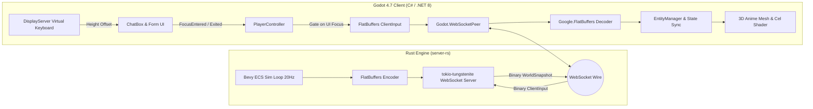

# Specification: Godot 4 + server-rs (Rust) Vertical Slice

> **Date:** 2026-10-13  
> **Status:** Draft / Ready for Implementation  
> **Target:** Godot 4.7 (C# / .NET 8) Client + `server-rs` (Rust ECS Engine)  
> **Goal:** Build an end-to-end vertical slice replacing Colyseus with native WebSocket + FlatBuffers, featuring anime/Genshin-style cel-shading and a cross-platform chat/form input system.

---

## 1. Architectural Overview

---

## 2. Wire Protocol & Serialization (FlatBuffers)

* **Schema Source:** [`schemas/game_protocol.fbs`](file:///Users/pasitnusso/workspace/repos/atlas-world-svc/schemas/game_protocol.fbs)
* **Namespace:** `Atlas.Protocol`
* **Transport:** Native binary WebSocket packets over `Godot.WebSocketPeer`.
* **Zero JIT / Zero Reflection:** Unlike JSON or reflection-heavy Colyseus schemas, Google FlatBuffers reads memory directly from `ByteBuffer` using offset pointers. This provides **100% NativeAOT safety on iOS** and extreme zero-copy performance.

### 2.1 Inbound: `WorldSnapshot` (Server $\to$ Client)
Broadcast at 20 Hz:
* `tick: uint32`
* `server_time_ms: uint64`
* `entities: [EntityDelta]` (`id`, `entity_type`, `pos: Vec2`, `vel: Vec2`, `health`, `max_health`, `state_flags`, `target_id`, `mob_type`)
* `removed_ids: [uint32]`
* `events: [GameEvent]` (`kind: Hit | Kill`, `source_id`, `target_id`, `amount`)

### 2.2 Outbound: `ClientInput` (Client $\to$ Server)
Sent on change or at tick interval:
* `client_tick: uint32`
* `move_x: float`, `move_y: float` (Normalized vector)
* `attack: bool`
* `skill_slot: ubyte`
* `target_id: uint32`, `target_x: float`, `target_y: float`
* `respawn: bool`

---

## 3. Visuals: Anime / Cel-Shading (Genshin Impact Style)

### 3.1 Two-Band Cel Shading
The surface shader replaces continuous Lambertian/PBR falloff with discrete light bands:
$$\text{Diffuse} = \text{clamp}(\vec{N} \cdot \vec{L}, 0.0, 1.0)$$
* $\text{Diffuse} > 0.5 \implies \text{Lit color}$
* $\text{Diffuse} \le 0.5 \implies \text{Shadow tone (Tinted cool/ambient)}$
* Smoothstep threshold (e.g. $[0.48, 0.52]$) to avoid pixel crawling while keeping sharp stylized bands.

### 3.2 Inverted-Hull Outlines
Implemented as a `next_pass` material on the 3D meshes:
* **Cull mode:** `CULL_FRONT` (renders backfaces only).
* **Vertex shader:** Extrudes vertices along vertex normals:
  $$\vec{V}_{\text{clip}} = \vec{V} + \vec{N} \cdot \text{outline\_width}$$
* **Fragment shader:** Outputs solid outline color (`#1A1A24`).
* **Performance:** Extremely cheap, runs on all mobile GPUs without full-screen post-process buffers.

---

## 4. UI Form & Chat Input System

### 4.1 Input Suppression Contract
* When any `LineEdit` or `TextEdit` gains focus, `PlayerController` must immediately stop sending movement intents and clear `_entities.SetLocalMoveHeld(false)`.
* This completely avoids the WASD walking bug while typing in chat.

### 4.2 Responsive Mobile Keyboard Handling
* Listen to `DisplayServer.VirtualKeyboardGetHeight()` in `_Process`.
* If `height > 0`, offset the Chat Container upwards by `(keyboard_height * viewport_scale)` so the text input remains fully visible.
* Tapping `Send` or pressing `Enter` calls `ReleaseFocus()`, hiding the mobile keyboard.

### 4.3 Multilingual & Thai Typography
* Ensure Godot uses `TextServerAdvanced` (default in Godot 4).
* Configure font fallbacks so Thai vowels and tone marks (`่ ้ ๊ ๋ ิ ี ึ ื ุ ู`) render correctly without tofu boxes.

---

## 5. Verification Plan

1. **Codegen Verification:** Compile FlatBuffers C# classes and verify zero compiler warnings with `dotnet build`.
2. **Headless Netcode Verification:** An automated C# test harness connects to `server-rs`, decodes incoming `WorldSnapshot` bytes, and validates entity position decoding.
3. **Shader & UI Verification:** Headless Godot runner checks material instantiation and chat box focus transitions.
