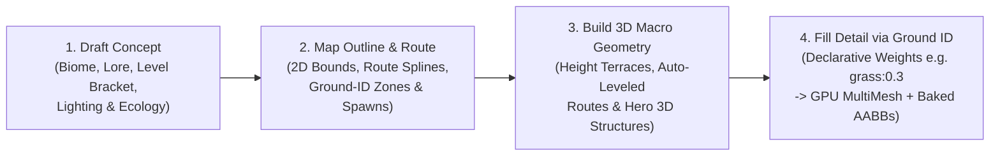

# Systematic 4-Stage Map Creation & Declarative `ground_id` Scatter Pipeline

- **Date:** 2026-10-17
- **Status:** Brainstorm & Architecture Spec (Handoff Ready)
- **Target Schema:** `UnifiedMapDocument` v3 (`content/maps/<map-id>.json` + `content/ground_palettes.json`)
- **Primary Runtime Files:**
  - [`game-client/src/World/UnifiedMapDocument.cs`](file:///Users/pasitnusso/workspace/repos/atlas-world-svc/game-client/src/World/UnifiedMapDocument.cs)
  - [`game-client/src/World/TerrainElevation.cs`](file:///Users/pasitnusso/workspace/repos/atlas-world-svc/game-client/src/World/TerrainElevation.cs)
  - [`game-client/src/World/MapChunkStreamer.cs`](file:///Users/pasitnusso/workspace/repos/atlas-world-svc/game-client/src/World/MapChunkStreamer.cs)
  - [`game-client/assets/shaders/stylized_grass_floor.gdshader`](file:///Users/pasitnusso/workspace/repos/atlas-world-svc/game-client/assets/shaders/stylized_grass_floor.gdshader)
  - [`game-client/src/UI/Widgets/MapBuilderDock.cs`](file:///Users/pasitnusso/workspace/repos/atlas-world-svc/game-client/src/UI/Widgets/MapBuilderDock.cs)

---

## 1. Problem Diagnosis: Why Current Map Authoring Hurts

In `UnifiedMapDocument` v2 ([`content/maps/freja-south-gate.json`](file:///Users/pasitnusso/workspace/repos/atlas-world-svc/content/maps/freja-south-gate.json)), ground detail and road corridors suffer from **three tightly-coupled hardcoding traps**:

1. **Hardcoded `(x, y, z)` Coordinate Pinning in `props[]`:**
   - Every cobblestone road tile (`road_tile_1..8`), grass clump (`grass_clump_01..06`), bush (`bush_01..04`), and perimeter tree (`tree_ring_01..10`) is stored as an explicit `{ id, assetPath, x, y, z, rotY, scale }` entry in JSON alongside a manually mirrored `staticObstacles[]` entry.
   - Authoring a `4000×4000` map by pinning individual `(x, y, z)` coordinates does not scale, bloats JSON diffs, and breaks whenever terrain elevation or road layout changes.
2. **Hardcoded C# Road & Clutter Rules in `TerrainElevation.cs` and `MapChunkStreamer.cs`:**
   - [`TerrainElevation.SampleRawUnflattenedHeight`](file:///Users/pasitnusso/workspace/repos/atlas-world-svc/game-client/src/World/TerrainElevation.cs#L135-L145) hardcodes the spawn plaza at `(0, 0)` and a single North-South road at `|wx| < 2.6m`.
   - [`MapChunkStreamer.AddDeterministicProceduralClutter`](file:///Users/pasitnusso/workspace/repos/atlas-world-svc/game-client/src/World/MapChunkStreamer.cs#L755-L814) hardcodes a 5:1 ratio of `grass_1_a_color1.glb` to `bush_2_a_color1.glb` across the entire map and hardcodes `if (Mathf.Abs(wx) < 2.6f && wz > -22f && wz < 22f) continue;`.
3. **Hardcoded Shader Road Mask in `stylized_grass_floor.gdshader`:**
   - [`stylized_grass_floor.gdshader`](file:///Users/pasitnusso/workspace/repos/atlas-world-svc/game-client/assets/shaders/stylized_grass_floor.gdshader#L112-L118) hardcodes `float road_dist = abs(wp.x + sin(wp.y * 0.12) * 1.2);` instead of reading the map's authored routes and `ground_id` zones.

---

## 2. The 4-Stage Systematic Map Creation Pipeline

Every map in Atlas World is authored top-down through **four progressive, decoupled stages**, where each stage compiles cleanly into the next without manual coordinate pinning:



### Stage 1 — Draft Concept (`concept` block)
Defines the **why** and **atmosphere** of the zone before any geometry is placed:
- **Zone Identity & Bracket:** `mapId`, `name`, `recommendedLevelRange: [1, 15]`, faction owner, and connected neighbor portals (`north -> prontera-city`, `east -> thornveil-woods`).
- **Atmosphere & Lighting Preset:** `defaultTimeOfDayHours`, `skyPreset`, `fogDensity`, `terrainAmplitude` (e.g. `1.0` for rolling meadow, `2.2` for alpine crags, `0.2` for sanctuary plaza).
- **Biome Palette Selection:** Selects the default `baseGroundId` for the map (e.g., `"freja_meadow_lush"`) and the allowed regional `ground_id` overrides.
- **Ecology Roster:** Declares the passive/aggressive monster families and MVP/Mini-Boss anchor for this map.

### Stage 2 — Map Outline & Route (`routes[]` + `groundZones[]` + `spawnAreas[]` + `portals[]`)
Defines the **2D playable flow and surface topology** (observable directly on the 2D SVG Minimap in Atlas Observatory and the in-game minimap):
- **World Bounds & Safe Hubs:** `width`, `height`, and safe zone polygons/circles (`safeZones[]`).
- **Arterial Routes (`routes[]`):** Authored as 2D polyline splines (`points: [[x, z], ...]`, `width: 4.8`, `clearMargin: 2.0`, `groundId: "cobble_road"`).
  - Routes automatically:
    1. Flatten terrain cross-slope along the spline (`TerrainElevation`),
    2. Paint cobblestone/dirt surface shader masks,
    3. Suppress colliding trees/boulders and tall grass inside `width * 0.5 + clearMargin`.
- **Declarative Ground-ID Zones (`groundZones[]`):** Coarse 2D shapes (`rect`, `circle`, or `polygon` with priority + feather radius) that assign a `groundId` (e.g. `"sanctuary_plaza"`, `"meadow_grass"`, `"pine_forest_edge"`, `"crystal_marsh"`, `"barren_cliff"`). Any `(x, z)` not inside an explicit zone falls back to `baseGroundId`.
- **Gameplay Encounters (`spawnAreas[]` & `portals[]`):** Mob spawn rectangles/circles and warp portals placed relative to the routes and regions.

### Stage 3 — Build 3D Macro Geometry (`heightTerraces[]` + `structures[]` + `heroLandmarks[]`)
Builds the **walkable 3D silhouette and verticality** on top of the 2D outline:
- **Elevation Terraces & Ridges (`heightTerraces[]`):** Radial or capsule plateaus (`x, z, radius, height, falloff`) that sculpt walkable hills (`<= 35°` slope) and impassable sheer cliff mesas (`> 35°` slope, auto-colored as rock strata).
- **Route-to-Terrace Ramps:** Where a Stage 2 `route` crosses a `heightTerrace` boundary, `TerrainElevation` smoothly interpolates elevation along the route spline so roads naturally form walkable mountain passes.
- **Walkable 3D Multi-Floor Structures (`structures[]`):** Hero architectural volumes (`watchtower`, `crystal_cave`, bridges, ruins, sanctuary gates) placed at key focal points.
  - Footprints automatically level the underlying ground mesh (`SampleAnalyticalTerrainHeight`) and register roof/wall cutaway canopies with `SmartCameraOccluder`.
- **Zero Ground Clutter Pinning in Stage 3:** Only unique, named hero landmarks (`heroLandmarks[]`, typically `< 10` per map, like a quest statue or boss altar) have explicit `(x, z)` coordinates.

### Stage 4 — Fill Detail via Declarative `ground_id` & Density Weights
Replaces manual `(x, y, z)` prop placement with **data-driven Ground Palettes (`groundDefinitions[ground_id]`)**:
- Each `ground_id` declares:
  1. **Surface Material / Shader Tint:** Base, highlight, and shadow colors + roughness/noise scale.
  2. **Movement Physics:** `friction` / `speedMultiplier` (unifying `docs/terrain.spec.md` with visual ground types).
  3. **Declarative Scatter Layers (`scatter` dictionary / list):** Probability/density weights per cell (e.g. `grass: 0.30`, `wildflower: 0.08`, `bush: 0.04`, `rock_small: 0.02`, `pine_tree: 0.015`).

---

## 3. Declarative `ground_id` Schema (`UnifiedMapDocument` v3)

Instead of listing hundreds of `UnifiedMapProp` coordinates, a map file defines (or references shared presets in `content/ground_palettes.json`) `groundPalettes` and assigns them via `baseGroundId`, `routes[]`, and `groundZones[]`:

```json
{
  "version": 3,
  "mapId": "freja-south-gate",
  "name": "Prontera South Gate — Freja Meadow",
  "seed": 104729,
  "width": 4000.0,
  "height": 4000.0,
  "baseGroundId": "meadow_grass",

  "groundPalettes": {
    "cobble_road": {
      "surfaceType": "stone_path",
      "albedoTint": "#C2B294",
      "friction": 0.85,
      "clearColliders": true,
      "scatter": {
        "road_cobble_trim": {
          "weight": 0.12,
          "assets": ["res://assets/nature/rock_1_a_color1.glb", "res://assets/nature/rock_1_b_color1.glb"],
          "placement": "edge_only",
          "scaleRange": [0.35, 0.65],
          "blocksMovement": false
        }
      }
    },
    "meadow_grass": {
      "surfaceType": "lush_grass",
      "albedoTint": "#529E47",
      "friction": 0.80,
      "maxSlopeDeg": 32.0,
      "scatter": {
        "grass": {
          "weight": 0.30,
          "assets": ["res://assets/nature/grass_1_a_color1.glb"],
          "scaleRange": [0.90, 1.45],
          "blocksMovement": false
        },
        "bush": {
          "weight": 0.05,
          "assets": ["res://assets/nature/bush_2_a_color1.glb"],
          "scaleRange": [0.75, 1.15],
          "blocksMovement": false
        },
        "pebble": {
          "weight": 0.02,
          "assets": ["res://assets/nature/rock_1_c_color1.glb", "res://assets/nature/rock_1_d_color1.glb"],
          "scaleRange": [0.40, 0.80],
          "blocksMovement": false
        }
      }
    },
    "pine_forest_border": {
      "surfaceType": "forest_moss",
      "albedoTint": "#346E36",
      "friction": 0.90,
      "maxSlopeDeg": 30.0,
      "scatter": {
        "grass": {
          "weight": 0.35,
          "assets": ["res://assets/nature/grass_1_a_color1.glb"],
          "scaleRange": [0.85, 1.35],
          "blocksMovement": false
        },
        "bush": {
          "weight": 0.10,
          "assets": ["res://assets/nature/bush_2_a_color1.glb"],
          "scaleRange": [0.85, 1.30],
          "blocksMovement": false
        },
        "canopy_tree": {
          "weight": 0.04,
          "minSpacingMeters": 4.5,
          "assets": [
            "res://assets/nature/tree_1_a_color1.glb",
            "res://assets/nature/tree_2_a_color1.glb",
            "res://assets/nature/tree_3_a_color1.glb"
          ],
          "scaleRange": [1.05, 1.40],
          "blocksMovement": true,
          "colliderHalfExtent": 0.95
        },
        "boulder": {
          "weight": 0.015,
          "minSpacingMeters": 5.0,
          "assets": ["res://assets/nature/rock_3_a_color1.glb", "res://assets/nature/rock_4_a_color1.glb"],
          "scaleRange": [0.90, 1.30],
          "blocksMovement": true,
          "colliderHalfExtent": 1.10
        }
      }
    }
  },

  "routes": [
    {
      "id": "prontera_south_highway",
      "groundId": "cobble_road",
      "width": 5.2,
      "clearMargin": 2.4,
      "points": [[0.0, -95.0], [0.0, -20.0], [0.0, 20.0], [0.0, 95.0]]
    },
    {
      "id": "watchtower_east_spur",
      "groundId": "cobble_road",
      "width": 3.6,
      "clearMargin": 1.8,
      "points": [[0.0, -6.0], [9.5, -6.0], [18.5, -14.0]]
    }
  ],

  "groundZones": [
    {
      "id": "central_sanctuary_clearing",
      "groundId": "meadow_grass",
      "priority": 20,
      "shape": "circle",
      "x": 0.0,
      "z": 0.0,
      "radius": 24.0,
      "feather": 4.0
    },
    {
      "id": "outer_timber_ring",
      "groundId": "pine_forest_border",
      "priority": 10,
      "shape": "annulus",
      "x": 0.0,
      "z": 0.0,
      "innerRadius": 24.0,
      "outerRadius": 180.0,
      "feather": 6.0
    }
  ]
}
```

---

## 4. Deterministic Evaluation Algorithm (Zero Coordinates Stored)

How does `MapChunkStreamer` + `UnifiedMapDocument` turn `{ "grass": 0.30, "bush": 0.05, "canopy_tree": 0.04 }` into identical 3D visuals AND identical server/client collision AABBs without storing `(x, y, z)` coordinates?

### Step 4.1 — `ResolveGroundIdAt(wx, wz)` (Priority Stack)
At any world coordinate `(wx, wz)`:
1. **Structure Footprint Mask:** If `(wx, wz)` is inside `structure.Radius + 3.6m` of any `UnifiedMapStructureVolume` (`watchtower`, `crystal_cave`), return `"structure_foundation"` (0 clutter, flat floor).
2. **Route Spline Corridor:** Compute minimum distance $d_{\text{route}}$ to each polyline in `routes[]`. If $d_{\text{route}} \le \text{route.width} \times 0.5$, return `route.groundId` (`"cobble_road"`). If $d_{\text{route}} \le \text{route.width} \times 0.5 + \text{route.clearMargin}$, mark `inRouteClearance = true` (allows low grass, blocks colliding trees/boulders).
3. **Slope Override:** If `TerrainElevation.SampleSlopeDegrees(wx, wz, doc) > palette.maxSlopeDeg` (e.g. `> 32°` cliff wall), return `"sheer_cliff_rock"` (0 grass/trees).
4. **Authored `groundZones[]` (Highest Priority Wins):** Evaluate `groundZones` ordered by descending `priority`. Using deterministic hash jitter `(Hash2D(wx, wz) - 0.5) * zone.feather`, blend transitions across zone boundaries so forest edges look organic rather than razor-straight.
5. **Fallback:** Return `doc.BaseGroundId` (`"meadow_grass"`).

### Step 4.2 — Two-Tier Grid Sampling per Chunk (`24m × 24m`)
Within each `24m × 24m` chunk `(cx, cz)`, `MapChunkStreamer` runs two deterministic passes using `Hash(doc.Seed, cx, cz, cellX, cellZ, layerId)`:

| Tier | Grid Sub-Cell | Target Scatter Layers | Rendering Path | Collision Path |
| :--- | :--- | :--- | :--- | :--- |
| **Tier A: Micro Ground Cover** (`blocksMovement: false`) | `1.5m × 1.5m` virtual grid (`16×16 = 256` candidate slots per `24m` chunk) | `grass: 0.30`, `wildflower: 0.08`, `bush: 0.05`, `pebble: 0.02` | Batched into chunk-level **`MultiMeshInstance3D`** (1 GPU draw call per `.glb` mesh per chunk, 0 `Node3D` overhead) | None (`blocksMovement: false`) |
| **Tier B: Macro Colliders / Canopy** (`blocksMovement: true`) | `4.0m × 4.0m` jittered Poisson/stratified grid (`6×6 = 36` candidate slots per `24m` chunk) | `canopy_tree: 0.04`, `boulder: 0.015` | Spawned as LOS-fading `Node3D` (when near camera/player) or distant LOD `MultiMeshInstance3D` | Deterministically registers `SpatialObstacleRecord` in `_spatialObstacleGrid` (and exports/synthesizes server `staticObstacles` from the same seed!) |

Because `u = HashFloat(seed, cx, cz, slot)` is 100% deterministic:
- If a layer has `"weight": 0.30`, roughly `30%` of the candidate sub-cells in that `ground_id` zone spawn an instance (`u < 0.30`), with sub-cell jitter `(du, dv)`, deterministic rotation `rotY`, scale lerped in `scaleRange`, and `groundY = TerrainElevation.SampleBaseTerrainHeight(wx, wz, doc)`.
- **Zero `(x, y, z)` coordinates need to be saved in JSON!**
- When an artist sculpts a `heightTerrace` or drags a `route` spline in the Map Builder, all grass, bushes, and trees immediately re-snap their altitude and automatically clear the new road path in real time.

### Step 4.3 — Manual Override Escape Hatch (`props[]` as Sparse Overrides Only)
- `props[]` remains supported for **hero one-off placements** (e.g. a specific campfire, quest signboard, or boss arena totem).
- In addition, a lightweight `exclusionZones[]` (or route/structure masks) suppresses procedural scatter around custom setpieces.

---

## 5. Implementation Roadmap (4 Slices)

1. **Slice 1 — Schema & Ground Palette Resolver (`UnifiedMapDocument` v3):**
   - Add `UnifiedMapGroundPalette`, `UnifiedMapScatterRule`, `UnifiedMapRouteSpline`, and `UnifiedMapGroundZone` to [`UnifiedMapDocument.cs`](file:///Users/pasitnusso/workspace/repos/atlas-world-svc/game-client/src/World/UnifiedMapDocument.cs).
   - Implement `ResolveGroundIdAt(wx, wz)` and distance-to-polyline helper `DistanceToRouteSpline(wx, wz)` with backward compatibility for v2 maps.
2. **Slice 2 — Route-Driven Terrain Flattening & Splat Shader (`TerrainElevation.cs` + `stylized_grass_floor.gdshader`):**
   - Replace hardcoded `|wx| < 2.6f` in [`TerrainElevation.cs`](file:///Users/pasitnusso/workspace/repos/atlas-world-svc/game-client/src/World/TerrainElevation.cs) with spline distance evaluation across `doc.Routes`.
   - Pass a lightweight route/zone splat texture (or uniform spline buffer) to [`stylized_grass_floor.gdshader`](file:///Users/pasitnusso/workspace/repos/atlas-world-svc/game-client/assets/shaders/stylized_grass_floor.gdshader) so painted routes and `ground_id` zones shade automatically.
3. **Slice 3 — Declarative MultiMesh & Collider Scatter (`MapChunkStreamer.cs`):**
   - Upgrade [`MapChunkStreamer.AddDeterministicProceduralClutter`](file:///Users/pasitnusso/workspace/repos/atlas-world-svc/game-client/src/World/MapChunkStreamer.cs#L755-L814) to evaluate `ResolveGroundIdAt(wx, wz)` and sample each `UnifiedMapScatterRule` (`weight`, `assets[]`, `scaleRange`, `blocksMovement`).
   - Migrate [`content/maps/freja-south-gate.json`](file:///Users/pasitnusso/workspace/repos/atlas-world-svc/content/maps/freja-south-gate.json) from 28 hardcoded ground props to declarative `groundPalettes` + `routes` + `groundZones`.
4. **Slice 4 — 4-Stage Stepper UI in `MapBuilderDock.cs` & Atlas Observatory 2D Preview:**
   - Upgrade [`MapBuilderDock.cs`](file:///Users/pasitnusso/workspace/repos/atlas-world-svc/game-client/src/UI/Widgets/MapBuilderDock.cs) into a 4-stage workflow tab bar (`1. Concept` → `2. Outline & Routes` → `3. 3D Terraces & Structures` → `4. Ground ID Weights`) with live sliders for `grass: 0.30`, `bush: 0.05`, `tree: 0.04`.
