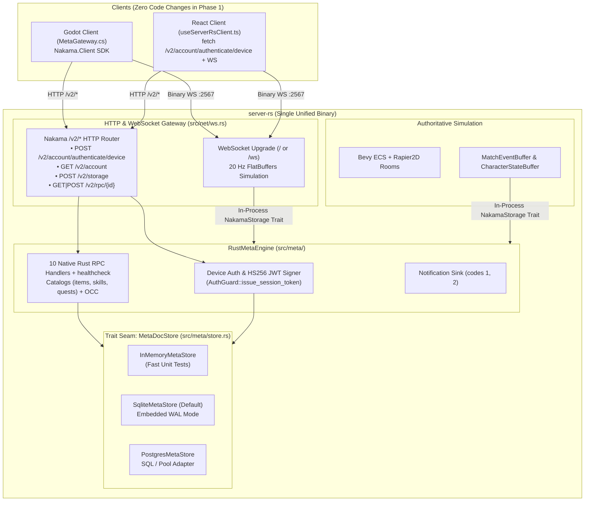

# Native Rust Meta Engine and Trait-Backed Persistence (`server-rs` Nakama Replacement)

- **Date:** 2026-10-18
- **Backlog ID:** `I-198`
- **Target Release:** `release/1.15`
- **Status:** Draft (Pending R0 Spec Gate)

---

## 1. Goal & Non-Goals

### Goal
Replace the external Go/Goja **Nakama + CockroachDB** stack with a native **Rust Meta & Auth Engine (`server-rs/src/meta/`)** built directly into `server-rs`, backed by a trait-based persistence layer (`MetaDocStore`: embedded SQLite WAL by default + Postgres support + in-memory test store) and a drop-in **Nakama `/v2/*` HTTP wire-compatible gateway** so Godot (`MetaGateway.cs`), React (`useServerRsClient.ts`), and `server-rs` real-time rooms run against a single unified Rust binary with zero S2S network overhead and zero external container dependencies in local/single-node deployments.

### Non-Goals
- **Rewriting Godot (`MetaGateway.cs`) or React (`useServerRsClient.ts`) client code in Phase 1:** Phase 1 preserves full wire compatibility with `/v2/account/authenticate/device`, `/v2/account`, `/v2/storage`, and `/v2/rpc/{id}` (both wrapped Nakama SDK envelopes and `?unwrap` raw JSON) so existing clients work unchanged.
- **Social/chat/matchmaking lobbies (Epic `E-008`):** Guilds, party chat, and matchmaking remain out of scope for this slice and will build natively on `server-rs/src/meta/` in `E-008`.
- **Deleting `contracts/content/{items,skills,quests}.json`:** Content JSON files remain the single authored source of truth and are embedded/validated at compile/startup time by `server-rs` via `include_str!`.

### Users & Jobs
- **Game Server Operator / Developer:** Wants `cargo run` (or a single `server-rs` container) to boot the complete authoritative simulation **and** persistent meta-systems (auth, profile, inventory, equipment, skills, quests, character state) in `< 50 ms` without spinning up CockroachDB, Nakama, `migrate.sh`, or the `esbuild` Goja bundler.
- **Godot (`game-client`) & React (`client/react-client`) Clients:** Authenticate device IDs into HS256 session JWTs, read player storage collections (`profile`, `inventory`, `equipment`, `skills`, `quests`), and invoke client RPCs (`equip_item`, `allocate_stats`, `set_skill_loadout`, `accept_quest`, `claim_quest_reward`) over `/v2/*`.
- **`server-rs` Authoritative Simulation Loop:** Hydrates joining players (`get_loadout`) and flushes `CharacterStateBuffer` (`save_character_state`) + `MatchEventBuffer` (`report_match_events`) directly in-process via `Arc<dyn NakamaStorage>` with zero HTTP serialization/loopback latency when running in unified mode.

### Success Measures
1. **100% Contract & Behavioral Parity:** All 10 gameplay RPCs + `healthcheck`, v1→v2 `profile` schema migration, optimistic concurrency (`version` CAS), multi-document atomic transactions (`claim_quest_reward`, `report_match_events`), and catalog referential-integrity validation pass in `cargo test`.
2. **Zero S2S Network Hop in Unified Mode:** `RustMetaEngine` implements `NakamaStorage` directly in-process (`< 0.2 ms` p99 per `get_loadout` / `save_character_state` / `report_match_events` vs `2–15 ms` HTTP S2S round-trip).
3. **Drop-In `/v2/*` Wire Compatibility:** Both `NakamaClient` HTTP integration tests (`tests/nakama_persistence.rs`, `tests/nakama_wiring.rs`) and Nakama SDK client flows (`authenticate/device`, `/v2/account`, `/v2/storage`, `/v2/rpc/*` with and without `?unwrap`) pass unchanged against `server-rs`.
4. **Dual Persistence Backend Verification:** Full unit + integration test suite passes against `InMemoryMetaStore`, `SqliteMetaStore` (WAL file & `:memory:`), and `PostgresMetaStore` (SQL transaction builder / wire protocol).

---

## 2. Architecture Overview



---

## 3. Requirements (EARS Form)

### R1 — Trait-Backed Document & Account Store (`MetaDocStore`)
- **R1.1 (Happy Path — Read & CAS Write):** When `read_doc(user_id, collection, key)` or `write_batch(writes)` is called on a `MetaDocStore` (`InMemoryMetaStore`, `SqliteMetaStore`, or `PostgresMetaStore`), the store shall execute all writes in the batch atomically, verifying that each write's `expected_version` matches the stored `version` (or `"*"` when the document does not yet exist) and assigning a new non-empty `version` string on commit.
- **R1.2 (Failure Twin — CAS Conflict):** If any `DocWrite` in `write_batch(writes)` specifies an `expected_version` that does not match the current stored `version` (including `"*"` when a document already exists), then the `MetaDocStore` shall abort the entire batch without mutating any document in the batch and return `Err(MetaError::VersionConflict)`.
- **R1.3 (Happy Path — Device Account Resolution):** When `authenticate_device(device_id, username_hint, create)` is called with a valid `device_id` (`1..=128` ASCII printable characters), the store shall return the existing `(user_id, username)` bound to `device_id`, or atomically create and persist a new UUIDv4 `user_id` and deterministic/unique `username` when `create == true`.
- **R1.4 (Failure Twin — Device Not Found or Invalid):** If `authenticate_device` is called with an empty `device_id` or with `create == false` for an unknown `device_id`, then the engine shall return `Err(MetaError::BadRequest)` (HTTP `400`) or `Err(MetaError::NotFound)` (HTTP `404`) respectively.

### R2 — Schema Migration & Catalog Integrity
- **R2.1 (Happy Path — Default Docs & `profile` v1→v2 Migration):** When `read_typed_doc` reads any of the 5 player collections (`profile`, `inventory`, `equipment`, `skills`, `quests`), the engine shall return the canonical default document (`version = "*"`) on a storage miss, and if a stored `profile` document has `schemaVersion == 1`, the engine shall migrate it in-memory to `schemaVersion = 2` by preserving existing `allocated` stats and defaulting missing `allocated.dex` to `1`.
- **R2.2 (Failure Twin — Corrupt / Untrusted Schema Version):** If a stored document in `profile`, `inventory`, `equipment`, `skills`, or `quests` has a missing, non-numeric, or unrecognized `schemaVersion < current` (other than `profile` v1), then the engine shall fall back to the collection's canonical `default_doc` while preserving the stored OCC `version` string so a subsequent write overwrites the corrupt payload cleanly.
- **R2.3 (Happy Path — Embedded Catalog Validation):** When `MetaCatalogs::load_embedded()` initializes from `contracts/content/{items,skills,quests}.json`, the engine shall validate all item, skill, and quest definitions and verify cross-catalog referential integrity (every `skill.requires` references a valid `skill.id`, every `quest.rewards.items[].itemId` references a valid `item.id`, and every `quest.objectives[].targetId` is non-empty).
- **R2.4 (Failure Twin — Broken Catalog Cross-Reference):** If `validate_catalog_integrity` encounters an unknown prerequisite `skillId`, an unknown quest reward `itemId`, or an empty quest objective `targetId`, then it shall return an `Err` naming the offending catalog entry ID and target ID.

### R3 — Native Rust Gameplay RPCs (S2S and Client Session)
- **R3.1 (Happy Path — S2S RPCs):** When an S2S caller (`ctx.user_id == None`, authenticated via `http_key` or in-process `NakamaStorage`) invokes `get_loadout`, `save_character_state`, `report_match_events`, `grant_xp`, or `grant_loot`, the `RustMetaEngine` shall execute the RPC with exact parity to `nakama/src/rpc/*.ts`:
  - `get_loadout`: hydrates `LoadoutSnapshot` from the 5 collections + `character_state`, resolving equipped `instanceId`s to `itemId`s via `inventory.uniques` (resolving missing/stale `instanceId`s to `None`).
  - `save_character_state`: deduplicates when `seq <= current.seq` (`{"deduped":true,"seq":current.seq}`), otherwise persists `CharacterStateDoc` (`{"deduped":false,"seq":seq}`).
  - `report_match_events`: deduplicates per `matchId` when `seq <= quests_seq[matchId]` (`{"deduped":true}`), otherwise folds matching `MOB_KILLED` / `ITEM_PICKED_UP` / `ZONE_ENTERED` events into active quests, atomically writes `quests` + `quests_seq`, records notifications (`code = 1` for progressed, `code = 2` for completed), and returns `{"deduped":false,"progressed":[...],"completedNow":[...]}`.
  - `grant_xp`: applies XP (`xp_to_next(level) = 100 * level`, `+3 statPoints` per level-up) with up to 2 OCC write attempts.
  - `grant_loot`: merges stackable items or appends unique item instances with fresh UUIDv4 `instanceId`s with up to 2 OCC write attempts.
- **R3.2 (Failure Twin — S2S Auth Enforcement & Attribution Guard):** If an authenticated client session (`ctx.user_id.is_some()`) invokes any S2S-only RPC (`get_loadout`, `save_character_state`, `report_match_events`, `grant_xp`, `grant_loot`), or if `report_match_events` contains an event whose `event.userId != batch.userId`, then the engine shall reject the call with `Err(MetaError::Forbidden)` / `Err(MetaError::BadRequest)`.
- **R3.3 (Happy Path — Client Session RPCs):** When an authenticated client (`ctx.user_id == Some(uid)`) invokes `equip_item`, `allocate_stats`, `set_skill_loadout`, `accept_quest`, or `claim_quest_reward`, the engine shall validate the caller's ownership/points/unlocks/quest state and persist the updated document(s) (using an atomic 3-doc batch for `claim_quest_reward` across `profile`, `inventory`, and `quests`).
- **R3.4 (Failure Twin — Unauthenticated or Invalid Client RPC):** If an S2S/unauthenticated caller (`ctx.user_id == None`) invokes a client-only RPC, or if the caller attempts to equip an unowned `instanceId`, spend more `statPoints` than available, equip > 4 or locked skills, accept an unknown/active/completed quest, or claim an uncompleted/already-claimed quest, then the engine shall reject the call without mutating storage.

### R4 — Drop-In Nakama `/v2/*` HTTP Gateway & Unified `server-rs` Wiring
- **R4.1 (Happy Path — `/v2/*` Endpoints on `WsServer`):** When `WsServer` receives an HTTP request for `/v2/account/authenticate/device`, `/v2/account`, `/v2/storage`, or `/v2/rpc/<id>` (on the primary `PORT` `2567` listener or optional `META_PORT` `7350` listener), it shall route the request to the attached `RustMetaEngine`:
  - `POST /v2/account/authenticate/device`: validates Basic auth against `NAKAMA_SERVER_KEY` (default `"defaultkey"` in dev), authenticates the device, and returns `200 OK` with `{"token":"<hs256_jwt>"}`.
  - `GET /v2/account`: validates `Authorization: Bearer <jwt>` and returns `200 OK` with `{"user":{"id":"<uid>","username":"<usn>"}}`.
  - `POST /v2/storage`: validates `Authorization: Bearer <jwt>`, reads requested `object_ids` owned by `<uid>` with `permission_read >= 1`, and returns `{"objects":[...]}` where each `value` is the serialized JSON string of the document.
  - `GET|POST /v2/rpc/<id>`: authenticates either `?http_key=<key>` (S2S) or `Authorization: Bearer <jwt>` (client), accepts both raw JSON objects and JSON-encoded string payloads, and returns raw JSON when `?unwrap` is present in query string or `{"payload":"<json_string>"}` when `?unwrap` is absent.
- **R4.2 (Failure Twin — Unauthorized `/v2/*` Requests):** If a `/v2/*` request supplies an invalid/missing Basic key, `http_key`, or Bearer JWT (except `/v2/rpc/healthcheck`), then the gateway shall return HTTP `401 Unauthorized` with a JSON error body and never leak internal keys.
- **R4.3 (Happy Path — Unified In-Process `server-rs` Mode):** When `server-rs` starts with `META_DB_URL` set (or in default embedded SQLite mode when external `NAKAMA_URL` is unset), `server-rs` shall instantiate `RustMetaEngine` in-process, wire it into `WsServer` and the simulation flush loops via `Arc<dyn NakamaStorage>`, and serve `/v2/*` HTTP routes without requiring an external Nakama process.

---

## 4. Acceptance Criteria & End-to-End Verification

| ID | Given | When | Then |
|---|---|---|---|
| **AC-1** | `SqliteMetaStore` (WAL) and `InMemoryMetaStore` | `write_batch` is called with valid `version = "*"` then updated with the returned `version`, and called again with a stale `version` | First two writes succeed and return distinct versions; the stale write returns `MetaError::VersionConflict` and leaves all docs in the batch untouched. |
| **AC-2** | A `profile` v1 document `{ "schemaVersion": 1, "level": 3, "xp": 50, "statPoints": 6, "allocated": { "str": 4, "agi": 2, "int": 1, "vit": 3 } }` | `get_loadout` or `read_typed_doc` reads the player's profile | It migrates to `schemaVersion: 2` with `allocated.dex == 1` and preserves `level: 3, xp: 50, statPoints: 6`. |
| **AC-3** | `RustMetaEngine` with embedded `items.json`, `skills.json`, `quests.json` | S2S and client RPCs (`grant_xp`, `grant_loot`, `equip_item`, `allocate_stats`, `set_skill_loadout`, `accept_quest`, `report_match_events`, `claim_quest_reward`, `save_character_state`, `get_loadout`) are executed | Every RPC matches the exact JSON schema, leveling curve (`100 * level`, `+3 statPoints`), quest progression, and OCC semantics of `nakama/src/rpc/*.ts`. |
| **AC-4** | `WsServer` with `RustMetaEngine` attached | A client calls `POST /v2/account/authenticate/device?create=true`, `GET /v2/account`, `POST /v2/storage`, `POST /v2/rpc/allocate_stats` (wrapped), and `NakamaClient` calls `POST /v2/rpc/get_loadout?http_key=...&unwrap` | All HTTP calls succeed with 200 OK, issue a valid HS256 JWT accepted by WebSocket join, and hydrate the player's live ECS entity in `server-rs`. |

### End-to-End Verification Command
```bash
cargo test --manifest-path server-rs/Cargo.toml && ./scripts/precheck.sh --no-install
```

---

## 5. Interfaces & Files Touched

- **`server-rs/Cargo.toml`**: Add `rusqlite = { version = "0.32", features = ["bundled"] }` for zero-system-dependency embedded SQLite WAL persistence.
- **`server-rs/src/meta/mod.rs`** *(new)*: Module exports for `store`, `catalogs`, `models`, `engine`, and `http`.
- **`server-rs/src/meta/models.rs`** *(new)*: Rust types and `serde` schemas for `InventoryDoc`, `EquipmentDoc`, `SkillsDoc`, `QuestsDoc`, `QuestDef`, `ItemDef`, `SkillDef`, and schema migration helpers (`migrate_profile_v1_to_v2`).
- **`server-rs/src/meta/catalogs.rs`** *(new)*: Compile-time embedded `items.json`, `skills.json`, `quests.json` loader + `validate_catalog_integrity`.
- **`server-rs/src/meta/store.rs`** *(new)*: `MetaDocStore` trait, `DocWrite`, `StoredDoc`, `UserAccount`, `InMemoryMetaStore`, `SqliteMetaStore` (WAL mode), and `PostgresMetaStore` adapter.
- **`server-rs/src/meta/engine.rs`** *(new)*: `RustMetaEngine` implementing all 10 RPCs + `healthcheck` AND implementing `crate::storage::NakamaStorage` for zero-hop in-process `server-rs` calls.
- **`server-rs/src/meta/http.rs`** *(new)*: Nakama `/v2/*` wire-compatible HTTP router (`/v2/account/authenticate/device`, `/v2/account`, `/v2/storage`, `/v2/rpc/*` with wrapped + `?unwrap` support and CORS headers).
- **`server-rs/src/auth/jwt.rs`**: Add `AuthGuard::issue_session_token(user_id, username, ttl_secs)` so `server-rs` can mint Nakama-compatible HS256 session JWTs as well as verify them.
- **`server-rs/src/net/ws.rs`**: Route `/v2/...` HTTP requests on `WsServer` to `RustMetaEngine` and accept `Arc<dyn NakamaStorage>` alongside `NakamaClient`.
- **`server-rs/src/main.rs`**: Initialize embedded `RustMetaEngine` (via `META_DB_URL` / default SQLite path when external `NAKAMA_URL` is not set) and optionally bind `META_BIND_ADDR` (e.g. `0.0.0.0:7350`).
- **`server-rs/tests/rust_meta_engine.rs`** *(new)*: Comprehensive unit + E2E wire tests covering all 10 RPCs, OCC conflicts, SQLite WAL persistence across restarts, `/v2/*` SDK envelope vs `?unwrap`, and live WebSocket join hydration.

---

## 6. Alternatives Considered

1. **Do Nothing (Keep Go Nakama + CockroachDB):**
   - *Why it lost:* Requires running 2 extra containers (`nakama` + `cockroachdb`) and `./migrate.sh` for 900 lines of TS logic, suffers from Goja ES5 runtime quirks, duplicates types/math across TS and Rust, and adds an HTTP S2S hop on every join and state flush.
2. **Separate `meta-rs` Microservice Binary Only:**
   - *Why it lost:* Forces an HTTP hop even in single-node/dev deployments and requires managing two Rust processes. Building `meta` inside `server-rs` behind `MetaDocStore` + `NakamaStorage` traits gives zero-hop in-process speed by default while still allowing `server-rs` to point at an external URL or shared Postgres when scaling horizontally.
3. **Clean-Break Custom REST API (Dropping `/v2/*` Compatibility):**
   - *Why it lost:* Would break `game-client/src/Meta/MetaGateway.cs` (which uses the `Nakama.Client` NuGet package) and `client/react-client/src/hooks/useServerRsClient.ts` simultaneously. Supporting the 4 `/v2/*` endpoints in `server-rs/src/meta/http.rs` is ~180 lines of Rust and makes the migration 100% non-breaking for all clients.

---

## 7. Assumptions

- `ASSUMED: Default local persistence uses embedded SQLite in WAL mode (META_DB_PATH defaulting to data/atlas_meta.db, or in-memory when neither META_DB_PATH nor NAKAMA_URL is set in tests) — reversible: Y`
- `ASSUMED: External NAKAMA_URL + NAKAMA_HTTP_KEY remains supported as an override so existing Nakama wiring tests and external deployments continue to work without regression — reversible: Y`
- `ASSUMED: /v2/* endpoints are served directly on the primary server-rs port (2567) AND optionally on META_PORT (e.g. 7350) when configured, so clients pointed at either port work seamlessly — reversible: Y`
- `ASSUMED: Session JWTs minted by POST /v2/account/authenticate/device use HS256 signed with AuthGuard's secret and default to a 7-day (604,800s) expiration matching local.yml — reversible: Y`
