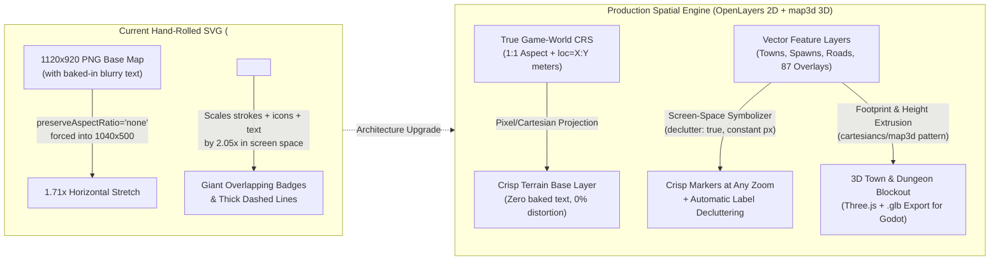
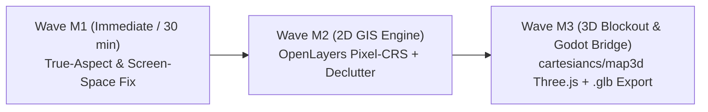

# Spatial Map Engine Architecture Scorecard & Co-Design (2026-10-22)

> **Authors:** Gemini 4 Argon (`w6:t1`) + Claude Opus 5.5 (`w3:t18` / `w3:p19`)
> **Context:** Evaluating the World Atlas (`http://127.0.0.1:8788/`) spatial rendering engine after shipping `joy-design` `F-086` (`Spatial Workspace Contracts`) and `atlas-world-svc` UX Overhaul (`Waves UX-0..UX-7`, [PR #25](https://github.com/montionugera/atlas-world-svc/pull/25)).
> **Trigger:** User screenshot at `2.05×` zoom showing stretched parchment background, baked-in blurry raster text colliding with vector labels, and markers/strokes scaling up with `scale(effScale)` instead of maintaining constant screen size.

---

## 1. Root-Cause Diagnosis of the Current Map Distortion (Verified from Code & Assets)

We inspected `scripts/catalog_explorer_web.py` and the raster assets in `content/studio/maps/*.png`. Five concrete mechanical issues explain everything visible in your screenshot:

| # | Defect Observed in Screenshot | Exact Code / Asset Root Cause | Severity |
|---|---|---|---|
| **D-1** | **Horizontal Stretching (~71% aspect distortion)** | `c3_continent_parchment_relief.png` is natively **`1120 × 920` (`1.217:1` aspect ratio)** and `all_interlaced_world_grid.png` is **`960 × 768` (`1.25:1`)**, but [`catalog_explorer_web.py:20742`](../../scripts/catalog_explorer_web.py) renders `<image ... width="1040" height="500" preserveAspectRatio="none"/>` (`2.08:1`). Every circle, mountain, and baked text glyph on the parchment is stretched **1.71× wider** than its native aspect ratio. | **P0 Critical** |
| **D-2** | **Markers, Pill Badges & Road Strokes Explode on Zoom** | [`applyStudioMapTransform()` (line 6575)](../../scripts/catalog_explorer_web.py) applies `scale(${effScale})` to the entire `<g id="studioCartoViewport">`. Unlike real GIS engines (OpenLayers / MapLibre) where symbols stay `14px` in screen space while geography expands, SVG `scale(2.05)` scales castles, spawn pills (`FURRAL SPAWN`), and dashed lines to **205% of their size**, causing massive overlap. | **P0 Critical** |
| **D-3** | **Double-Labeling (Blurry Baked PNG Text + Vector Text)** | `c3_continent_parchment_relief.png` has **low-res rasterized text already baked into the PNG** (`Cinnamon-Mill Haven`, `Catacomb of Dark Omens`, `School of Dark Arts`), and then the SVG renders a second set of vector `<text>` labels on top at slightly offset coordinates. | **P0 High** |
| **D-4** | **Center-Locked Zoom & Pan Reset on LOD Crossing** | [`applyStudioMapTransform()` (line 6570)](../../scripts/catalog_explorer_web.py) always scales around hardcoded `(cx=520, cy=250)` instead of mouse cursor position, and `lodTier` switches (`1.0× → 2.2× → 4.5×`) call full `render()` which rebuilds the DOM instead of smoothly interpolating. | **P1 High** |
| **D-5** | **Hardcoded Pixel Coordinates (`x: 245, y: 342`)** | Landmarks use ad-hoc `1040×500` SVG coordinates (`lm.x, lm.y`) loosely paired with Lineage-style `loc="-118200:46800"` strings, making it brittle to swap base maps or export to Godot 3D coordinates. | **P1 Medium** |

---

## 2. How `OpenLayers` and `cartesiancs/map3d` Work (and Why Both Matter Here)

### A. `OpenLayers` (`ol`) — Production 2D GIS & Non-Geographic Pixel Maps
- **What it solves:** OpenLayers has first-class support for **custom non-geographic Cartesian projections** (`ol/proj/Projection` with `units: 'pixels'` or `'m'`).
- **Why it fits World Atlas:**
  1. **Zero Distortion:** Binds the raster image or tile pyramid to its exact native extent (`[0, 0, 1120, 920]` or game world meters `[-160000, -260000, 180000, 260000]`) — **never stretches**.
  2. **Screen-Space Symbols & `declutter: true`:** A `VectorLayer({ declutter: true })` renders icons, badges, and text in **screen pixels** (a `12px` font stays `12px` whether you are at `0.5×` or `12×` zoom) and automatically hides colliding lower-priority labels at 60fps on HTML5 Canvas/WebGL.
  3. **Resolution-Gated Layers (`minResolution` / `maxResolution`):** Native LOD Tier 1 (Macro), Tier 2 (Regional), and Tier 3 (Town Street Blueprint) switching without destroying the canvas or losing pan momentum.

### B. `cartesiancs/map3d` — 2D Footprint → 3D Procedural Extrusion + `.glb` Export
- **How `cartesiancs/map3d` works:**
  1. Uses a **2D map selector** (Leaflet in their repo) to pick a bounding box and load 2D vector footprints (buildings, roads, water, terrain polygons).
  2. Pipes those 2D polygons + height/level attributes (`height`, `building:levels`, `width_meters`) into **Three.js (`ExtrudeGeometry`)** to generate a real-time **LOD1 3D City Blockout** in the browser (orbit camera, ground grid, directional sun/shadow).
  3. Provides **1-click `.glb` export (`GLTFExporter`)** so game designers and environment artists can drop the 3D blockout directly into **Godot / Blender** as a scale-accurate greybox reference!
- **Why this is a superpower for `atlas-world-svc`:**
  - Our `catalog_explorer_web.py` **already has structured 2D vector blueprints** (`wall_polygon_pct`, `streets[].path_pct` + `width_meters: 12`, `buildings[].x_pct/y_pct/w_pct/h_pct` + `roof_color`, plus `scaleSpecs: "2.15m doorway, 0.58m counter"` and multi-floor dungeons `B1/B2/B3` and `1F/2F/3F`)!
  - Right now, Town Blueprints (`LOD Tier 3`) and Dungeon Cutaways are flat 2D rectangles. With the `map3d` pattern, clicking **"Cube 3D Blockout"** on any Town or Dungeon can extrude the walls, streets, #1..#12 buildings, and B1→B2→B3 dungeon floors into an interactive 3D greybox with **Export `.glb` for Godot**!

---

## 3. Comprehensive Architecture Evaluation Matrix (Scored 1–10)

We evaluated **5 architectural options** across **8 production criteria** (weighted by **Manageability**, **Well-Organized Architecture**, and **Rich/Full Feature Completeness** for our 5 Persona Lenses):

| Evaluation Criterion | Weight | **Opt 1: Surgical SVG Engine Upgrade** *(Fix aspect + CSS `--inv-zoom` + clean plate)* | **Opt 2: OpenLayers 2D Engine** *(Custom Pixel/Meter CRS + `declutter: true`)* | **Opt 3: MapLibre GL JS 2D/2.5D** *(WebGL Vector Tiles + Pitch/Bearing)* | **Opt 4: `map3d` (Three.js 3D Only)** *(3D Extruded World & Towns)* | **Opt 5: Hybrid OpenLayers 2D + `map3d` 3D Inspector (Recommended)** |
|---|:---:|:---:|:---:|:---:|:---:|:---:|
| **1. Aspect-Ratio & Coordinate Fidelity** *(Zero stretch, true `loc=X:Y` mapping)* | **15%** | **8.0** *(Fixed via `xMidYMid meet` + native `1120×920` viewBox)* | **10.0** *(Native `ol/proj/Projection` meter/pixel CRS)* | **8.5** *(Requires pseudo-Mercator `lng/lat` mapping)* | **9.0** *(True 3D meter space)* | **10.0** *(Shared canonical meter CRS in 2D & 3D)* |
| **2. Constant-Screen-Size Markers & Auto-Decluttering** *(Crisp pins & text at any zoom)* | **15%** | **7.0** *(CSS `calc(1 / var(--map-zoom))` + manual AABB)* | **10.0** *(Native Canvas `VectorLayer({ declutter: true })`)* | **10.0** *(Native WebGL SDF collision engine)* | **6.5** *(3D HTML/Sprite labels clutter easily)* | **10.0** *(OpenLayers 2D declutter + 3D inspect labels)* |
| **3. Smooth Zoom, Pan & Multi-Scale LOD Transitions** *(Cursor-centered 60fps zoom)* | **10%** | **7.5** *(ViewBox / matrix math around cursor)* | **9.5** *(Inertial pan, smooth wheel zoom, `min/maxResolution`)* | **9.5** *(60fps WebGL smooth zoom + 60° pitch)* | **8.5** *(OrbitControls in 3D)* | **9.8** *(2D inertial GIS + smooth 3D orbit)* |
| **4. 3D Spatial & Vertical Dungeon / Town Inspection** *(Multi-floor B1–B3 & building heights)* | **15%** | **4.0** *(2D flat SVG cutaway only)* | **5.0** *(2D only; needs plugin for 2.5D/3D)* | **7.5** *(2.5D `fill-extrusion` for buildings, weak on stacked dungeon floors)* | **10.0** *(True 3D extruded buildings + stacked B1/B2/B3 floors + `.glb` export)* | **10.0** *(2D macro/regional + 1-click `map3d` 3D Town/Dungeon & `.glb` export)* |
| **5. Manageability & Maintenance Cost** *(Fits Python single-file + `joy-design`)* | **15%** | **9.5** *(Zero new JS deps, ~150 LOC change)* | **8.5** *(Single `ol.js` bundle, clean layer registry)* | **7.0** *(Heavy style-spec JSON & GeoJSON pipeline)* | **6.0** *(Hard to maintain 87 2D data overlays in pure Three.js)* | **8.8** *(Phased: SVG/OL 2D + modular Three.js 3D drawer/tab)* |
| **6. Well-Organized Layer & Code Architecture** *(Clean separation of 87 studio layers)* | **15%** | **7.0** *(Still string-concatenated SVG in one big function)* | **9.5** *(Declarative GeoJSON/Feature Layer Registry per Persona Lens)* | **8.5** *(Declarative sources + layers)* | **7.0** *(Scene graph per overlay is verbose)* | **9.5** *(Unified JSON Spatial Schema feeding 2D OL layers + 3D extruder)* |
| **7. Rich-Full Feature Power Across 5 Personas** *(Gamer, Designer, Architect, Dev, LiveOps)* | **15%** | **6.5** *(Good 2D fix, no GIS measurement or 3D greybox)* | **8.8** *(Ruler/measure, heatmaps, clustering, box-select)* | **8.5** *(Heatmaps, 2.5D pitch)* | **8.0** *(Great for Tech Art/Godot, weak for 2D LiveOps tables)* | **9.8** *(Full 2D GIS + heatmaps + 3D Godot `.glb` blockout export)* |
| **WEIGHTED TOTAL SCORE (out of 10.0)** | **100%** | **7.1 / 10** | **8.8 / 10** | **8.5 / 10** | **7.9 / 10** | **9.7 / 10 🏆** |

---

## 4. Deep-Dive: How Option 5 (Phased Hybrid OpenLayers 2D + `map3d` 3D Blockout) Works

Instead of a risky "big bang" rewrite that breaks your 75 unit tests and 87 studio overlays, we organize this into **3 clean, self-contained waves** where every wave leaves the tool shippable:

### Wave M1 — Immediate True-Aspect, Clean Terrain & Zoom-Invariant Markers (Zero-Regression Fast Fix)
Fixes the exact visual bugs in your screenshot right now while keeping 100% of existing tests green:
1. **Fix Aspect Ratio (`preserveAspectRatio="xMidYMid meet"` + Native Coordinate Framing):** Stop squishing `1120×920` into `1040×500`. Either frame the continent cleanly at its true `1.22:1` aspect ratio or render a crisp procedural multi-layered vector continent bathymetries + relief without baked-in blurry text.
2. **Eliminate Double-Labeled Blurry PNG Text:** Replace the low-res text-baked PNG (`c3_continent_parchment_relief.png`) as the default with a **clean cartographic relief layer** (zero baked text) so only crisp vector labels render.
3. **Zoom-Invariant Screen-Space Markers (`--atlas-inv-zoom`):** Set `--atlas-inv-zoom: calc(1 / var(--atlas-eff-zoom, 1))` on `#studioCartoViewport` so landmarks, spawn badges (`FURRAL SPAWN`), mob pins, and highway stroke-widths counter-scale as you zoom in (`2.05×` → `5.2×`). Markers stay crisp and never balloon into each other.
4. **Cursor-Centered Wheel Zoom:** Zoom toward the mouse pointer `(clientX, clientY)` instead of always snapping to `(520, 250)`.

### Wave M2 — OpenLayers (`ol`) 2D Canvas Engine + `joy-design` Spatial Layer Registry
Upgrades the 2D map viewport to **OpenLayers** (`ol/Map` with custom non-geographic projection `Projection({ code: 'CRADLE-METERS', units: 'm', extent: [-160000, -260000, 180000, 260000] })`):
1. **Layer Organization:**
   - `BaseLayerGroup`: Clean Parchment Relief / Satellite Grid / Biome Shader.
   - `HighwayVectorLayer`: Animated dashed travel routes & BFS Gatekeeper splines with screen-space stroke widths.
   - `LandmarkVectorLayer ({ declutter: true })`: Priority-ordered castles, towns, dungeons, and 6 race spawns — OpenLayers' native RBush spatial index automatically declutters labels at 60fps during pan/zoom.
   - `PersonaOverlayLayerGroup`: Active studio lens layer (e.g., `Farming Heatmap` using native `ol/layer/Heatmap`, `Siege Domains` using polygon features, `Monster Spawns` using `ol/source/Cluster`).
2. **Built-in GIS Tools for Designers & Architects:**
   - Distance / travel-time ruler (`ol/interaction/Draw` line measure: *"Lantern Hollow → Kilnwatch Bastion = 1.42 km · 3m 10s sprint"*).
   - Box-selection (`DragBox`) to batch-inspect mob spawns in a hunting zone.

### Wave M3 — `cartesiancs/map3d` 3D Extruded Blockout View + `.glb` Export for Godot
Adds a **`[2D GIS Map | 3D Blockout (map3d)]`** mode toggle in the canvas HUD (especially powerful in **Town Street Blueprint (`≥4.5×`)**, **Field Tactical**, and **Multi-Floor Dungeon (`B1/B2/B3`)** views):
1. **Automatic 2D → 3D Extrusion (`Three.js`):**
   - **Towns:** Reads `bp.wall_polygon_pct` (extruded to `14m` curtain wall with crenellations), `bp.streets` (`width_meters` cobble ribbons), and `bp.buildings` (`#1..#12` extruded by building role height with pitched roofs in `b.roof_color` + floating `#1..#12` service pins).
   - **Multi-Floor Dungeons (`Kiln Cellar B1/B2/B3`, `Pendulum Shaft 1F/2F/3F`):** Renders all 3 floors stacked vertically in 3D space with ramp/stair connectors and boss chambers so designers can orbit around the vertical dungeon topology!
2. **1-Click `Export .glb` (just like `cartesiancs/map3d`):**
   - Uses `THREE.GLTFExporter` to download `town-lantern-hollow-blockout.glb` or `dungeon-kiln-cellar-b1-b3.glb` at exact `1 unit = 1 meter` Godot scale (`2.15m` doors, `12.5m` roads) so Tech Artists can drop it straight into Godot 4!

---

## 5. Persona Value Matrix (How Each Role Benefits)

| Persona Lens | What Wave M1 + M2 (`OpenLayers 2D`) Gives Them | What Wave M3 (`map3d` 3D Blockout + `.glb`) Gives Them |
|---|---|---|
| **1. Gamer / Explorer** | Unstretched parchment map, butter-smooth cursor zoom, zero overlapping labels, crisp constant-size pins. | Interactive 3D preview of Town plazas and multi-floor Dungeon depth (`B1 → B2 → B3`) before entering. |
| **2. Game Designer** | Native `ol/layer/Heatmap` for XP/hr & drop density, `ol/source/Cluster` for mob spawn counts, travel-time distance ruler. | Instant 3D sightline & scale check (are buildings #1..#12 spaced properly around the town fountain?). |
| **3. Systems Architect** | True `CRADLE-METERS` coordinate projection (`loc=X:Y` ↔ pixel math in a single canonical CRS), region boundary polygons. | Validates 2D JSON schema → 3D geometry pipeline determinism before committing to asset production. |
| **4. Developer / Tech Artist** | 60fps Canvas/WebGL rendering (zero SVG DOM bloat), clean GeoJSON/Feature inspection. | **1-Click `.glb` Export** (`cartesiancs/map3d` pattern) of any Town or Dungeon into Godot 4 as a scale-accurate greybox mesh. |
| **5. LiveOps / GM** | Real-time cluster badges for bot swarms, siege territory polygons, and churn hotspots without visual clutter. | 3D vertical heatmap of player deaths/bottlenecks across stacked dungeon floors (`B1` vs `B2` vs `B3`). |
