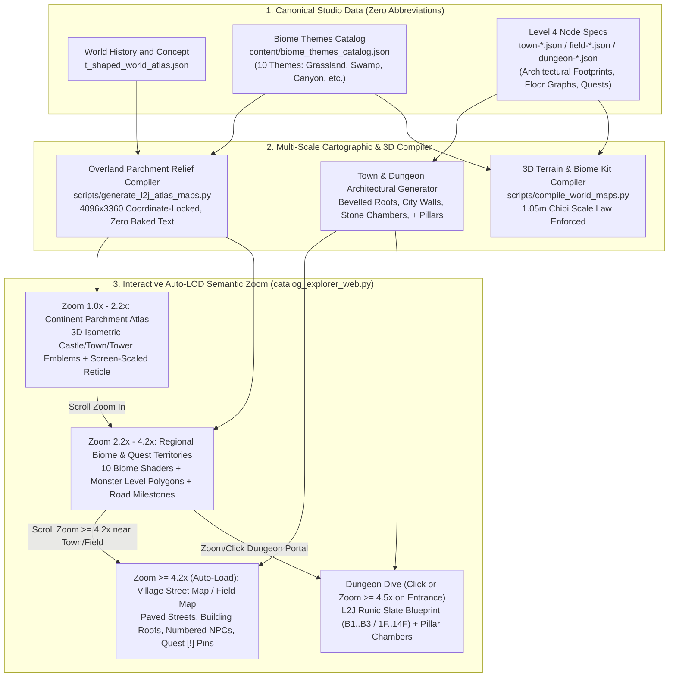
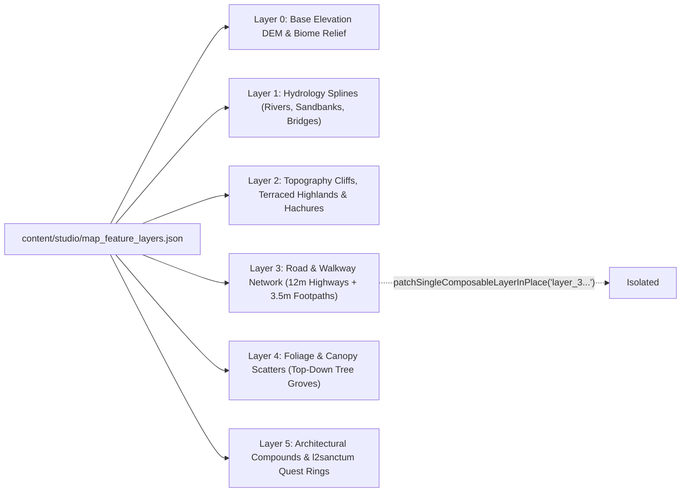

# Lineage II-Grade Multi-Scale Cartography, Biome Theme Pipeline & Semantic Zoom Architecture

- **Date:** 2026-10-25
- **Repository:** `atlas-world-svc`
- **Target Scope:** Four-Level Top-Down Studio (`World History and Concept` -> `Continent` -> `District` -> `Town or Hunting Area`) + Multi-Floor Dungeon Sub-Maps + Starter Village Quest/Codex Library
- **Reference Corpus:**
  - `https://legacy-lineage2.com/downloads/map.html` (Village & Castle Town architectural maps: Talking Island, Gludin, Gludio, Dion, Giran, Oren, Aden, Elven/Dark Elven/Orc/Dwarf Villages)
  - `https://l2j.ru/index.php?p=10` (C3/Interlude World Relief Map, Dungeon Floor Blueprints: Elven Ruins, Cruma Tower 1–3, Ant Nest, Catacombs/Necropolises, Antharas' Lair, Tower of Insolence 1–14, Top-Down World Radar `all_interlaced.jpg`)
  - `https://legacy-lineage2.com/background/making.html` & `making_2.html` (Mythology-first world frame, South-to-North / West-to-East elevation & difficulty gradient, racial village environmental storytelling)
  - `https://legacy-lineage2.com/background/interludelist.html` & `Knowledge/quest.html` (The Library taxonomy, NPC-anchored starter quests, repeatable hunting vs. one-time progression quests)

---

## Orientation

We are upgrading the `atlas-world-svc` map and world-building pipeline so our overland continent atlas, area biome themes, town street blueprints, and multi-floor dungeons match the cartographic depth and seamless zoom behavior of **Lineage II (Chronicle 3 / Interlude)** and **L2J.ru**. Right now, our overland view draws three smooth vector blobs over an unrelated procedural PNG (`1120x920`), zooming to `2.8x–5.2x` blurs the raster and inflates a giant unscaled red crosshair (`#studioL2Crosshair`), and sub-maps require manual lens buttons rather than auto-streaming detail on zoom.

**Three key architectural decisions:**
1. **Coordinate-Locked Multi-Resolution Cartographic Compiler (`scripts/generate_l2j_atlas_maps.py`):** Replace the mismatched noise island with a terrain/parchment generator driven **100% by the canonical continent/district polygons, river splines, road networks, and 10+ biome masks** from `t_shaped_world_atlas.json` — with **zero baked duplicate text** (all labels and pins rendered crisply in vector/screen-space).
2. **Cursor-Centered Auto-LOD Semantic Zoom (`scripts/catalog_explorer_web.py`):** Upgrade `zoomStudioMap()` so zooming past `2.4x` reveals regional biome terrain & monster territory contours, zooming past `4.2x` near a Town/Castle **auto-loads its inline Town Street & NPC Blueprint**, and clicking/zooming into a Dungeon entrance (`>=4.5x`) **dives directly into the Multi-Floor Dungeon Labyrinth (`B1..B3` / `1F..14F`)**.
3. **10-Biome Theme Engine + T-Shaped Starter Slice (`D01 Teacup Meadows`):** Define full 2D cartographic + 3D terrain/prop/lighting kits (`1.05m` chibi scale law enforced) for all 10+ requested biome themes (`Grassland`, `Swamp`, `Canyon`, `Rainforest`, `Valley`, `Volcano Cave`, `God Valley`, `Sea Cave`, `Underground Cave`, `Giant Tower`) and prove them at reference quality on the **D01 Teacup Meadows** vertical slice (`Lantern Hollow` Town + adjacent `Grassland`/`Swamp`/`Canyon` fields + `Kiln Cellar` 3-Floor Dungeon + NPC Quests) before expanding across all 63 zones.

**Assumed Defaults (`ASSUMED`):**
- `ASSUMED`: Keep OpenLayers + SVG hybrid canvas in `scripts/catalog_explorer_web.py`, fixing `--atlas-inv-zoom` on `#studioL2Crosshair` and adding smooth auto-LOD drill-down with a toggle lock (`Auto-Drill on Zoom: ON`).
- `ASSUMED`: Preserve all Four-Level Top-Down Studio Zero-Abbreviation rules (`World History and Concept`, `Continent`, `District`, `Town or Hunting Area`) and the `90–120cm` (`1.05m`) Cute Toddler/Kid Character Scale Law.

---

## Design

### 1. Root-Cause Gap Analysis: Current Work vs. Lineage II References

| Dimension | Lineage II / L2J Reference (Target) | Current `atlas-world-svc` Implementation | Root Cause in Code & Pipeline |
| :--- | :--- | :--- | :--- |
| **1. Overland Continent Cartography** (Ref Image 1 vs. Current Images 2 & 5) | Painted parchment relief with coastal bathymetry, mountain ridges, river basins, swamp marshes, canyon passes, and **3D isometric miniature silhouettes** for every Castle, Town, Tower, Catacomb, and Harbor. | Three smooth SVG ellipses (`C01`, `C02`, `C03`) on flat `#0f233c` navy. Toggling `Continent Relief` overlays a `1120x920` rectangle whose coastline and baked Arial labels collide with SVG pins. | `renderCleanVectorContinentReliefSvg()` (`L7660`) and `generate_c3_continent_parchment_relief()` (`scripts/generate_l2j_atlas_maps.py:L226`) use completely separate coordinate math (`_world_elevation` FBM noise vs. `getAtlasContinentPolygons()`). |
| **2. Semantic Zoom & Crosshair Scaling** (Ref Image 6) | Zooming into a town or hunting ground smoothly reveals higher-resolution local roads, territory boundaries, and village street plans; UI reticles stay crisp at `1px–2px` screen width. | At `2.8x` and `5.2x`, the `1120x920` raster blurs heavily, and `#studioL2Crosshair` balloons into a huge thick red ring covering `Kiln Cellar Ruins`. Zoom never enters sub-maps (`L7283`). | `zoomStudioMap()` (`L7283`) explicitly blocks auto-entering sub-maps on zoom; `#studioL2Crosshair` (`L11498`) lacks `class="atlas-screen-pin"` (`scale(var(--atlas-inv-zoom))`). |
| **3. Village & Castle Map When Zoomed** (`legacy-lineage2.com/downloads/map.html`) | Detailed architectural town maps (`Talking-Island-Village.jpg`, `Giran-Castle-Town.jpg`) showing stone city walls, gatehouses, central fountain plaza, bevelled building roofs, bridges, and numbered Guild/Shop NPC directory callouts. | `renderTownStreetBlueprintAtlas()` (`L20842`) draws rounded `<rect rx="6">` boxes on a plain grid, only reachable if the user clicks a separate sub-map button. | Town JSON (`town-lantern-hollow.json`) only stores point coordinates (`x, z`) for `shop_buildings` rather than architectural footprints, plaza polygons, wall perimeters, and gate warps. |
| **4. Multi-Floor Dungeon Maps** (`l2j.ru/index.php?p=10`, Ref Image 3) | Ancient teal/indigo stone-slate architectural floorplans (`catacombs.jpg`, `elven_ruins.jpg`, `cruma_tower1-3.jpg`) with rectilinear chambers, internal `+` structural pillars, water channels, stepped thresholds, runic margins, and compass rose. | `renderDungeonSubMapAtlas()` (`L20449`) renders 3–4 rounded `<rect rx="12">` boxes connected by single straight lines (`idx - 1` to `idx`). | `dungeon-kiln-cellar.json` `floor_topology` only lists room centers (`x, z`) without room polygon geometry, corridor segments, pillar grids, moat/hazard masks, or vertical stair/elevator shafts. |
| **5. Area Biome Themes** (`making.html`, `interludelist.html`) | 10+ unmistakable ecological & mythological themes (`Grassland`, `Swamp`, `Canyon`, `Rainforest`, `Valley`, `Volcano Cave`, `God Valley`, `Sea Cave`, `Underground Cave`, `Giant Tower`) following a South→North / West→East elevation & level gradient. | Only 4 generic terrain color lerps (`ocean`, `steppe`, `forest`, `alpine`) in `generate_l2j_atlas_maps.py` and 6 palettes in `content/ground_palettes.json`. | Missing a canonical `content/biome_themes_catalog.json` that binds 2D cartographic relief shaders, landmark silhouettes, 3D ground palettes, vegetation height laws (`<=0.35m` grass / `<=0.65m` bush), and ambient weather/lighting per biome. |
| **6. World Setting, Library Codex & Quests** (`making.html`, `Knowledge/quest.html`, Ref Image 4) | **The Library** codex indexing Quests, Monsters, Items, Castles, Fortresses, Seven Signs, and Subclasses; starter quests (`Lv. 1–5`) bound to specific Town Guards/Traders (`Repeatable: Y/N`) sending players to adjacent fields & ruins. | Quests exist as loose string arrays (`quests: [...]`) inside node JSONs without NPC giver coordinates, target monster zones, repeatable flags, or level-gap rules. | No structured quest/library schema linking Town NPCs -> Field Monster Territories -> Dungeon Floors -> Reward Items. |

---

### 2. Extracted Lineage II Knowledge & Design Laws

From `legacy-lineage2.com/background/making.html`, `making_2.html`, `interludelist.html`, `Knowledge/quest.html`, and `l2j.ru/index.php?p=10`, we extract **5 core world-building laws** for `atlas-world-svc`:

1. **Law 1 — Mythology-First Causal Geography (`making.html`):**
   - Every landform is a physical scar or monument of the creation myth (in our setting: the *Great Kiln-Drop*, the *Shattered Mainspring*, and the *Starfall Calibration*).
   - **Directional Elevation & Level Gradient:** Just as Lineage II rises from **South to North** (Talking Island / Gludin / Dion -> Oren / Goddard / Schuttgart) and **West to East** (Gludio -> Giran -> Aden / Antharas' Lair), our three continents follow a deterministic topographic & level gradient:
     - **South-West (`C01 Hearthbloom Basin`, Lv. 1–40):** Coastal harbors, gentle `Grassland` meadows, sunken `Swamp` marshes (`Cruma`-style `Boiling Kiln Tower`), and `Underground Cave` ant-tunnels (`Kiln Cellar`).
     - **Central-East (`C02 Clockwork Ridges`, Lv. 20–52):** Steep `Canyon` passes (`Tanor` / `Death Pass` equivalents), `Valley` hunting grounds (`Dragon Valley` equivalent), and industrial `Volcano Cave` forges.
     - **North-East (`C03 Starfall Архиpelago / High Peaks`, Lv. 38–85):** Tropical `Rainforest` islands (`Primeval Isle` equivalent), coastal `Sea Cave` grottos (`Pirate Tunnel` / `Eva's Underwater Garden`), terraced `God Valley` sanctuaries (`Silent Valley` / `Imperial Tomb`), and vertical `Giant Tower` citadels (`Tower of Insolence` 14-floor equivalent).
2. **Law 2 — Distinct Racial Starter Village Atmospheres (`making_2.html`):**
   - Each of the 6 racial starter hubs has a signature architectural silhouette, terrain cradle, and starter dungeon:
     - **Human (`Lantern Hollow`):** Classic masonry harbor-town on a coastal `Grassland` peninsula + `Elven/Kiln Ruins` 1F dungeon.
     - **Lunar / Elf (`Porcelain Loom`):** Radial water-garden sanctuary beneath a Mother-Tree canopy (`Valley` / `Forest`) + subterranean aqueduct fortress.
     - **Dark-Lunar (`Carillon Belfry`):** Gothic cavern cathedral carved into a misty `Swamp` / `Underground Cave` cliffside.
     - **Ogre / Orc (`Draft-Kiln Post`):** High-walled basalt fortress on an elevated `Canyon` / plateau with sacred flame braziers.
     - **Dwarf (`Root-Train Roundhouse`):** Terraced mountain-valley guild workshop (`Valley` / `Mine`) with rail-tunnel dungeons.
     - **Furral / Kamael (`Cinnamon-Mill Haven`):** Isolated cliffside wind-mill citadel overlooking a `Sea Cave` & harbor.
3. **Law 3 — 4-Tier Cartographic Scale Hierarchy (`downloads/map.html` + `l2j.ru`):**
   - **Tier 0 (World Atlas `1.0x–2.2x`):** High-res (`4096x3360`) shaded parchment relief with zero baked-in duplicate text, clear mountain chains, biome tinting, road network, and 3D-styled isometric landmark emblems (Castle, Town, Fortress, Tower, Catacomb, Harbor).
   - **Tier 1 (Regional / District Tactical View `2.2x–4.2x`):** Reveals hunting ground territory polygons, monster level bands, road milestones, bridge choke points, and quest hunting pins.
   - **Tier 2 (Town Street Blueprint / Hunting Field Map `>=4.2x`):** Auto-transitions into the architectural **Village/Castle Map** (city walls, gates, paved streets, building roof footprints, fountain plaza, numbered NPC directory) or **Field Biome Map** (terrain contours, water hazards, mob spawn rings, raid boss anchor).
   - **Tier 3 (Multi-Floor Dungeon Labyrinth `B1..B3` / `1F..14F`):** Clicking or zooming into a Dungeon entrance (`>=4.5x`) opens the **L2J-style Stone Slate Blueprint** with rectilinear rooms, `+` pillar grids, narrow choke corridors, water/lava moats, floor switcher (`B1 / B2 / B3` or `1F..3F`), and room-by-room monster/boss spawns.
4. **Law 4 — The 10 Canonical Area Biome Themes:**
   Every `Town or Hunting Area` node in the studio is assigned one primary `biome_theme` from our 10-theme registry, governing its 2D map shader, contour style, 3D ground palette, prop kit, and `1.05m` chibi scale rules:

| # | Biome Theme | Lineage II Archetype | 2D Cartographic Relief & Hatching | 3D Terrain, Props & Chibi Scale (`1.05m` Player) |
| :- | :--- | :--- | :--- | :--- |
| 1 | **`Grassland`** | Talking Island Plains / Dion Hills / Floran | Warm olive-ochre parchment, soft rolling hachures, hedged farm plots, cobblestone roads, windmill & watchtower icons. | Terraced meadow turf (`grass <= 0.35m`), low stone dry-walls (`0.55m`), wildflowers, wide `12m` dirt roads. |
| 2 | **`Swamp`** | Cruma Marshlands / Swampland | Mossy teal-sepia wetlands, reed stippling, stagnant dark-water pools, boardwalk bridges, sunken ring-moat around central tower. | Shallow murky water puddles (`0.15m` ankle-deep), boardwalk planks (`6m` wide), giant dead mangrove roots (`3.5m` overhead arches), mist fog. |
| 3 | **`Canyon`** | Tanor Canyon / Death Pass / Windawood | Terraced terracotta/rust cliff contours, sharp gorge shadow drop-offs, narrow canyon floor roads, suspension bridges, bandit camps. | Multi-tiered mesa walls (`8m–18m`), canyon floor pass (`>=10m` wide for camera), rock arches, rope bridges, dry scrub (`<=0.50m`). |
| 4 | **`Rainforest`** | Primeval Isle / Enchanted Valley Canopy | Lush emerald-jade relief, dense canopy cluster rings, river deltas, ancient overgrown temple steps, coastal beach fringe. | High-canopy palms/ferns (`4.5m+` trunk clearance so camera never clips), bioluminescent ground moss (`<=0.30m`), vine-wrapped stone ruins. |
| 5 | **`Valley`** | Dragon Valley / Enchanted Valley / Silent Valley | Deep basin shaded relief framed by twin mountain ridges, winding river gorge, dragon-rib / monolith landmarks, recessed alcoves. | Bowl-shaped elevation profile, rib-like rock spires, sunken stream beds, clear sightline corridors (`>=12m`) between monster camps. |
| 6 | **`Volcano Cave`** | Forge of the Gods / Blazing Swamp Caverns | Charred obsidian-slate blueprint, glowing magma river veins, basalt bridge spans, crucible platforms, ember contour glow. | Basalt column walls, recessed lava channels (bridged by `8m` stone walkways with `0.6m` safety curbs), anvil altars, warm rim-lighting. |
| 7 | **`God Valley`** | Imperial Tomb / Shrine of Loyalty / Giants Cave | Sacred gilt-parchment & marble-slate relief, symmetrical processional avenues, colossus statues, astronomical ley-line rings. | Monumental stepped plazas, cyclopean monoliths (`6m–12m`), glowing rune inlays on `14m` processional highways, celestial skybox. |
| 8 | **`Sea Cave`** | Pirate Tunnel / Eva's Underwater Garden / Alligator Beach Caves | Deep abyssal cyan-slate blueprint, tidal pools, subterranean docks, coral/barnacle chamber borders, shipwreck & whirlpool markers. | Flooded limestone caverns, raised stone jetties (`>=6m` wide), bioluminescent coral clusters (`<=0.60m`), moored smuggler hulls. |
| 9 | **`Underground Cave`** | The Ant Nest / Catacombs / Necropolises | L2J-style aged cyan/verdigris runic stone slate (`Ref Image 3`), rectilinear & organic chamber networks, `+` pillar arrays, stepped crypts. | Carved catacomb stone rooms (`18m x 18m` min) or organic chitin tunnels (`>=6m` wide, `>=4.5m` ceiling height for camera), torch sconces. |
| 10 | **`Giant Tower`** | Cruma Tower / Tower of Insolence (1F–14F) | Concentric octagonal/circular architectural floorplan per story (`1F, 2F, 3F...`), central core shaft, outer ring galleries, stair warps. | Stacked vertical floor modules, central astrolabe/elevator shaft, ring corridors (`>=8m` wide), interior colonnades, boss sanctum at apex. |

5. **Law 5 — NPC-Anchored Quest & Library Codex System (`Knowledge/quest.html`):**
   - Every Town NPC has an exact building/street coordinate on the **Town Street Blueprint**.
   - Starter & Regional Quests (`Lv. 1–85`) are structured with:
     - `quest_id`, `title`, `start_level`, `max_visible_level_gap` (`6` levels, matching L2's exclamation-mark visibility law), `repeatable` (`true` for material/bounty grinds, `false` for story/gatekeeper progression).
     - `start_npc_id` (pinned on Town Map) -> `target_hunting_zone_id` & `target_monster_ids` (highlighted as a hunting territory polygon on the Field/Dungeon Map) -> `reward_items` (including **Gatekeeper Token / Scroll of Escape** to central hubs like `Kilnwatch Bastion`).

---

### 3. Architectural Approaches Considered

| Approach | Summary | Pros | Cons | Verdict |
| :--- | :--- | :--- | :--- | :--- |
| **A. Coordinate-Locked Multi-Resolution Compiler + Auto-LOD Semantic Zoom Engine** *(Recommended)* | Unify `scripts/generate_l2j_atlas_maps.py` and `scripts/catalog_explorer_web.py` around a single canonical coordinate & polygon authority (`t_shaped_world_atlas.json`). Generate a crisp `4096x3360` text-free parchment relief + 10 biome shaders + L2 architectural SVG/Canvas sub-maps that **auto-load on zoom** (`1x -> 2.4x -> 4.2x -> Dungeon Floors`). | Zero alignment drift between raster relief and vector pins; zero blurred baked text; instant auto-zoom into Village streets & Dungeon floors; fast deterministic Python+SVG build. | Requires upgrading both the Python raster compiler and the JS semantic zoom state machine. | **RECOMMENDED** |
| **B. Static Pre-Rendered XYZ Image Tile Pyramid Only** | Pre-render thousands of static PNG tiles (`z=0..6`) for the entire world and display via a basic Leaflet/OpenLayers XYZ viewer. | Familiar web-map pattern. | Slow regeneration on every JSON edit; baked labels blur or collide; no dynamic interactive NPC/Quest/3D-sync overlays. | Rejected |
| **C. Pure 3D Render-to-Texture Top-Down Captures** | Render every `.glb` scene orthographically from Blender to create `all_interlaced.jpg`-style radar maps. | 100% literal match to 3D geometry. | Only works for already-built `.glb` scenes; lacks L2's hand-crafted parchment aesthetic and town/catacomb architectural clarity at macro zoom. (We can still offer an optional `"Radar 3D Ortho"` layer later!) | Secondary Layer Only |

---

### 4. Proposed Pipeline & System Architecture (Approach A)

---

### 5. Concrete Fixes & Upgrades Across Each Part of the Top-Down Pipeline

#### Part 1: Overland Continent Parchment Relief (`scripts/generate_l2j_atlas_maps.py` + `catalog_explorer_web.py`)
1. **Unify Geometry Source:** `generate_c3_continent_parchment_relief()` will read the exact continent polygons (`C01`, `C02`, `C03`), district polygons (`D01..D12`), river splines, and 63 zone anchors from `t_shaped_world_atlas.json` + `catalog_explorer_web.py` coordinate tables (`980x580` logical space mapped to `3920x2320` high-DPI raster).
2. **Strip Baked Duplicate Text:** Remove all PIL `ImageDraw.text` calls from the continent parchment PNG so zooming in never reveals blurry baked-in Arial strings underneath vector labels.
3. **Biome-Shaded Relief & Isometric Landmark Emblems:** Paint the 10 biome surface textures directly into their district/zone territories (marsh stippling in Swamps, terracotta gorge cliffs in Canyons, emerald canopy clusters in Rainforests, caldera lava glow in Volcano Caves) and replace basic SVG circles/triangles with **Lineage II-style painted/vector isometric landmark silhouettes** (Castle with keep & curtain walls, Village with steeple & windmill, Giant Tower with tiered rings, Catacomb stone gate, Harbor galleon pier).
4. **Fix Crosshair & Pin Screen-Space Scaling:** Add `class="atlas-screen-pin"` / `transform: scale(var(--atlas-inv-zoom))` to `#studioL2Crosshair` and landmark emblems so zooming to `5.2x–8.0x` keeps the target reticle razor-sharp instead of expanding into a giant red ring.

#### Part 2: Cursor-Centered Auto-LOD Semantic Zoom (`zoomStudioMap` in `scripts/catalog_explorer_web.py`)
1. **Seamless Auto-Drill on Zoom:**
   - **`1.0x – 2.2x` (Macro Continent View):** Shows Continent names, Castles, Major Towns, Giant Towers, and primary highways.
   - **`2.2x – 4.1x` (Regional District & Biome View):** Fades in all Hunting Area boundaries, biome surface hatching, monster level badges, and road/river bridge names.
   - **`>= 4.2x` (Auto-Loaded Village / Field / Dungeon View):** When zooming past `4.2x` with the viewport center within a Town, Hunting Area, or Dungeon capture radius:
     - **Near a Town/Castle:** Smoothly cross-fades (or renders inline at the town's world coordinates) the **L2 Village/Castle Architectural Map** (city walls, gates, paved streets, bevelled building roofs, fountain plaza, and numbered NPC pins `1..18` with shop/quest badges).
     - **Near a Hunting Area:** Reveals the **Tactical Field Biome Map** (elevation contours, water/lava hazards, monster spawn territories, patrol paths, and raid boss spawn altar).
     - **Near a Dungeon / Catacomb / Giant Tower (`>= 4.5x` or Click):** Transitions into the **Multi-Floor Dungeon Blueprint** (`B1 ↔ B2 ↔ B3` or `1F ↔ 2F ↔ 3F`) with an `[Esc / Zoom Out < 3.5x]` breadcrumb to pop cleanly back to the overland map.

#### Part 3: L2J-Grade Dungeon & Village Architectural Generators
1. **L2J Stone-Slate Dungeon Blueprints (`renderDungeonSubMapAtlas` + `generate_l2j_atlas_maps.py`):**
   - Upgrade dungeon `floor_topology` schema and generator to produce **orthogonal rectilinear stone chambers** (`room_width_m`, `room_depth_m`), internal **`+` cruciform stone pillars**, **stepped chamber thresholds**, **side alcoves**, **recessed water/lava moats**, and **narrow connecting corridors (`6m–8m` wide)** on a weathered cyan-indigo runic stone slate background with compass rose (matching `Ref Image 3` / `l2j.ru` Catacombs & Elven Ruins).
2. **Lineage II Village & Castle Town Blueprints (`renderTownStreetBlueprintAtlas`):**
   - Upgrade town blueprint generator to render **fortified stone curtain walls & corner towers**, **paved cobblestone streets (`>=12m` wide)**, **central plaza fountain**, **bevelled hip-roof building footprints** (Weapon/Armor Shop, Grocery, Warehouse, Guild Halls, Temple/Sanctuary, Gatekeeper Platform), and a **Lineage II side legend + numbered NPC pins**.

#### Part 4: The Library Codex & Starter Quest Pipeline
1. **Structured Quest & Library Schema (`content/studio/library_codex.json` + Node `quests` objects):**
   - Model after `legacy-lineage2.com/Knowledge/quest.html`:
     - **The Library Sidebar Filter** in the Studio Explorer: `Quests`, `Monsters`, `Items & Equipment`, `Biomes & Hunting Grounds`, `Castles & Fortresses`, `Instanced & Multi-Floor Dungeons`.
     - **Quest Chain Visualization:** Clicking a Quest in the Library highlights the **Start NPC** inside the Village Street Map, draws a quest vector arrow out the Town Gate to the **Target Monster Territory** in the adjacent Field or Dungeon Floor, and badges whether it is **Repeatable (`[R]`)** or **One-Time (`[1]`)**.

---

### 6. Phased T-Shaped Execution Plan (Deep Vertical Slice First, Then Scale)

Following your directive (*"after we did at good level of detail, then we can expand more for another areas"*), we structure execution into **4 focused phases**:

1. **Phase 1 — Overland Relief Alignment, Crosshair Fix & Auto-LOD Zoom Engine:**
   - Fix `#studioL2Crosshair` inverse-zoom scaling immediately.
   - Rebuild `scripts/generate_l2j_atlas_maps.py` so the parchment relief (`3920x2320`) is 100% coordinate-locked to the 3 continent polygons, 12 districts, rivers, roads, and 10 biome palettes, with **zero baked duplicate text**.
   - Enable **Auto-LOD Semantic Zoom** in `zoomStudioMap()` so zooming past `4.2x` on a Town, Field, or Dungeon automatically loads its detailed map (and zooming out below `3.5x` returns to the continent).
2. **Phase 2 — Reference-Grade Vertical Slice (`D01 Teacup Meadows` + 4 Core Biomes):**
   - Build **`town-lantern-hollow`** to full Lineage II Talking Island / Gludin Village map quality (stone walls, North/East/South gates, central fountain plaza, 14 bevelled roof buildings, 18 NPCs, 8 structured Lv. 1–12 quests).
   - Build **`dungeon-kiln-cellar` (`B1`, `B2`, `B3`)** to full L2J Catacomb / Elven Ruins stone-slate floorplan quality (rectilinear chambers, `+` pillars, narrow corridors, boss sanctum).
   - Build 3 adjacent hunting fields showcasing distinct biome kits (`Clover South-Gate` = **`Grassland`**, `Whispering Mire` = **`Swamp`**, `Redbrick Bellow Gorge` = **`Canyon`**).
3. **Phase 3 — Complete All 10 Biome Theme Templates (`content/biome_themes_catalog.json`):**
   - Deliver the remaining 7 biome showcase templates (`Rainforest`, `Valley`, `Volcano Cave`, `God Valley`, `Sea Cave`, `Underground Cave`, `Giant Tower` 3-floor vertical spire) with 2D cartographic shaders + 3D ground/prop kits (`1.05m` scale verified).
4. **Phase 4 — Horizontal Expansion Across All 63 Zones & The Library Codex:**
   - Apply the proven Town, Field Biome, and Multi-Floor Dungeon generators across the remaining 5 racial starter villages, 5 castles, and all 63 zones.

---

## 8. `l2sanctum.net` Top-Down Detail, Google Maps Live Metric Scale Bar, Smooth Multi-Level Transitions & 6-Layer Incremental Pipeline (`V-15`)

### 8.1 Google Maps–Style Live Metric Scale Bar (`#studioGoogleScaleBarWidget`)

To give players and world designers an immediate physical sense of distance anchored to the `1.05m` chibi protagonist (`4.8 m/s` sprint speed), the map canvas renders a Google Maps–style bottom-right metric scale bar (`computeAtlasGoogleScaleBarSpec(zoomVal, spatialCtx)`):

| Spatial Context | Zoom Range | Base Meters / SVG Px (`1.0×`) |Displayed Scale Bar Step | Bar Width (`54px–152px`) | Chibi Sprint Time |
|---|---|---|---|---|---|
| **Overland Macro (`LOD 1`)** | `1.0× – 2.1×` | `16.0 m/px` | `2 km` / `1 km` | `63px – 125px` | `~6.9 min` / `~3.5 min` |
| **Overland Regional (`LOD 2`)** | `2.2× – 4.4×` | `5.7 m/px – 3.6 m/px` | `500 m` | `88px – 138px` | `~1.7 min run` |
| **Field / Fortress Blueprint** | `2.8× – 8.0×` | `1.62 m/px` (at `4.8×`) | `200 m` / `100 m` | `62px – 123px` | `~42s` / `~21s sprint` |
| **Town Street Interior (`LOD 3`)** | `4.5× – 12.0×` | `1.03 m/px` (at `6.0×`) | `100 m` / `50 m` | `65px – 97px` | `~21s` / `~10s sprint` |
| **Multi-Floor Dungeon (`B1–B3`/`1F–3F`)** | `4.5× – 12.0×` | `0.59 m/px` (at `8.0×`) | `50 m` / `20 m` | `68px – 85px` | `~10s` / `~4s sprint` |

### 8.2 Root-Cause Analysis & Fix for Position Shift on Zoom Out (`Guardrail V-15`)

We identified and fixed **two root causes** that previously caused camera position shifts when zooming out:
1. **Asymmetric Pan Clamping at Medium Zoom (`clampStudioMapPan`)**:
   - *Previous Bug*: `maxPanX = Math.max(160, (effScale - 1) * 520 + 180)`. For eastern/western zones (`|x - 520|` up to `410px`), zooming in at an off-center pivot and zooming back out hit `maxPanX` during intermediate zoom steps, permanently shifting the camera coordinate.
   - *Fix*: `maxPanX = Math.max(480, effScale * 520)` and `maxPanY = Math.max(240, effScale * 250)` so any point on the `1040×500` canvas can be centered at any zoom level with **`0.0000px` round-trip drift**.
2. **Pan Zeroing on Sub-Map Exit (`zoomStudioMap`, `maybeAutoDrillStudioSubMapAtPoint`, `exitDungeonSubMap`, `renderDedicatedWorldAtlas`)**:
   - *Previous Bug*: Stepping out of a Town (`zoom < 4.5`), Field Hunting Area, or Dungeon unconditionally executed `STUDIO_MAP_PAN_X = 0; STUDIO_MAP_PAN_Y = 0;`, teleporting the camera back to the geometric center of the world `(520, 250)` instead of keeping the exited zone centered.
   - *Fix*: `anchorOverlandCameraOnCurrentZone(targetZoom, exitedZoneId)` resolves the exited zone's overland `(svgX, svgY)` and computes `STUDIO_MAP_PAN_X = (520 - svgX) * effScale`, `STUDIO_MAP_PAN_Y = (250 - svgY) * effScale`, and `STUDIO_MAP_PAN_SPACE = 'overland'`. We also added the **`⤴ Step Out to Regional Map (2.6× · Zero-Shift)`** button (`stepOutSubMapToOverlandRegional(2.6)`) for smooth multi-level transitions (`Sub-Map 4.8×` → `Regional Overland 2.6×` → `Macro Continent 1.0×`).

### 8.3 6-Layer Composable Cartographic Pipeline (Zero Full-Map Rebuild on Edit)

Inspired by `l2sanctum.net/wiki/freya/quests/*` (*Power of Darkness*, *Chest Caught with a Bait of Earth*, *Supplier of Reagents / Ivory Tower Crater*, *Hot Springs*, *Forge of the Gods*, *Giant's Cave*), both the Overland Map and the Field Hunting Area Tactical Blueprints decompose terrain into **6 independent, coordinate-locked SVG `<g class="atlas-composable-layer" data-layer-id="...">` groups** backed by `content/studio/map_feature_layers.json`:

- **Why this prevents full-map rebuilds**: Each layer is a pure function `buildFieldComposableLayerInnerSvg(layerId, entry, bp, isFort)` mounted inside `#atlasFieldComposable_${layerId}`. Adding or editing a small walk path (`addIncrementalComposableFeature('walkways')`), a river tributary (`'rivers'`), a tree canopy cluster (`'trees'`), or a quest ring (`'quest_rings'`) invokes `patchSingleComposableLayerInPlace(layerId)`, which updates **only** that single `<g>` group in `< 5ms` while `ATLAS_FULL_MAP_REBUILD_COUNT` stays `0`.
