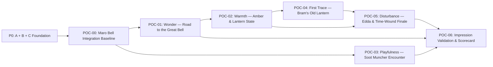

# Atlas: The Cala Knight — Project Roadmap & First 10 Minutes POC (`E-011`)

> **Source:** ChatGPT project *"Atlas: The Cala knight"* — *"Write Atlas Storyline"* ([share `6af0bfb5`](https://chatgpt.com/share/6af0bfb5-d9d8-83ec-945d-8d1d866c4884)) + *"Game Roadmap Ideation"* (`Roadmap Proposal v1.0 · Epic-ready breakdown`, 2026-11-09).
> **Epic ID:** `E-011` (`First 10 Minutes POC — The First Light of Maro Bell`)

---

## Executive Direction

The first POC is about **how players feel when they enter Atlas**, not about proving another technology stack. The POC answers one central question:

> **Can Atlas make an ordinary adventurer feel small in an enormous, beautiful world — and make helping someone with a small problem feel important enough to stay?**

The goal is not a ten-minute tutorial; it is a **ten-minute memory** across four target impressions in order:
1. **Wonder** — The player is tiny; the world is immense (*Tiny Human, Massive World*).
2. **Belonging (Friendship)** — Small kindnesses matter.
3. **Playfulness (Agency)** — Movement and encounters are enjoyable.
4. **Mystery** — Something is wrong with tomorrow.

---

## 1. Overall Atlas Project Roadmap (`P0`–`P5`)

| Phase | Name | Question Answered | Contents | Completion Evidence | Explicitly Out of Scope |
|---|---|---|---|---|---|
| **P0** | **Technical Foundation** | Are the core contracts reliable? | **A** (`F-200` coordinate contract), **B** (`F-201..F-203` Nakama removal → `RustMetaEngine`), **C** (`millcross-ford` compiled-region gate), **D** (`30 Hz` rational time migration when ready) | Unit & persistence contracts, compiled-map verification, deterministic test harnesses, performance baseline | Multi-server shared saves |
| **P1** | **First 10 Minutes POC (`E-011`)** | **Is Atlas compelling?** | Maro Bell guided 10-minute playtest (`POC-00`..`POC-06`) | Playable, observed 10-minute experience with actionable player feedback | Full MMORPG economy, all 6 starter towns |
| **P2** | **Vertical Slice** | **Does Atlas work as an MMORPG?** | Full Maro Bell & Maro Valley exploration, all 8 starter quests (`q-maro-01..08`), progression, base-class skills, Lantern Vermin family, party & Field Boss | One representative regional MMO loop end-to-end with real server authority | Complete continent or Chapter VIII |
| **P3** | **Launch Foundation** | **Can the team produce & operate Atlas repeatedly?** | Six starter-town framework, hub, progression, and regional content pipelines | Reusable quest, NPC, world asset, and progression pipelines; production readiness gates | Every future region built simultaneously |
| **P4** | **Base Game Story Releases** | **Can Atlas sustain its world & storyline?** | Approved Chapter 0–VIII arc (world losing time) and associated regions delivered in stages | Approved chapter story delivered through staged releases | All chapters at initial launch |
| **P5** | **Expansion I** | **Can Atlas grow without invalidating what came before?** | Retrace the unfinished legacy of the **Last Cala Knight** (female, unnumbered, Himmel heart / Serie strength) | Substantial new journey centered on historical traces | Making players Cala Knights |

---

## 2. First 10 Minutes — Narrative & Gameplay Contract (`Maro Bell`)

### Locked Canon Used by `E-011`
- **Prototype Town & Hero Landmark:** **Maro Bell** (`content/maps/maro-bell.json`, `80×160 m`), anchored by **The Great Bell** (ระฆังใหญ่) suspended between two cliffs, hundreds of brass lanterns, giant porcelain ribs in the valley walls, and a lantern-lit road.
- **6 Locked NPCs:**
  - **Pip** (Spark/traveller, 19) — Full POC interaction (welcome + missing delivery).
  - **Amber** (lantern-oil seller, 34) — Full POC interaction (small kindness + Time-Wound lantern).
  - **Bram** (Heart, 60, lantern keeper) — Full POC interaction (old lantern with unexplained precision repair = **First Trace**).
  - **Edda** (Scar, 46, bell schedule keeper) — Full POC interaction (bell timing anomaly).
  - **Reed** (gatekeeper, 38) — Ambient/minimal dialogue in POC (establishes village road & wider world; full `q-maro-08` in P2).
  - **Tovin** (shrine/kiln-record keeper, 65) — Ambient/minimal dialogue in POC (hints at town history & old records).
- **Enemies ("Lantern Vermin", one shared rig):**
  - **Soot Muncher** (Lv1–3) — Primary playable combat encounter in the 10-minute POC.
  - **Wick Runner** (Lv4–6) & **Oil Leech** (Lv7–10) — Full combat in P2 Vertical Slice; optional environmental glimpse of Oil Leech during the Slice 5 Time-Wound.
- **Canon-Safe POC Progression Rule:**
  - Canonical `q-maro-01..08` spans Levels 1–10. The 10-minute POC separates **demonstration beats** (`poc_maro_10m` scenario flags) from canonical Lv1–10 quest completion so showcasing Bram's lantern (`first_trace`) and the Impossible Flame (`time_wound`) in 10 minutes never corrupts normal progression saves.

### Ten-Minute Critical Path & Emotional Curve

| Time | Beat | Description | Who / Category | Wonder (0–5) | Connection (0–5) | Mystery (0–5) |
|---|---|---|---|---|---|---|
| `00:00–01:15` | **Arrival** | A tiny traveller enters Maro Bell along the lantern road. | World / Environment | 2 → 5 | 0 | 0 |
| `01:15–02:30` | **The Great Bell** | The immense landmark reveals itself. Pip welcomes the player. | **Pip** (+ ambient **Reed**, **Tovin**) | 5 | 1 → 3 | 0 |
| `02:30–04:15` | **A Small Kindness** | Help Amber with a practical lantern problem; a village lantern lights up. | **Amber** | 4 | 4 | 1 |
| `04:15–06:15` | **A Playful Encounter** | Recover a missing delivery and encounter Soot Munchers. | **Pip** / **Soot Muncher** | 3 | 5 | 2 |
| `06:15–07:45` | **The Old Lantern** | Bram shows a repair whose maker is unknown. | **Bram** · *First Trace* | 4 | 5 | 4 |
| `07:45–09:00` | **A Bell Out of Time** | Edda notices a mismatch in the bell's timing. | **Edda** | 4 | 4 | 4 |
| `09:00–10:00` | **The Impossible Flame** | A lantern abruptly loses its oil in seconds. The world has a problem. | *Time-Wound* · Closing hook | 5 | 4 | 5 |

---

## 3. Multi-Phase Epic Breakdown (`E-011`: `POC-00` – `POC-06`)

### `POC-00` — POC Integration Baseline
- **Goal:** Repeatable `maro-bell` build on Godot C# + `server-rs` (`metres-v1`, 2.5D, `35°` walkability, `RustMetaEngine` SQLite).
- **Deliverables:** Mapped `maro-bell` room ID on `server-rs` & `game-client` (no silent fallback to `map-for-play`), known spawn & guided-route coordinates on the `80×160 m` `maro-bell.json` map, repeatable test-profile reset, and minimal diagnostics overlay (position, map ID, connection, frame time, active POC beat).
- **Exit Criteria:** Godot loads `maro-bell` in 3D; movement and blocking geometry are Rust-authoritative; restarting returns to a clean initial state.

### `POC-01` — Wonder: The Road to the Great Bell (`00:00–02:30`)
- **Goal:** Convey *Tiny Human, Massive World* scale within 60–90 seconds without instructional overload.
- **Deliverables:** Spawn-to-Bell lantern road composition (cliffs, suspended Great Bell, porcelain ribs, foreground brass lanterns), scenic reveal camera framing, ambient audio (brass, wind, footsteps), **Pip** greeting (`q-maro-01` beat), ambient **Reed** & **Tovin** placement, and non-intrusive objective prompt.
- **Exit Criteria:** First-time tester navigates and discovers The Great Bell and Pip without tutorial popups or camera/collision blockers.

### `POC-02` — Warmth: A Small Kindness (`02:30–04:15`)
- **Goal:** Prove ordinary kindness matters through a visible environmental improvement.
- **Deliverables:** **Amber** NPC presentation & interaction (`q-maro-02` beat), reusable interactable lantern/supply object, authoritative beat completion in `server-rs`, visible lantern state change (unlit → repaired/lit), and EN/TH-ready dialogue structure.
- **Exit Criteria:** Objective cannot complete twice or duplicate rewards; lantern state visibly updates in the world; emotional feedback outshines UI chrome.

### `POC-03` — Playfulness: The Missing Delivery (`04:15–06:15`)
- **Goal:** Responsive, playful introductory combat encounter under Rust authority.
- **Deliverables:** Shared **Lantern Vermin** base rig with polished **Soot Muncher** visuals & animations (idle, move, attack, hit, defeat), `server-rs` authoritative encounter & parcel recovery (`q-maro-03` beat), Godot hit VFX/SFX, and encounter reset/replay path.
- **Exit Criteria:** Rust alone determines range, damage, and defeat; animations and hit reactions align; parcel recovery returns cleanly to the village.

### `POC-04` — Emotional Mystery: Bram's Old Lantern / First Trace (`06:15–07:45`)
- **Goal:** Introduce the first subtle trace of the Last Cala Knight without naming or identifying her.
- **Deliverables:** **Bram** NPC interaction (`q-maro-04` beat), old lantern hero prop with uncredited precision repair detail, close-up inspect camera/interaction, restrained musical cue, and isolated `first_trace` POC persistence via `RustMetaEngine`.
- **Exit Criteria:** Testers recognize an unknown master repaired the lantern long ago out of kindness; zero identity spoilers; canonical `q-maro-04` save state remains uncorrupted.

### `POC-05` — Disturbance: The Bell Out of Time & The Impossible Flame (`07:45–10:00`)
- **Goal:** Climax with a clear supernatural time anomaly while keeping the tone hopeful.
- **Deliverables:** **Edda** bell-timing discrepancy interaction (`q-maro-05` beat), deterministic replayable **Time-Wound** lantern oil-drain event (`q-maro-06` beat) with synchronized light/audio transitions, optional visual glimpse of **Oil Leech**, and closing invitation to keep helping beyond the Bell.
- **Exit Criteria:** Event triggers reliably and idempotently across reconnects; players grasp that time is behaving abnormally without lore-dump explanations.

### `POC-06` — Player Impression Validation & Scorecard Gate
- **Goal:** Measure whether the 10-minute experience achieves its intended impression and lock regression verification.
- **Deliverables:** End-to-end headless verification probe (`ATLAS_VERIFY_POC_MARO_10M`), session telemetry (beat timings, FPS, interactions), and the 7-metric **POC Success Scorecard** (Landmark discovery ≥80%, Movement ≥90%, Warmth recall ≥70%, Combat clarity ≥80%, Mystery comprehension ≥80%, Curiosity to continue ≥70%, Technical stability 100%).
