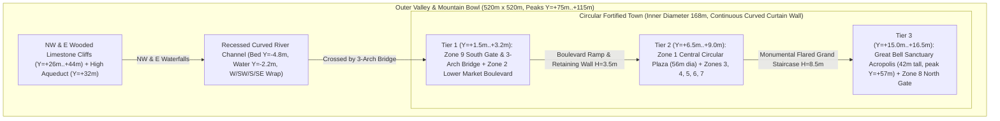

# Spec: Maro Bell M1 — Circular 9-Zone 3-Tier Hillside, Recessed River Channel & Outer Valley Master Plan (`I-310` / `F-225`)

- **Date:** 2026-11-16
- **Milestone:** `M1 — Town & Terrain Master Plan` (of `M1–M7` Milestone-Gated Rebuild)
- **Governing Engineering Standard:** `/Users/pasitnusso/asset-studio-private/atlas-3d-plan/art-refs-gpt-env/gpt-m1-m7-engineering-standard-2026-11-16.md`
- **Target QA Gate:** ChatGPT Visual QA `>= 8.0 / 10` on the 4 required `M1` views + owner sign-off before advancing to `M2`.

---

## 1. Context & Problem Statement

In `F-224`, ChatGPT Visual QA scored the Maro Bell 3D build `3.0 / 10` (`Terrain & 3-tier hillside silhouette: 1.5/10`, `Town plan, curved fortifications & valley: 2.0/10`, `Bird's-Eye Nine-Zone Town: 2.0/10`) because:
1. The town was built on a flat `80m × 160m` rectangular ground plane (`terrainAmplitude: 0`) rather than a broadly circular, terraced 3-tier hillside town wrapped around a central plaza.
2. The three distinct elevation levels (`Tier 1 Waterfront/Market`, `Tier 2 Central Circular Plaza & Mid-Ring`, `Tier 3 Upper Great Bell Sanctuary Acropolis`) were missing.
3. The river was a flat cyan box sitting on top of the ground rather than a recessed curved river channel wrapping the perimeter with cliff waterfalls and plunge pools.
4. Outer walls and roads were placed as disconnected straight props rather than continuous curved ribbons sweeping around a circular hillside perimeter, and the background horizon lacked the surrounding wooded cliffs, Romanesque aqueduct, and alpine mountain bowl.

---

## 2. Architecture & Spatial Master Plan (`M1`)

### 2.1 Scale & Metric Standards (`World Scale Prototype D`)
- **Player Height (`D`):** `1.30 m` (`4.7 heads`)
- **Main Doors:** `3.0 – 3.5 m` (`3.2 m`)
- **1-Story House Massing:** `5.0 – 7.0 m` (`6.0 m`)
- **2-Story House Massing:** `11.0 – 14.0 m` (`12.0 m`)
- **Civic / Guild Hall Massing:** `15.0 – 25.0 m` (`24.0 m`)
- **Landmark (Great Bell Sanctuary):** `30.0 – 80.0+ m` (`42.0 m` structure height above Tier 3 terrace, reaching `Y = +57.0 m` world altitude)
- **Main Boulevard Width:** `14.0 m` (`12 – 18 m` target)
- **Residential / Radial Street Width:** `7.0 m` (`6 – 8 m` target)
- **Central Circular Plaza Diameter:** `56.0 m` (`50 – 80 m` target)
- **Circular Walled Town Diameter:** `168.0 m` (`R = 84.0 m`) inside a `520.0 m × 520.0 m` valley & mountain bowl.

### 2.2 Nine-Zone Spatial Coordinates & Elevations

| Zone | Name | Center `(X, Y, Z)` | Tier | Architectural Massing & Role |
|---|---|---|---|---|
| **①** | **Great Bell Plaza** | `(0, +6.5, -2)` & `(0, +15.0, -52)` | Tier 2 & 3 | `56m` circular central plaza (`Y=+6.5m`) with Astrolabe Fountain + Flared Grand Staircase rising to the `42m` Great Bell Sanctuary (`Y=+15.0m..+57.0m`) |
| **②** | **Market District** | `(0, +3.0, +46)` | Tier 1 | `14m` wide ascending southern boulevard (`Z=+70..+24`) lined with `12m` 2-story market hall massings & awnings |
| **③** | **Crafting Quarter** | `(-46, +6.2, +16)` | Tier 1–2 SW | Southwest stepped artisan terraces, smithy halls (`8–12m`), and SW cliffside windmill |
| **④** | **Residential Area** | `(-44, +8.5, -22)` | Tier 2 NW | Northwest curved residential terraces (`7m` streets) with dense `6–12m` 1 & 2-story gable massings |
| **⑤** | **Adventurer's Guild** | `(+46, +6.8, +12)` | Tier 1–2 E | East monumental Civic/Guild Hall (`24m` tall) + enclosed guild plaza |
| **⑥** | **Inn & Tavern** | `(+44, +8.5, -22)` | Tier 2 NE | Northeast `14m` 2-story Inn & Tavern courtyard overlooking the central plaza |
| **⑦** | **Shrine & Records** | `(+74, +7.5, +4)` | Tier 2 Far E | Far-East semicircular bastion terrace projecting toward the eastern waterfall valley |
| **⑧** | **North Gate (to Wilds)** | `(0, +15.5, -82)` | Tier 3 N | Northern twin-tower gatehouse exiting to the upper mountain pass |
| **⑨** | **South Gate (to Region)** | `(0, +2.0, +76)` | Tier 1 S | Southern twin-tower gatehouse & 3-arch stone bridge (`Z=+76..+98`) over the recessed river |

---

## 3. Four Mandatory `M1` QA Views

1. **`m1_view1_topdown_annotated.png`:** Orthographic Top-Down Master Plan showing the circular 9-zone layout (`①–⑨`), metric scale bar & dimensions (`168m` town ring, `56m` plaza, `14m` boulevard, `7m` streets), elevation contour labels (`Y = -2.2m, +2.0m, +6.5m, +15.0m, +32.0m`), north arrow, and `1.30m` player scale markers.
2. **`m1_view2_birdseye_shot5.png`:** 3/4 Bird's-Eye Aerial render from the southern-southwest vantage (`FOV 46°`) matching approved Shot 5 (`11-atlas-cala-knight-town-design-board.png`).
3. **`m1_view3_side_section_profile.png`:** Orthographic East-to-West Side Section / Elevation Profile cutting through the South River (`Y=-4.8m/-2.2m`), Tier 1 Market (`Y=+2.0..+4.2m`), Tier 2 Central Plaza (`Y=+6.5m`), Grand Staircase, Tier 3 Great Bell Sanctuary (`Y=+15.0m`, spire `Y=+57.0m`), Zone 8 North Gate (`Y=+15.5m`), and Northern Cliffs/Mountains (`Y=+32m..+95m`) with metric elevation lines.
4. **`m1_view4_godot_player_eye_south.png`:** Godot 4 Forward+ Player-Eye render (`1.30 m` eye height above bridge deck at `X=0, Z=+86m`, looking North toward `(0, +24m, -52m)`) showing the 3-tier vertical silhouette rising from the river bridge through the South Gate, Market Boulevard, Central Plaza, and Grand Staircase up to the Great Bell Sanctuary and distant mountain peaks.
