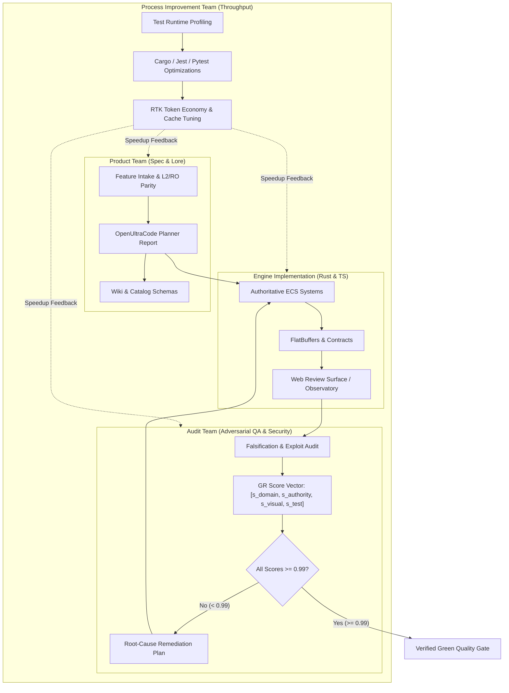

# Multi-Team UltraCode Operating Architecture

## 1. Executive Summary
This document establishes the multi-team operational model for the pure Rust MMORPG Engine (`atlas-world-svc`), utilizing **OpenUltraCode** discipline to maximize development velocity, engine throughput, and verification fidelity.

The organization operates as a **Triad of Specialized Autonomous Teams** with decoupled responsibilities and high-density handoff contracts:
1. **Product Team**: Requirements refinement, game mechanics (L2/RO parity), economy balance, catalog specifications, and wiki observatory synchronization.
2. **Audit Team**: Adversarial falsification, anti-cheat validation, combat authority stress-testing, and Graded Review (GR) score calculation.
3. **Process Improvement Team**: Test execution speed, compilation caching, token efficiency, pipeline automation, and cycle-time reduction.



---

## 2. Team Charters & Operational Roles

### 2.1 Product Team
- **Mission**: Ensure game systems are deeply designed, balanced, and canonically aligned before code is written.
- **Key Responsibilities**:
  - Authoritative mechanics design (Lineage 2 enchanting & party buffs, Ragnarok Origin 6-stat & ASPD formulas, MVP scoring).
  - 6 Canonical Races lore, starter town bindings, and racial trait specs.
  - Catalog database schema evolution (`races_catalog`, `world_dungeons`, `boss_encounters`, `enchanting_rules`).
  - Wiki observatory design alignment with Joymify theme standards.
- **UltraCode Output**:
  ```markdown
  ## Planning Report (Product Team)
  - GOAL: <Specific feature goal>
  - ACCEPTANCE_CRITERIA: <Measurable, numeric criteria>
  - ASSUMPTIONS: <Explicit mechanics assumptions>
  - RISKS: <Economy, balance, or progression risks>
  - STEPS: <Ordered implementation tasks>
  - VERIFICATION: <Exact commands that prove success>
  ```

### 2.2 Audit Team
- **Mission**: Protect engine integrity through relentless adversarial falsification and mathematical verification.
- **Key Responsibilities**:
  - Exploit testing: Corpse-running, packet spoofing, trade race conditions, cast-interruption evasion.
  - Runtime verification against live simulation (Anti-Mock Tier 1–4).
  - GR Score evaluation across four orthogonal dimensions:
    $$\text{Score} = [s_{\text{domain}}, s_{\text{authority}}, s_{\text{visual}}, s_{\text{test}}] \quad (\ge 0.99 \text{ required to pass})$$
  - Anti-look-off visual audit on wiki observatory and client interfaces.
- **UltraCode Output**:
  ```markdown
  ## Adversarial Review (Audit Team)
  - VERDICT: ship | fix | reject
  - GR_SCORE_VECTOR: [s_domain, s_authority, s_visual, s_test]
  - FINDINGS:
    - ID: <SEC-001>
      SEVERITY: high | medium | low
      CONFIDENCE: high | medium | low
      AFFECTED_REQUIREMENT: <REQ-ID>
      EVIDENCE: <Reproduction command / test trace>
      DISPOSITION: accepted | fixed | rejected
  - COMPLETION_RISK: <Residual risk summary>
  ```

### 2.3 Process Improvement Team
- **Mission**: Maximize engineering throughput, eliminate latency bottlenecks, and preserve context economy.
- **Key Responsibilities**:
  - Test runner acceleration: targeted cargo test partitioning, jest worker pooling, pytest execution tuning.
  - Token budget stewardship: RTK proxy enforcement, bounded parallel reads, zero unneeded file reads.
  - Zero-poll reactive handoffs: Ensuring agents sleep reactively rather than polling loops.
  - Automated GR loop chaining: Bridging audit findings directly into surgical fix tasks.
- **UltraCode Output**:
  ```markdown
  ## Process Improvement Report
  - BOTTLENECK_IDENTIFIED: <Slow build step, test suite, or context waste>
  - ROOT_CAUSE: <Underlying inefficiency>
  - OPTIMIZATION_ACTION: <Script, flag, or architectural change>
  - LATENCY_IMPACT: <e.g. 45s -> 8s (82% reduction)>
  - TOKEN_SAVINGS: <Tokens saved per iteration>
  ```

---

## 3. UltraCode Throughput Maximization Discipline

To achieve 10x throughput without sacrificing quality:
1. **Parallel Lane Execution**: Product plans the next wave while Audit verifies the current wave, and Process team optimizes the tooling harness.
2. **Deterministic Anti-Mock Verification**: Never rely on mock claims. Every verification gate executes real binaries (`cargo test`, `npm test`, `pytest`).
3. **GR Loop Fast Convergence**: Low-score areas are triaged with single-hypothesis root cause analysis and targeted 1-step remediation.
4. **Token Economy**: Use RTK proxies and compact subagent return budgets (≤15 lines) to keep agent contexts clean and prevent context thrashing.
