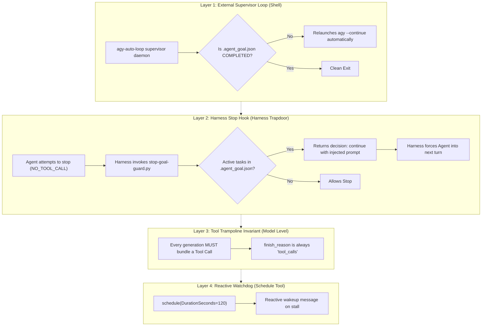

# 100% Deterministic Prevention of AI Agent "Auto Stop"

## 1. Executive Summary & Root Cause Analysis

In every conversational AI agent runtime (Antigravity CLI / `agy`, Claude Code, ACP), the execution loop is governed by the LLM API's `finish_reason`.
- If the model emits $\ge 1$ tool calls, `finish_reason` is `"tool_calls"`, and the harness continues into the next turn automatically.
- If the model emits **pure text with zero tool calls** (e.g. a status summary, explanation, or "here is what I did"), `finish_reason` is `"stop"`. The harness interpreter views this as a completed conversational turn and **yields control back to the terminal prompt or GUI user**.

### Why Soft Prose Rules Failed
Prose rules in `CLAUDE.md` and `GEMINI.md` (*"zero polite checkpointing"*, *"never announce without a tool call"*) are **soft constraints**. They rely on LLM token prediction. If an instruction-tuned LLM generates a paragraph of conversational closure, attention recency causes it to emit an end-of-turn token instead of calling a tool.

As Rule #11 states: **"Prose binds agents; config binds pipelines."**
To prevent stopping 100% of the time, prevention must be **mechanically enforced by the harness**.

---

## 2. The 4-Layer Mechanical Defense Architecture



---

## 3. Concrete Implementation

### 3.1 Harness Stop Hook (`~/.gemini/config/hooks/stop-goal-guard.py`)
Registered in `~/.gemini/config/hooks.json` under `"Stop"`:
```json
{
  "goal-guard": {
    "Stop": [
      {
        "command": "python3 /Users/pasitnusso/.gemini/config/hooks/stop-goal-guard.py",
        "timeout": 10,
        "type": "command"
      }
    ]
  }
}
```
**Mechanism**:
- When Antigravity attempts to terminate due to `NO_TOOL_CALL`, the harness invokes `stop-goal-guard.py`.
- If `.agent_goal.json` has `"active": true` and uncompleted tasks, the hook emits:
  ```json
  {"decision": "continue", "reason": "⚡ GOAL-GUARD: Objective is NOT finished! Tasks remaining: [...]. You are FORBIDDEN from stopping. Continue execution with an immediate tool call."}
  ```
- The harness **rejects the stop** and feeds the continuation prompt back to the agent. Stopping is physically impossible.

### 3.2 Persistent State Contract (`.agent_goal.json`)
Placed at workspace root:
```json
{
  "active": true,
  "goal": "<High-level Objective>",
  "status": "IN_PROGRESS",
  "remaining_tasks": [
    "Task 1 description",
    "Task 2 description"
  ]
}
```
Only when all tasks are implemented, verified by real test execution, and cleared from `remaining_tasks` does the agent update `"active": false` and `"status": "COMPLETED"`.

### 3.3 The External Supervisor Wrapper (`agy-auto-loop`)
For hands-free execution outside the IDE:
```bash
#!/usr/bin/env bash
while [ -f ".agent_goal.json" ] && [ "$(jq -r '.active' .agent_goal.json)" = "true" ]; do
  echo "⚙️ Resuming session..."
  agy --continue --prompt "Continue executing remaining tasks in .agent_goal.json until active is false."
  sleep 2
done
```
